# The 3D: cleaner and easy to play (a plan)

The owner asked, on 25 November 2026: "plan the improvement of everything that is 3D but the improvement needs to be even more than the one we did here and things will need to look cleaner and easily playable". "Here" is the interface programme of `docs/art/ui-quality/report.md`, phases 0 to 3, closed on 24 November.

This document is that plan. It finds what stops the 3D from looking clean and playing easily today, sets a target that can be measured, and lays out six phases to reach it.

**It is a plan only.** Nothing in it has started. The agent program is stopped by the owner's order and stays stopped until the owner says what comes next.

Everything here was measured or rendered from this branch. Versions 1 and 2 used `0304219a`; the final version's measurements ran on `7223743a`, and no game code differs between the two. The stills are in [`stills/`](stills/). Targets, hours and dates are proposals and estimates, and are marked as such.

It builds on the 3D programme that already exists (`docs/art/3d-program.md`). The look rules, the budgets and the file ownership of that programme stay. What changes is the definition of done.

## What changed in this version

Final version, 25 November 2026. Version 2 left eight things estimated or untested. Each one that can be measured from this branch has now been measured or tried, and the results change the plan again.

- **Figure sizes are measured, not estimated.** Eight moments of one heist, each at three camera widths. A crew member is 23 to 28 points tall at today's 15 tiles, 31 to 38 at 11 tiles and 49 to 61 at 7. A standing guard is 38, 50 to 52 and 80 to 82.
- **11 tiles reaches the 32-point target for the crew, with no margin.** The smallest crew member reads 33 or 34 points in six of seven moments and 31 in one.
- **11 tiles costs sight of the nearest guard.** That guard is fully in view and clear of the panels in 5 of 7 moments at 15 tiles, and in 2 of 7 at 11 tiles. So step 1a gains a framing rule and edge markers for threats off screen; a tighter zoom alone is not enough.
- **The triangle question is answered.** The heist frame holds 56,462 mesh triangles, under the 60,000 budget. The renderer counts 85,428 because the outline passes draw 28,966 of them a second time. About a third of the count is outlines.
- **The new guard fields do not change the stored replay.** Tried in the engine: the recorded replay is byte-for-byte the same with and without them.
- **The defences shot is not broken.** Its default tab is the defence log, which has no 3D view. The rehearsal tab draws 36,011 triangles.
- **Step 1a has a costed breakdown**: 18 hours, up from about 15, because of the framing rule and the markers. It is still an estimate.
- **Kept from version 2.** The close camera already exists as a zoom level. The panels are the obstacle: they cover 37.5% of the screen's pixels. Phase 1 opens with "Clear the screen". Phase 0's style frames are real renders.
- **Two additions:** a table of what changes on each screen (section 5), and the first tasks in order (phase 0).

## Plan at a glance

**The finding.** The 3D was built to match the design's stills, and it mostly does. But matching the stills does not make a heist easy to play: in the design's own heist still the crew are about 25 pixels tall. The bar has to move from "looks like the still" to "a new player can read the screen and play it". The measurements of version 2 sharpen this: the camera is not the obstacle (a view 7 tiles across, with the crew 49 to 61 points tall, is already in the code as a zoom level). The panels are: they cover 37.5% of the screen, and at the close view they sit over the action. The final version's measurements add one thing: a closer camera also loses sight of the nearest guard, so it must come with a framing rule (section 2.6).

**The target (section 4).** Fourteen qualities, each with a number and a way to measure it. The four that matter most:

| Quality | Today | Target (proposed) |
|---|---|---|
| Share of the heist screen that shows the world with nothing over it | 39% (measured) | at least 60% |
| Height of a crew member on the heist screen (a standing guard is 38) | 23 to 28 points (measured) | at least 32 points |
| The heist's default camera | 15 tiles across | about 11 tiles across (the owner picks on the style frames) |
| What the screen shows of a guard's sight | one cone, one range, a state name | three range zones, a suspicion meter, six states |
| Draw calls on the heist and result screens | 120 in the still measured here; 127 to 149 at other moments (track notes); the limit is 150 | at most 120 at every moment |

**The phases (section 6).** A phase starts only when the one before has met its exit.

| Phase | What | Hours (estimate) | Exit |
|---|---|---|---|
| 0. Measure and choose | The measuring tool, the baseline, a renderer trial, three rendered heist style frames, the data spec | 50 | The owner picks a style frame; the baseline is published; the data spec is frozen |
| 1. The heist pilot | First "Clear the screen" (1a, about 18 hours): a closer default camera, a framing rule that keeps threats in view, edge markers and slimmer panels, playable early. Then the rest (1b): one realm's heist made clean and playable from end to end | 90 | The owner tries the 1a build on a phone; the heist qualities pass on the pilot; the owner plays it on a phone and signs |
| 2. Ground, kit and light | The pilot's look across the six realms | 110 | The ground, building and depth qualities pass in all six realms |
| 3. Realm screens and universe | Framing and clarity on every screen that shows an island | 90 | The framing quality passes on every screen |
| 4. Characters and motion | Every creature reads; movement tells sneak from walk from run | 80 | The figure and motion qualities pass for every creature |
| 5. Polish and audits | Performance, two blind audits, the owner's board | 50 | Both audits done; the owner's board stands |
| | **Total** | **470** | |

**Size against the interface programme (section 10).** The interface programme was planned at 187 hours and took about 272. This plan is 470 hours, 2.5 times that plan. Every interface phase ran 24% to 56% over; if the 3D does the same, expect about 580 to 730 hours, which is 2.1 to 2.7 times what the interface took. At the interface programme's pace that is about four to six weeks, stops included (estimate).

**The team (section 7).** At most four builders at once (order 3's cap), on eight tracks with their own files. The lead cycles, merge queue and checks work as they did for the interface.

**The owner's decisions (section 12).** Nothing starts until D1.

| # | Decision | When | Default if not decided |
|---|---|---|---|
| D1 | Approve this plan and its size | Before phase 0 | Nothing starts |
| D2 | The new definition of done: "a new player can read the screen and play it", measured by the fourteen qualities, in place of "beats the design's still" | Before phase 0 | Adopted |
| D3 | Draw crew and guards larger than their true size on the heist screen (the picture only; the rules do not change) | End of phase 0, on the style frames | Decided on the frames |
| D4 | The renderer: stay on Compatibility with drawn shadows, or move to Mobile for real ones | End of phase 0, on the trial | Stay on Compatibility unless the trial shows Mobile holds the frame rate on a phone |
| D5 | Hand the screen more of what the simulation already computes: suspicion, the near and middle sight ranges, noise | Phase 0 | Add them as read-only fields. Tried: the stored replay format does not change (section 9) |
| D6 | The detection spec (`docs/design/spec/detection.md`) is still marked "proposed". Confirm it as what the screen must show | Phase 0 | Treated as the target |
| D7 | The builder cap | Before phase 0 | Four (order 3) |
| D8 | The model and effort for the program's sessions | Before phase 0 | Orders 5 and 6 stand |
| D9 | The parked work: the BT track (BT-09 is ready but not merged), icon batches 3 and 4 | Before phase 0 | Stays parked |
| D10 | The owner's time: one choice among three style frames, a short play check after step 1a, and a short play session on a phone at the end of phases 1, 3 and 5 | At each gate | The phase's measured numbers stand in, and the play session is noted as not done |
| D11 | Let the heist's panels be moved and slimmed to give the world more room. This touches finished interface work | Phase 1 | Allowed: layout only, the kit's components unchanged |

## 1. Verdict

The 3D is consistent and well made. It has one look, it holds its budgets, and it matches the design's stills closely. It is not yet clean, and it is not yet easy to play.

Three things cause most of it:

1. **The world gets too little of the screen.** On the heist, panels cover the top quarter and the bottom third. The clear band of world between them is 39% of the screen's height (measured), and smaller interface items still sit inside it.
2. **What the player acts on is the smallest and faintest thing in the picture.** The crew are 23 to 28 points tall and standing guards 38 (measured), they sit at nearly the same gray as the grass, and the strongest shapes on screen are a speech bubble, a label and fireflies.
3. **The screen is handed less than the game knows.** The simulation computes three sight zones, a suspicion value and six guard states. The screen receives one cone, one range and a state name, so it cannot show the player why they were seen or how close they are to being seen.

The earlier 3D programme could not catch these, because its definition of done was "every still beats the matching design still". The design's stills have the same faults.

## 2. What the stills show

Each still was rendered at the phone's size from the current head with `tools/render/shoot.sh`. The stills added in version 2 were rendered the same way, with the shot's `ZOOM` and `HIDE` settings. The final version's stills (`m-*.jpg`) come from the eight-moment matrix in section 2.6.

### 2.1 The heist

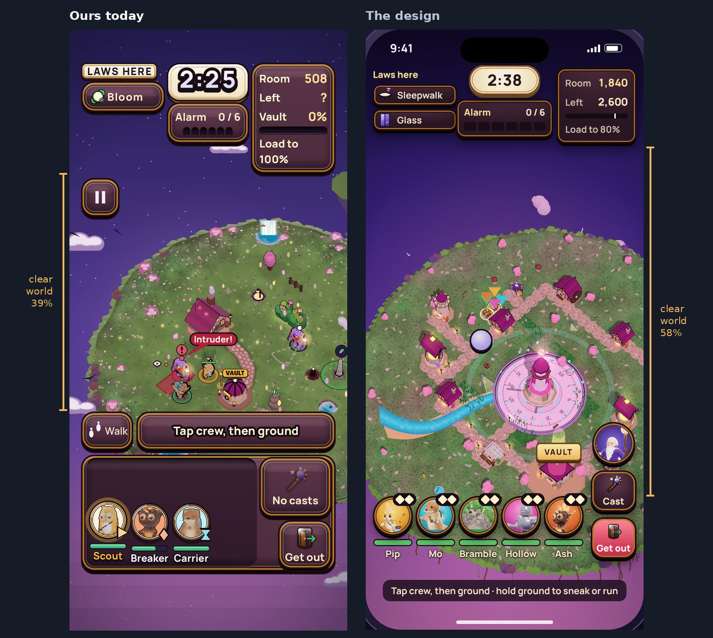

- **Ours:** the panels end at about 24% of the height and the action bar starts at about 63%. The crew tray below it is opaque. The clear band is 39% of the height (rows 572 to 1487 of 2340), and smaller interface items still sit inside it. By pixel count, the panels cover 37.5% of the screen. There is empty sky under the tray, and the island is cut off on three sides.
- **The design:** the panels end at about 20%, and the island runs on behind the portraits and the buttons. The clear band is about 58%.
- **Both:** the figures are tiny. In the design they are about 25 pixels tall. So matching the design is not enough.

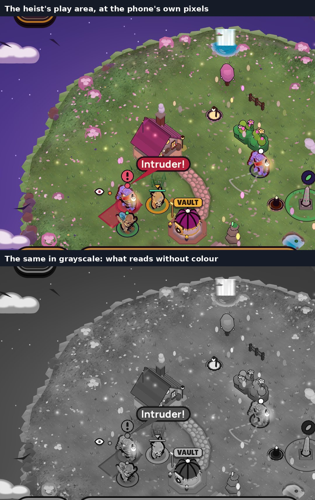

This is the play area at the phone's own pixels, and then with the colour removed.

- **Figures.** A crew member is 23 to 28 points tall on a phone (70 to 84 pixels; measured by projecting each figure's bounds in eight moments). A standing guard is 38 points. The look rules of §21.1 ask for a silhouette that reads at 32 points, so the guards pass and the crew do not.
- **Overlap.** Three figures stand by the Vault. Their rings, a red sight patch, an "Intruder!" bubble, an alert icon and an eye icon sit on top of each other.
- **Grayscale.** The figures almost vanish into the grass. The bubble, the "VAULT" label and the firefly dots are the strongest shapes. The earlier character track measured this: for five creatures, 20% to 33% of the figure's pixels are within 18 gray levels of the grass; for three others, 8% to 13%.
- **Ground.** Petals and fireflies cover every part of the grass, including where the crew walk. There is one short path. No tiles show, so distances cannot be judged. Nothing casts a shadow, so figures seem to float.
- **Edges.** A ward pylon is cut off at the right edge.

**The camera, three ways (added in version 2).** The same moment, rendered at three camera distances with the panels hidden:

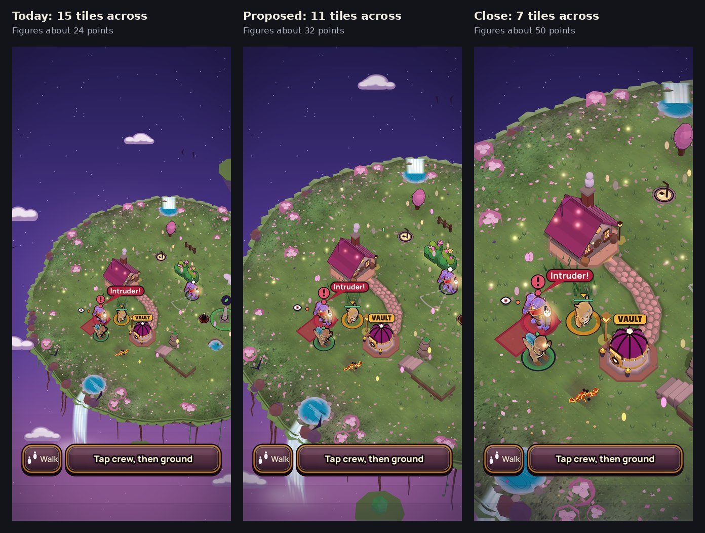

- **The close view is not new work.** `world_view.gd` has three zoom levels: the whole realm, 15 tiles across and 7 tiles across. The heist opens on the middle one. The heist camera is a narrow perspective (22° field of view, 50° pitch), not an orthographic one; every other view is orthographic.
- **At 11 tiles** the house, the path, the vault and the crew are in frame, and the nearer guard is at the edge of it (partly cut in the measurement). Crew members are 31 to 38 points tall and standing guards 50 to 52 (measured). Other moments are less kind to the nearest guard: see the matrix in section 2.6.
- **At 7 tiles** crew members are 49 to 61 points tall (measured), but less of the route is in view, and the nearest guard is off screen in 5 of 7 moments.

The same two cameras with the panels on:

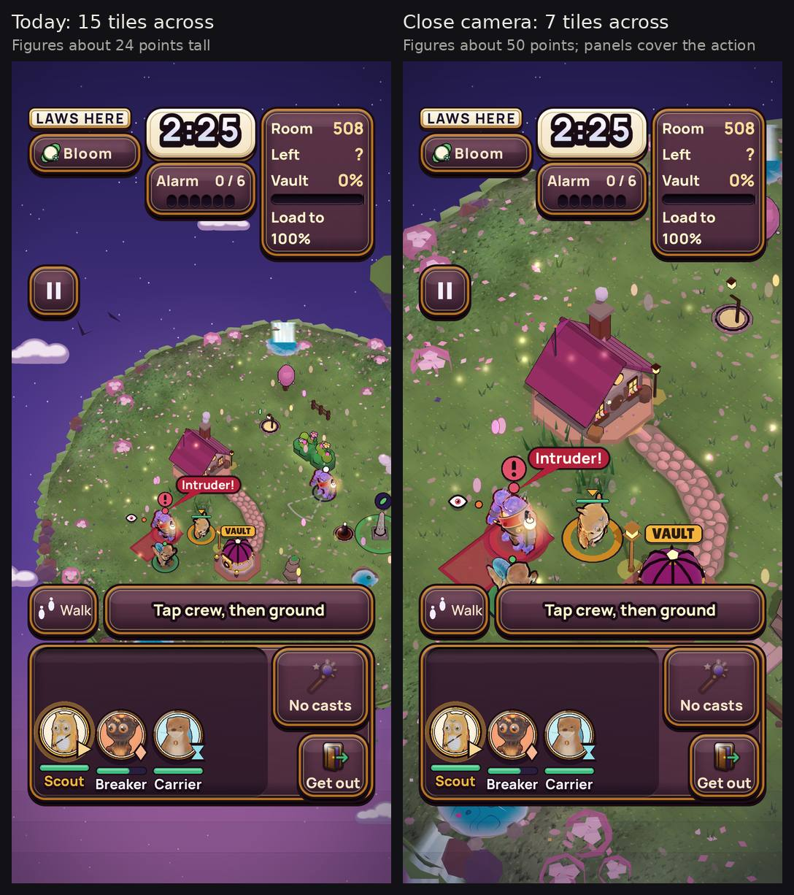

- **With the panels on, the close camera is worse to play, not better.** The top block, the pause button, the order bar and the bottom panel cover the action, and the vault is half hidden. The panels are the blocker (D11), not the camera.

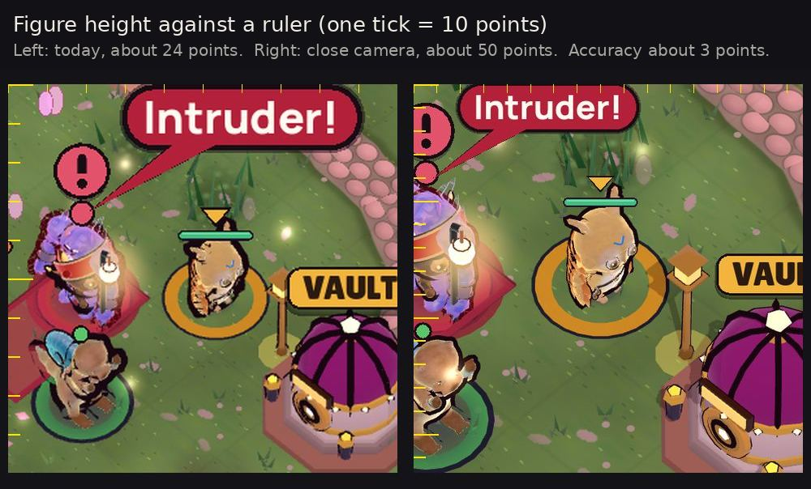

### 2.2 The realm at home

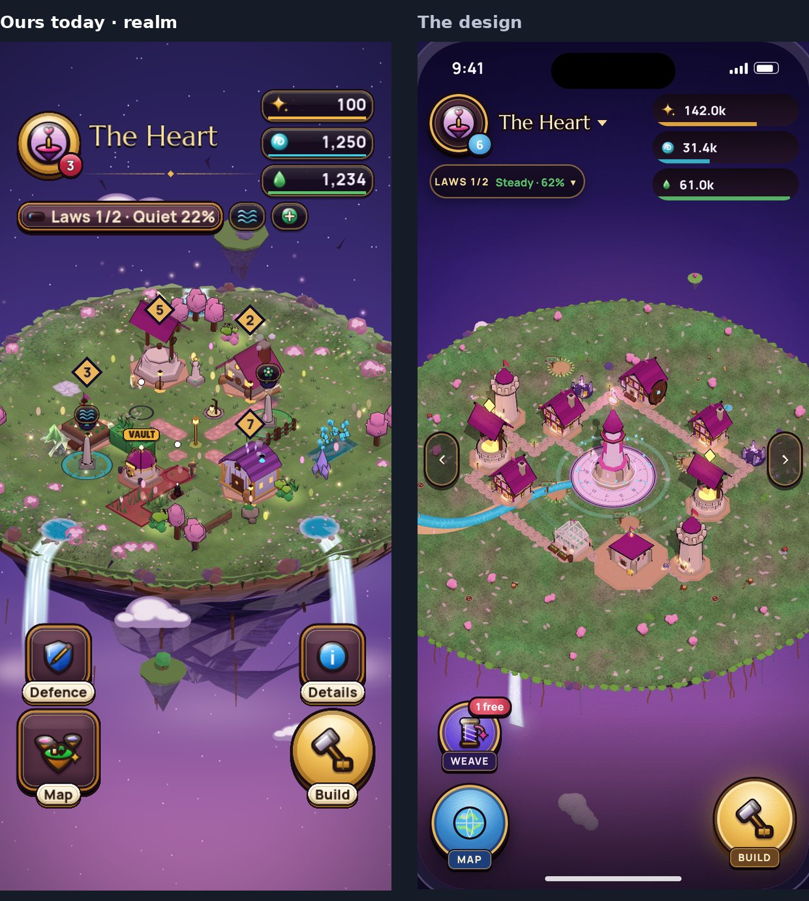

The island is framed by large panels with empty sky around it. The earlier tracks note a flagstone grid where the design has a meadow, and weak clouds, waterfalls and ambient life.

### 2.3 The universe

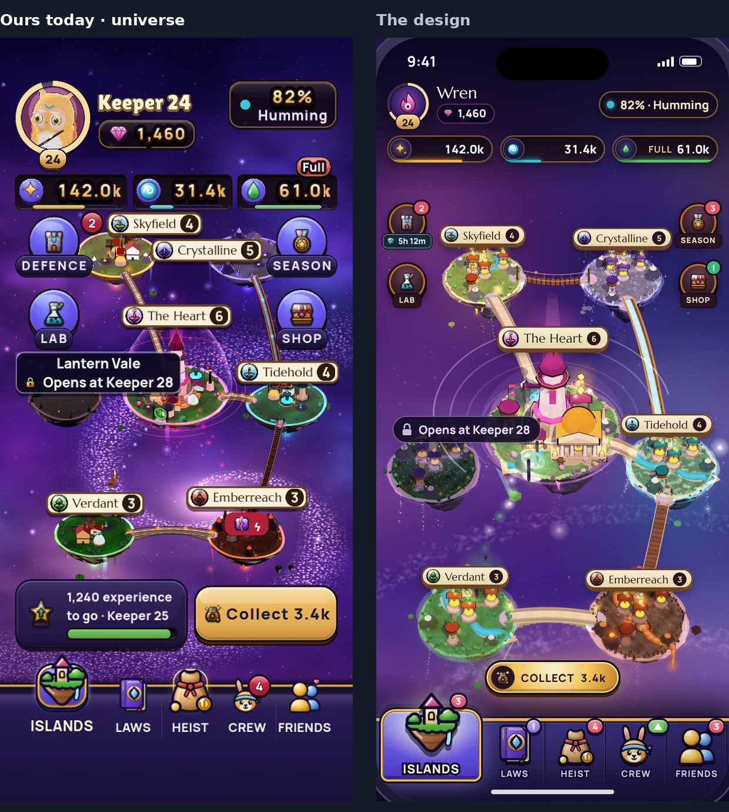

The islands are small and the backdrop is busy. Away from the focused realm, buildings are plain blocks. The map sits at 39,695 of its 40,000 triangles, so it has no room left.

### 2.4 The character

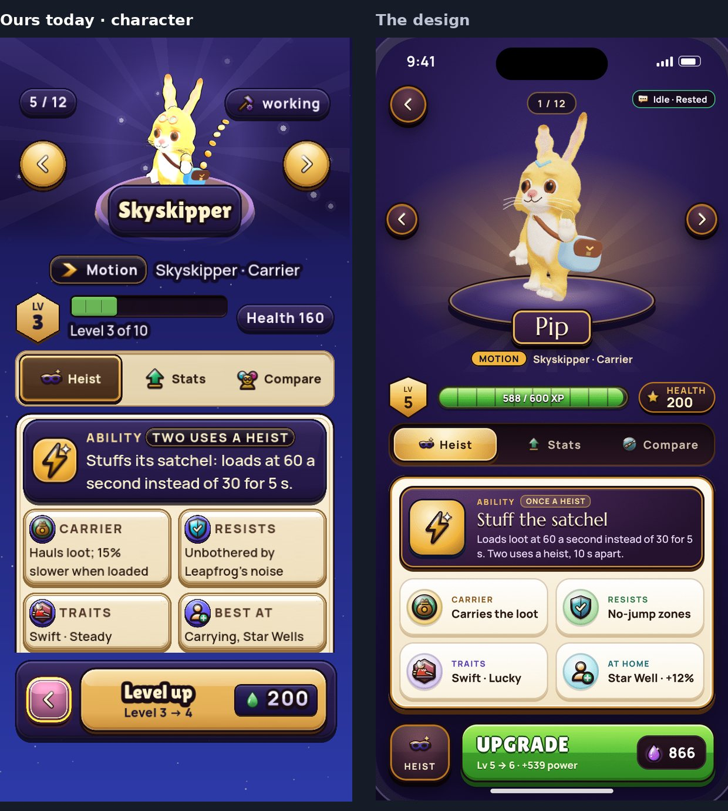

Our model is small and its name plate hides half of it. In the design the character fills about a third of the height and stands on a plate. The character track also notes that colours drift dark under the stage light, and that sheets cover the lower third.

### 2.5 The builder

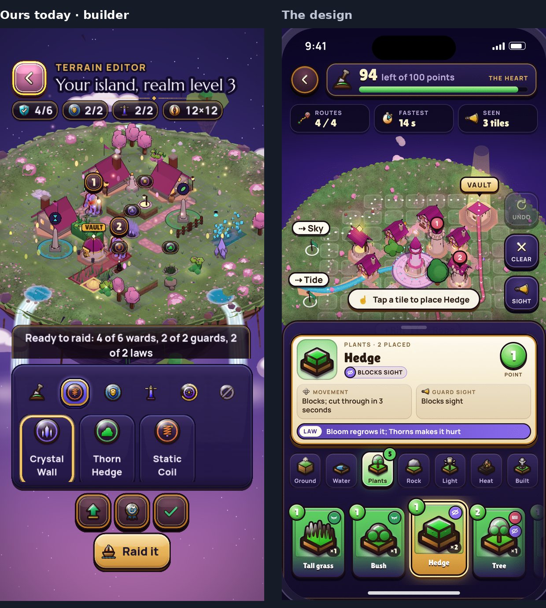

The same framing fault: large panels, a small island, unused sky.

### 2.6 What the numbers say

| Measure | Today | Limit or rule | Source |
|---|---|---|---|
| Clear world band on the heist | 39% of the height | the design has about 58% | measured on the stills |
| Crew height on the heist, 15 tiles (today) | 23 to 28 points | 32 points (§21.1) | measured in eight moments (section 2.6) |
| Crew height at 11 tiles / at 7 tiles | 31 to 38 / 49 to 61 points | 32 points (§21.1) | measured in eight moments |
| Standing guard height at 15 / 11 / 7 tiles | 38 / 50 to 52 / 80 to 82 points | 32 points (§21.1) | measured in eight moments |
| Panels' share of the heist screen's pixels | 37.5% | none set | the still with and without panels, compared pixel by pixel |
| Figure pixels near the grass's gray | 8% to 33% | none set | the character track's measurements |
| Draw calls, heist, the still measured here | 120 (81 for the 3D alone) | 150 | the shot's `budget:` line |
| Draw calls, heist, other moments | 127 to 145 | 150 | `docs/art/tracks/t5.md` |
| Draw calls, result | up to 148 to 149 | 150 | `docs/art/tracks/t5.md` |
| Primitives the renderer counts, heist, 3D alone | 87,522 | 60,000 scene triangles (not the same measure) | the shot's `budget:` line |
| Triangles, universe map | 39,695 | 40,000 | `docs/art/tracks/universe.md` |
| Code in `client/world/` | 29,238 lines of GDScript | | counted |

The heist still prints 92,724 "primitives" with its panels and 87,522 without. That is the renderer's count, not the meshes' triangles. The final version splits it, at 11 tiles in the same moment: the meshes in view hold **56,462 triangles** (figures 27,209, which is 48%), and the outline passes draw 28,966 of them a second time. The two add up to 85,428, exactly the heist view's count. So the 60,000-triangle budget is met by the meshes, with about 3,500 to spare, and about a third of what the renderer draws is outlines. The rest of the frame's total (92,576 at 11 tiles) belongs to the panels and two small sub-views that were not identified. The panels cost about 39 of the still's 120 draw calls.

**The camera trial (added in version 2).** The same moment at three camera distances, at 1080 × 2340:

| Shot | Draw calls | Primitives |
|---|---|---|
| 15 tiles across (today's default), with panels | 120 | 92,724 |
| 11 tiles across (trial), with panels | 119 | 92,570 |
| 7 tiles across (the existing close zoom), with panels | 123 | 100,839 |
| 15 tiles across, panels hidden | 81 | 87,522 |
| 11 tiles across, panels hidden | 80 | 87,368 |
| 7 tiles across, panels hidden | 84 | 95,637 |

A closer camera costs nothing: 11 tiles draws the same as today's 15, and 7 tiles adds 3 draw calls.

**Two ways to measure "clear world".** The band between the top block and the order bar is 39% of the height. But smaller interface items sit inside that band: the longest stretch where under 10% of each row is covered is 16.6% of the height. By pixel count, 62.5% of the screen is already uncovered. The 60% target is for the band between the panels; phase 0 fixes which measure the mask tool reports.

**Eight moments, three cameras (added in the final version).** One heist, stopped at eight moments, each rendered at 15, 11 and 7 tiles across at 1080 × 2340 with the panels on. For every figure the tool projected its bounds to the screen, and noted whether it was fully visible and clear of the panels.

| Moment | Crew height, points (15 / 11 / 7 tiles) | Nearest guard at 15 / 11 / 7 | Vault at 15 / 11 / 7 | 3D primitives at 11 tiles |
|---|---|---|---|---|
| start | 24–28 / 33–38 / 53–60 | clear / cut / off | clear / under panel / under panel | 85,170 |
| sneak | 24–28 / 33–38 / 53–60 | clear / cut / off | clear / clear / clear | 85,428 |
| vault | 24–27 / 33–38 / 53–59 | clear / clear / cut | clear / clear / clear | 85,646 |
| alarm | 23–28 / 31–38 / 49–61 | clear / clear / clear | clear / clear / under panel | 85,838 |
| escape | 25–28 / 34–38 / 53–60 | cut / off / off | clear / clear / off | 78,020 |
| entry | 24–27 / 33–37 / 52–59 | cut / off / off | clear / clear / off | 77,332 |
| hold | 24–28 / 33–38 / 53–60 | clear / cut / off | clear / clear / clear | 85,428 |

"Clear" means fully visible and not under a panel; "cut" means partly outside the frame; "off" means off screen. The eighth moment, "cross", is the swoop between realms (§21.1) caught mid-way: a deliberate overview about 1.9 times wider than the play camera, so it is left out of the counts. The landing picker (§5.4) has no crew on the island and was not measured.

- **The crew at 11 tiles.** The smallest crew member per moment reads 33, 33, 33, 31, 34, 33 and 33 points. The 32-point target is met in six of seven moments, with no margin. A drawn scale of about 1.05, or a camera near 10.5 tiles, closes it; the style frames decide which (D3).
- **The crew are never lost at 15 or 11 tiles.** All three are fully visible and clear of the panels in every moment. At 7 tiles two of them go off screen at "alarm".
- **The nearest guard is the cost.** Clear in 5 of 7 moments at 15 tiles, in 2 of 7 at 11 tiles, and off screen in 5 of 7 at 7 tiles. The second guard is in view at 15 and 11 tiles in every moment.
- **The vault.** At 11 tiles it sits under the order band at "start" and is clear in the other six moments. At 7 tiles it is under a panel or off screen in 4 of 7.
- **Zoom is free.** The 3D pass draws 77,000 to 86,000 primitives in 62 to 77 draw calls at every width.
- **Guards with a raised arm** reach 51, 69 and 109 points at 15, 11 and 7 tiles.

| 15 tiles (today) | 11 tiles |
|---|---|
| 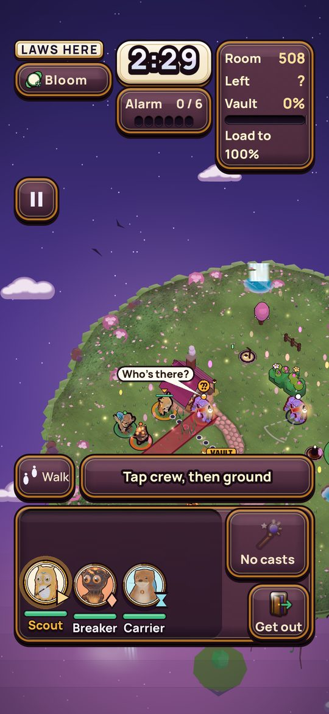 | 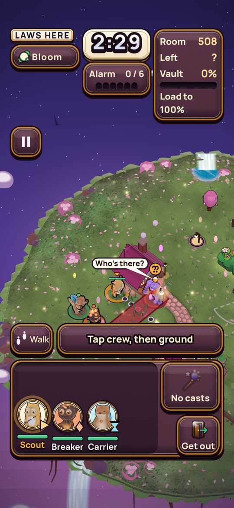 |
| 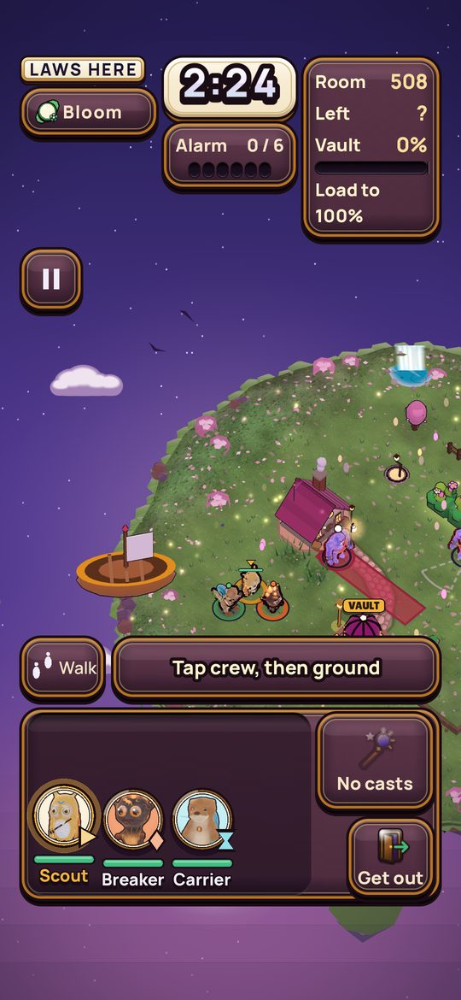 | 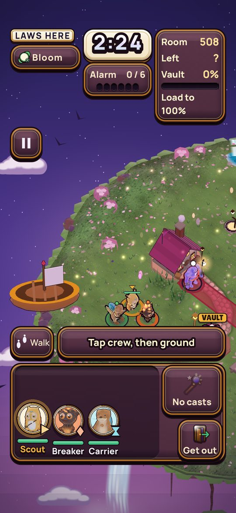 |

Top: the start. At 11 tiles the crew are larger, the nearer guard is cut by the frame and the vault slips under the order band. Bottom: the escape. At 11 tiles the nearest guard is off screen.

| At the vault, 11 tiles | The alarm, 11 tiles |
|---|---|
| 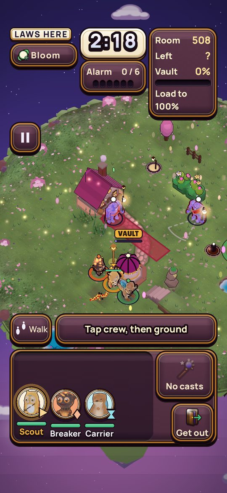 | 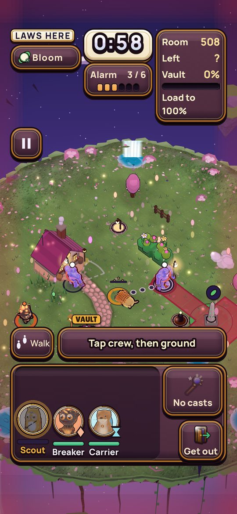 |

The two moments where 11 tiles keeps everything in view: crew, both guards and the vault.

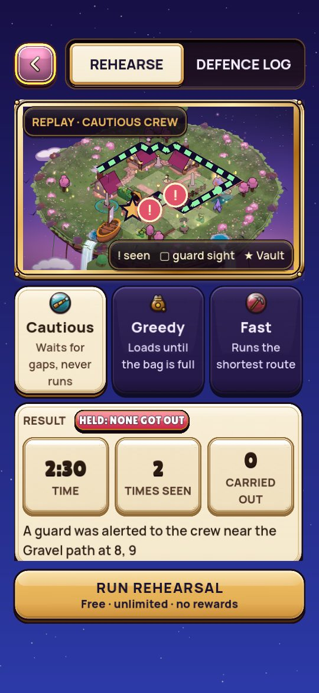

The defences screen's rehearsal tab: 36,011 triangles in 86 draw calls. Version 2 read the "0 triangles" of its other tab, the defence log, as a defect; that tab has no 3D view.

## 3. Root causes

1. **The definition of done was the design's still.** A still cannot be played. It rewards detail and atmosphere, and it does not punish a figure that is too small to tap.
2. **The camera was set to show the place, and the panels were laid over it afterwards.** `world_view.gd` frames 15 tiles across a portrait phone by default (`FOLLOW_TILES`), though a 7-tile view exists one zoom level in. The panels then leave a clear band of 39% of the height.
3. **Decoration and play share the same ground.** Petals, fireflies, flowers and paths were all drawn at the same strength, with nothing reserved for the tiles the crew walk on.
4. **Each track added its own markers.** Rings, cones, bubbles, icons and labels came from different files with no shared rule for how many may show at once, or where.
5. **The data path is narrow.** `client/ext/src/lib.rs` has one function, `guards()`, that decides what the screen knows about a guard. It passes on `at`, `facing`, `cone`, `far`, `state` and `down`. The simulation's `near`, `mid` and `suspicion` stop there.
6. **The phone renderer has no real shadows.** The client runs on Godot's Compatibility renderer. Nothing has yet been drawn in their place.
7. **The checks measured likeness.** The interface programme's automated judge missed its target on all eight of its qualities. Hand checks, two blind audits and the owner's boards carried the quality. The 3D needs checks that return a number.

## 4. The target: fourteen qualities

Each quality has a number, and each number comes from a tool or a scored test. The targets are proposals; phase 0 measures the baseline for every screen and may adjust them once, with the owner's agreement.

| # | Quality | Today | Target (proposed) | How it is measured |
|---|---|---|---|---|
| Q1 | **World share.** The band of the heist screen that shows the world with nothing over it | 39% (measured) | at least 60% | The mask tool |
| Q2 | **Figure size.** Height of the smallest crew member or guard at the heist's default zoom | 23 points (crew; guards 38) | at least 32 points | The mask tool |
| Q3 | **Figure separation.** Share of a figure's pixels within 18 gray levels of the ground behind it | 8% to 33% | at most 5% | The mask tool, in grayscale |
| Q4 | **No pile-ups.** When figures share a tile or stand next to each other, each head and each marker stays visible | fails by the Vault | every head and marker at least 80% visible | The mask tool |
| Q5 | **Quiet ground.** Decoration on walkable tiles during a heist; paths between buildings | petals and fireflies everywhere; one path | none on walkable tiles; a path links every building | The mask tool |
| Q6 | **Marker budget.** Markers per actor and per objective; markers that cover what they describe | several per actor, overlapping | one per actor, one per objective, none covering its object | The mask tool |
| Q7 | **Stealth you can read.** What the screen shows of a guard's sight and state | one cone, one range, a state name | three zones for the chosen or nearest guard, a suspicion meter, six states each with its own icon, colour and shape | A scripted check, and the find-it test |
| Q8 | **Orders you can read.** What the screen shows before an order is confirmed | a hint line | the path, where on it the crew will be seen, and how loud it is | A scripted check, and the find-it test |
| Q9 | **Find it in five seconds.** Crew, guards, the vault, the exit and the safest route, from one still | not measured | at least 90% right | The find-it test |
| Q10 | **Buildings you can name.** Name a building from its grayscale silhouette at home zoom | not measured | at least 90% right | The find-it test |
| Q11 | **Framing.** The chosen crew, their target and the nearest guard inside the safe area; the island not cut off on realm screens; the character at least a third of the screen's height | fails on heist (nearest guard clear in 5 of 7 moments), realm, builder, character | passes on every screen | The mask tool |
| Q12 | **Depth.** A contact shadow under every figure and building; cliff faces darker than tops | no shadows | present on every screen | The mask tool and a scripted check |
| Q13 | **Motion.** Sneak, walk and run told apart in a two-second clip; the picture answers an order within 0.1 seconds | not measured | at least 90% right; within 0.1 seconds | The find-it test on clips; a timing check |
| Q14 | **Performance.** Draw calls on heist and result; scene triangles; frame time on a real phone | 120 to 149; 56,462 mesh triangles on the heist at 11 tiles (the renderer counts 85,428 with the outline passes); not measured: no phone here | at most 120 at every moment; at most 60,000 mesh triangles at every moment; set in phase 0 from the trial | The shots' `budget:` line; a phone run |

Qualities the interface programme already holds stay in force and are re-checked: text at 100% and 200%, and high contrast.

## 5. What changes

Ten directions. Each names the files it touches.

**A. Give the world the screen.** Bring the default camera from 15 tiles across to about 11 and frame the action, not the island. This is one constant (`FOLLOW_TILES`); it was rendered for this plan at seven moments and costs no draw calls. Slim the heist's top panels to one row and let the world run on behind the bottom controls, as the design does. The distance alone is not enough: at 11 tiles the nearest guard is clear of the panels in only two of the seven moments. So a framing rule keeps the chosen crew, their target and the nearest guard inside the safe area, and a marker at the screen's edge points to a guard or the vault when it is out of view. (`world_view.gd`, `overlay_hud.gd`, the heist's layout in `client/ui/`.)

**B. A quiet ground.** Reserve walkable tiles for play: no petals, no fireflies, no flowers there during a heist. Show the tile grid faintly so distance can be judged. Link every building with a path. Keep decoration on the rim, the cliffs and the sky, where it frames the play without competing with it. (`island_builder.gd`, `kit_ground.gd`, `world_look.gd`, `look_*.gd`.)

**C. Figures that read.** Raise the crew to at least 32 points (guards already stand at 38), with a closer camera and, if the owner chooses it on the style frames, a larger drawn size. At 11 tiles the crew reach 31 to 38 points, so a drawn scale of about 1.05 or a camera near 10.5 tiles is needed for margin. A closer camera must come with a framing rule that keeps the nearest threat in view (section 2.6). The hook for a larger drawn size already exists (`readable_scale`, read in `world_view.gd`). Give crew and guards team colours that hold in grayscale. Put a contact shadow under each. Fan figures out when they share a tile. (`creature*.gd`, `actor_builder.gd`, `world_view.gd`.)

**D. One marker language.** One marker per actor and one per objective, from one file with one set of rules for size, place and priority. A marker never covers what it describes. When two would collide, the less urgent one shrinks to a dot. (`fx_*.gd`, `law_fx*.gd`, `overlay_hud.gd`.)

**E. Stealth you can read.** Draw the three sight zones for the chosen or nearest guard, and a thin cone for the rest. Show suspicion as a meter that fills over the guard. Give each of the six states its own icon, colour and shape, so they differ without colour. Show hiding places and unlit tiles as such. (`fx_ground.gd`, `world_view.gd`, and the data track in section 9.)

**F. Orders you can read.** Before an order is confirmed, draw the path, mark where on it the crew will be seen, and show how far the noise will carry. (`fx_*.gd`, `world_view.gd`, and the data track.)

**G. Light and depth.** Drawn contact shadows and darker cliff faces under the current renderer. Phase 0 tries the Mobile renderer on a phone; if it holds the frame rate, real shadows replace the drawn ones (D4). (`world_look.gd`, shaders, `project.godot` only if D4 says so.)

**H. Buildings and kit.** Fewer, larger, clearer shapes. Each building must be named from its gray silhouette. Far realms get simpler models in place of plain blocks. (`building_kit.gd`, `kit_*.gd`, `realm_kit.gd`, `geo.gd`.)

**I. Universe and realm screens.** Larger islands on the universe map, a calmer backdrop, and the player's own island found at once. On realm screens, the island fills the space the panels leave. On character screens, the character fills a third of the height and nothing hides it. (`universe_*.gd`, `overlay_*.gd`, `stage_*.gd`, `stage_hero*.gd`.)

**J. Motion and performance.** Sneak, walk and run each get a gait that reads at a glance. The picture answers every order within 0.1 seconds. Draw calls come down to 120 by merging materials and batching decoration, which also pays for the new shadows and markers. (`creature*.gd`, `actor_builder.gd`, all tracks for the batching.)

**Build or buy.** Stay procedural. The 3D is generated in code, which keeps it deterministic and the download small, and 29,238 lines of it already exist. Bought models would need a second pipeline and would not match the look.

### What changes on each screen

| Screen | Fault today | What changes | Phase |
|---|---|---|---|
| Heist (the pilot realm) | Panels cover 37.5% of the screen; the crew are 23 to 28 points; one sight cone per guard | Closer default camera, slimmer panels, readable figures, markers, stealth and orders (directions A to G) | 1 |
| Replay and result | They share the heist's view and its faults | They follow the pilot | 1 |
| The other realms' heists | The same faults, on each realm's ground and kit | The pilot's ground, kit and light, realm by realm | 2 |
| Realm at home | Large panels, empty sky around the island, a flagstone grid where the design has a meadow, weak clouds, waterfalls and ambient life | Framing, a quiet ground, light and depth (directions A, B, G and I) | 3 |
| Builder, curation, defences, planner | Large panels, a small island, unused sky (seen on the builder; the others are measured in the baseline) | The same framing work | 3 |
| Scout, observatory, landing, laws | Not rendered for this plan | Measured in the phase 0 baseline first, then the same framing rules | 3 |
| Universe home and zoom | Small islands, a busy backdrop, plain blocks away from the focused realm; 39,695 of 40,000 triangles used | A quieter backdrop and islands that can be found, inside the same triangle limit (direction I) | 3 |
| Character and roster | A small model, half hidden by its name plate; colours drift dark under the stage light; sheets cover the lower third | The character large and unhidden: at least a third of the screen | 4 |
| Sage hall, forms, hatch, first-run | Not rendered for this plan | Measured in the phase 0 baseline first, then the same character rule | 4 |

## 6. The phases

### Phase 0. Measure and choose (about 50 hours)

- **The mask tool.** A second render pass that paints every actor, marker and ground type a flat colour. From it a script computes Q1 to Q6, Q11 and Q12 for any still, with no judge. It is checked by hand against ten stills before it is trusted.
- **The baseline.** Every 3D shot in `client/tests/shots/` rendered and measured, and the table published beside this plan. The `screen_defences` shot is shot on its rehearsal tab (`TAB=0`: 36,011 triangles, 86 draw calls); its default tab is the defence log, which has no 3D view, so the "0 triangles" it printed was correct and nothing needs fixing.
- **The renderer trial.** Compatibility against Mobile on a real phone: frame time, shadows, heat. It decides D4.
- **Three heist style frames, as real renders.** The same moment of the same heist, three ways: (a) a closer camera only, 11 tiles across, with figures at their true size (crew 31 to 38 points, measured). This one is already rendered at seven moments (section 2.6). (b) Today's camera with figures drawn about 1.4 times larger, through the `readable_scale` hook. (c) Both, with the quiet ground and the new markers. The first two are cheap, because the zoom constants and the scale hook already exist. The owner picks one. It decides D3.
- **The data spec.** What `guards()` adds, what noise and order previews need. Frozen before phase 1. The replay question is settled (section 9): `near`, `mid` and `suspicion` are already in the simulation's `Guard`, and adding them to the dictionary `guards()` returns leaves the recorded replay byte-for-byte the same. What remains is a shot moment where a guard is suspicious, since the trial only saw `suspicion` at 0. For noise, the client receives one value today (`landing_reach()`).
- **The find-it test.** A fixed set of stills and clips with five questions each. The answers are scored against the mask, so no opinion is involved.

**Exit:** the owner has picked a style frame; the baseline is published; the mask tool agrees with the hand measurements; the data spec is frozen; the phone's frame time is known.

**First tasks, in order:**

1. Make the shots' `budget:` line print the split this plan measured by hand (mesh triangles, outline passes, other views), and shoot `screen_defences` on its rehearsal tab.
2. Build the mask tool and check it against this plan's measurements (crew 23 to 28 points at 15 tiles, 37.5%, 39%, and the eight-moment matrix).
3. Render the three style frames for the owner.
4. Render and measure the baseline for every 3D shot.
5. Write the data spec, and add a shot moment with a suspicious guard.
6. Run the renderer trial and one frame-time run on a real phone.

### Phase 1. The heist pilot (about 90 hours)

**1a. Clear the screen (about 18 of the 90 hours; an estimate).** The default camera moves to the distance the owner chose (about 11 tiles). A framing rule keeps the crew, their target and the nearest watching guard in frame, and widens toward 15 tiles when it must. A guard that is still off screen gets a marker at the screen's edge. The panels are slimmed and moved (D11) so nothing sits over the crew, their target or the nearest guard. Nothing else changes. The owner gets this build on a phone as an early check, and what they say steers 1b.

| Piece of step 1a | Hours (estimate) |
|---|---|
| Default camera distance, checked on each realm | 2 |
| Framing rule: crew, target and nearest watching guard in frame | 4 |
| Edge markers for threats off screen | 3 |
| Slim and move the panels (D11) | 5 |
| Re-checks: 200% text, high contrast, safe areas | 2 |
| Rerun the eight-moment matrix, new stills, the owner's phone build | 2 |
| **Total** | **18** |

The 18 hours replace version 2's "about 15". The framing rule and the markers were already phase 1's work (Q11); the matrix shows they cannot wait for 1b, so their hours move forward. Phase 1 stays at about 90 hours.

**1b. The rest of the pilot.** One realm's heist, made clean and playable from end to end: directions A to G, on that one realm. The replay and result screens follow, since they share the heist's view.

**Exit:** Q1 and Q2 are measured on the 1a build, and the owner has tried it (or that is noted as not done). Q1 to Q9, Q11, Q12 and Q14 pass on the pilot. The owner plays one heist on a phone and signs, or says what is still hard.

### Phase 2. Ground, kit and light across the six realms (about 110 hours)

The pilot's ground, buildings and depth applied to every realm (Crystalline, Emberreach, Lanternvale, Skyfield, Tidehold, Verdant), each keeping its own palette and character.

**Exit:** Q5, Q10 and Q12 pass in all six realms; the heist qualities still pass in each; draw calls are at most 120 everywhere.

### Phase 3. Realm screens and universe (about 90 hours)

Every screen that shows an island or the universe: realm, builder, curation, defences, planner, scout, observatory, landing, laws, universe home and universe zoom.

**Exit:** Q11 passes on every screen; the player's own island is found on the universe map in the find-it test; the owner looks through the screens on a phone.

### Phase 4. Characters and motion (about 80 hours)

Every creature reads at heist size and in grayscale. Gaits for sneak, walk and run. The character, roster, Sage hall, forms, hatch and first-run screens show the character large and unhidden. Far figures get the drafted impostors.

**Exit:** Q2, Q3, Q4 and Q13 pass for every creature; the character fills at least a third of its screens.

### Phase 5. Polish and audits (about 50 hours)

A performance pass on a phone. Two blind audits by sessions that have not seen the work. The owner's board of every screen, before and after.

**Exit:** both audits are done and their misses fixed; the owner's board stands; the owner plays a heist on a phone.

## 7. Tracks and files

At most four builders at once. Each track owns its files and stays in them.

| Track | Owns | Complex under order 6? |
|---|---|---|
| Measure | `tools/render/`, `client/tests/shots/`, the mask tool, the find-it test | No |
| Camera and framing | `world_view.gd`, `overlay_*.gd`, `stage_*.gd`, the heist's layout | No |
| Ground and look | `world_look.gd`, `island_builder.gd`, `realm_palette.gd`, `kit_ground.gd`, `look_*.gd`, shaders | No |
| Kit | `building_kit.gd`, `kit_*.gd`, `realm_kit.gd`, `geo.gd` | No |
| Actors | `creature*.gd`, `actor_builder.gd`, `stage_hero*.gd` | No |
| Markers and stealth | `fx_*.gd`, `law_fx*.gd`, `overlay_hud.gd` | No |
| Universe | `universe_*.gd` | No |
| Data | `client/ext/src/lib.rs`, and `sim/` only if the spec needs it | Yes: it can span `sim/` and `client/`, and it touches a wire contract |

`world_view.gd` is shared by the camera track and the markers track. They take turns on it; the lead orders their tasks so that only one holds it at a time.

At the interface programme's average task size (about 2.2 hours), 470 hours is about 210 tasks (estimate).

## 8. How it is checked

- **Numbers first.** The mask tool returns Q1 to Q6, Q11 and Q12 for every still, on every merge candidate. A task that makes a number worse does not merge.
- **Scored tests, not opinions.** The find-it test has right answers, taken from the mask. A fresh session that knows nothing of the project answers from the still alone, and so does the owner on a short sample at each gate.
- **The owner plays.** At the end of phases 1, 3 and 5 the owner plays on a phone. A still cannot show whether a game is easy to play; ten minutes of play can.
- **Two blind audits** in phase 5, as the interface programme had.
- **No automated judge of looks.** The interface programme's judge missed its target on all eight qualities. This plan does not rely on one.
- **The existing checks stay.** `bash tools/check_all.sh` must print "All checks passed" before any merge. GDScript warnings are errors. The shots' `budget:` line is read on every candidate.

## 9. What the simulation must hand the screen

The simulation already computes what the player needs to see. The screen is not given it.

| The simulation has | The screen is handed today | The plan adds |
|---|---|---|
| A sight cone and three ranges: `near`, `mid`, `far` (`sim/src/lib.rs`) | `cone` and `far` | `near` and `mid` |
| A suspicion value from 0 to 1000 per guard | nothing | `suspicion` |
| Six states: Unaware, Suspicious, Investigating, Alerted, Searching, Returning (`sim/src/guard.rs`) | the state's name | nothing new; the screen starts drawing all six |
| Weak vision at the corner of the eye | nothing | the corner angle |
| Noise that carries along walkable paths (`sim/src/noise.rs`) | one value (`landing_reach()`); the client draws no noise | to be settled in phase 0 |

The extension reads the simulated world directly, so the new fields are additions to one dictionary in `client/ext/src/lib.rs`, with no change to the stored replay. This was tried in the final version, not inferred:

- **The simulation does not change.** Its `Guard` already carries `near`, `mid` and `suspicion`.
- **The stored replay does not hold the guards.** It is written by `Heist::encode` in `sim/src/replay.rs` and holds the seed, the island digest, the rules version, the ticks, the crew, the commands and the era data.
- **The trial.** Three lines were added to `guards()` and the extension rebuilt. The same heist was run at 11 tiles with the original library and with the edited one. The recorded replay is identical: 716 bytes, with the same SHA-256 at two moments (`c5606372…` at "alarm", `be0c36cc…` at "vault").
- **The screen can read the new fields.** At "alarm" the script read guard 0 at near 2.0, mid 4.0 and far 6.0 tiles, and guard 1 at 1.5, 3.0 and 4.5.
- **The tests pass**: the extension's 6 tests and the simulation's 3 golden replay tests.
- **The limit.** `suspicion` read 0 for both guards; a value above 0 was not seen. Phase 0 adds a shot moment with a suspicious guard.

The trial edit was reverted. The change itself belongs to phase 0's data spec task.

**Outside this plan.** Several things the design's heist still shows depend on rules that are not built: abilities, Cast, the Sage's powers, and terrain moves such as climb, wade and leap. The plan leaves room for them on screen and builds none of them.

## 10. Hours and size

| | Planned | Actual or expected | Tasks |
|---|---|---|---|
| The interface programme, phases 0 to 3 | 187 hours | about 272 hours | 122 |
| This plan, phases 0 to 5 | 470 hours | about 580 to 730 hours, if it overruns as the interface did (24% to 56%) | about 210 (estimate) |
| Ratio | 2.5 times | 2.1 to 2.7 times | about 1.7 times |

The interface programme ran from 4 to 24 November 2026, with five stops and a 108-hour bug-fix wave inside it. At that pace this plan takes about four to six weeks, stops included. That is an estimate from one programme, not a promise.

It is larger than the interface programme in five ways: more hours; a harder target (playing, not looking); a reach into the data the simulation hands the screen; checks that are measured on the screen and played on a phone, where the interface programme compared stills; and it reopens finished interface work where that blocks play (D11).

## 11. Rules kept

- The look rules of §21.1 to §21.3: picture-book dioramas in a violet sky, chunky toy-like shapes, silhouette first, one toon look with a four-step ramp, violet-tinted shadows, ink outlines.
- The budgets: 3,000 to 6,000 triangles for a character; 25,000 to 40,000 for a realm at home and about 60,000 in a heist; no full-screen post-processing on the phone. The draw-call limit tightens from 150 to 120.
- The 3D draws only what `RulebornReplay`, `RulebornIsland` and screen state give it. Heists stay deterministic.
- Each track stays in its files. Nothing merges without the full checks.
- The owner's orders in `CLAUDE.md` stand, including the stop switch, the cap of four builders and the model and effort orders.

## 12. The owner's decisions

The table is in "Plan at a glance". Three need a word more.

- **D3, larger figures.** A figure drawn 1.5 times its true size reads far better, but it overlaps walls and other figures more. The style frames show both, so the choice is made on a picture and not on an argument.
- **D5 and D6, the stealth data.** The detection spec is marked "proposed". If the owner wants a different stealth model, it is far cheaper to say so before the screen is built to show this one.
- **D11, the heist's panels.** Reaching 60% clear world is not possible without moving them. The components stay as built; their size and place change. The camera trial shows why (section 2.1): with today's panels, a closer camera hides more of the action.

## 13. Risks

| Risk | What the plan does |
|---|---|
| A closer camera hides guards the player needs to see | Measured: the nearest guard is clear in 5 of 7 moments at 15 tiles and 2 of 7 at 11. Step 1a ships the framing rule and the edge markers with the closer camera, and Q11 checks them on the eight-moment matrix |
| Larger figures and new shadows cost draw calls | Phase 1 brings draw calls down first; Q14 blocks any merge that goes over |
| The Mobile renderer is too slow on a phone | The default is to stay on Compatibility with drawn shadows |
| The new fields turn out to need a replay format change | Closed: tried in the engine, the recorded replay is unchanged (section 9) |
| The hours overrun, as every interface phase did | The plan states the expected range, not only the planned number |
| The owner has no time to play at a gate | The numbers stand in, and the gap is written down, not hidden |
| Moving the heist's panels breaks interface checks | Layout only; text at 200% and high contrast are re-checked on every candidate |

## 14. What was not checked

Version 2 listed eight gaps. Six are closed above. What remains cannot be settled from this branch:

- **The frame time on a real phone.** It needs a device. It is phase 0's last task.
- **How noise should reach the client.** That is a design choice for the data spec, not a measurement.
- **A suspicious guard.** The trial read `suspicion` at 0 only.
- **The 11-tile camera in a person's hands.** The matrix is eight moments of one heist on one realm. Nobody has played a whole heist with that camera. Step 1a's phone build is that test.
- **Other realms.** The measurements are from one realm. Phase 0's baseline covers the rest.
- **Two small sub-views in the heist frame** (780 × 420 and 384 × 384). They were counted but not identified. With the panels they account for about 7,000 of the frame's 92,576 primitives.
- **Hours and dates.** They are estimates. Only step 1a has a piece-by-piece breakdown.
- **The published page.** Republished as the final version and checked three ways: the published page contains this session's source text in full; its file list holds the page and all sixteen stills, and the seven new stills match the files in this folder byte for byte; and the page was rendered locally at phone and desktop width with no overflow and no broken image. It was not viewed in a signed-in browser on claude.ai, which this session cannot do.
