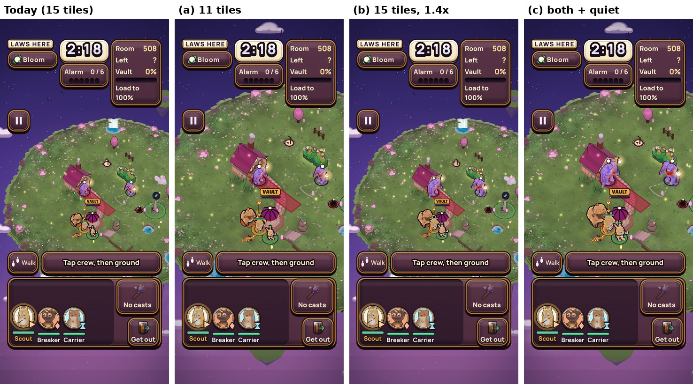
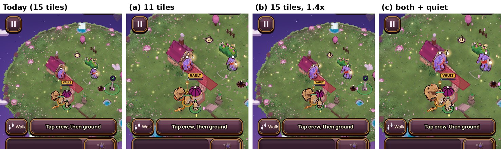

# Heist style frames

Phase 0 of the 3D quality plan ([`plan.md`](plan.md), section 6) asks for three style frames: the same moment of the same heist, rendered three ways. The owner picks one, and that pick decides D3 (larger figures) and the default camera for step 1a.

All four stills below are real renders. They come from one shot, `client/tests/shots/style_frame_heist.gd`, which builds on the heist screen's own shot. The moment is "vault": the crew stand at the Vault, cracking it, and both guards are in view. In the plan's eight-moment matrix, this is one of the two moments where 11 tiles keeps everything in view. Each still was rendered at 1080 × 2340 and saved at phone size (360 × 780) and at 2x (720 × 1560).

The looks exist only in the shot. The game's default camera, figure scale and ground are unchanged.

## The frames side by side





| | What it is | Phone size | 2x |
|---|---|---|---|
| Today | Today's camera (15 tiles across), figures as the game draws them. For reference only | [phone](style-frames/today-phone.jpg) | [2x](style-frames/today-2x.jpg) |
| **(a)** | The camera at 11 tiles across. Figures at their true size | [phone](style-frames/a-camera-11-phone.jpg) | [2x](style-frames/a-camera-11-2x.jpg) |
| **(b)** | Today's camera (15 tiles). Crew and guards drawn 1.4 times larger, the size `readable_scale` would give them | [phone](style-frames/b-figures-1-4-phone.jpg) | [2x](style-frames/b-figures-1-4-2x.jpg) |
| **(c)** | Both: 11 tiles and figures 1.4 times larger, with a quiet ground | [phone](style-frames/c-both-quiet-phone.jpg) | [2x](style-frames/c-both-quiet-2x.jpg) |

## What each frame shows

- **(a) and (b) put the figures at almost the same size.** The crew grow about 1.37 times in (a) and 1.40 times in (b). The difference is everything else.
  - In (a), the whole world grows: the Vault, the buildings, the paths and the marks around the figures. The frame holds less of the island, so guards sit nearer its edges.
  - In (b), the world stays as wide as today and only the figures grow. They crowd the Vault and each other, while their rings and marks stay at today's size.
- **(c) is the largest by far.** The figures are about 1.9 times today's height, and they overlap the Vault and each other most. The ground is calmer:
  - The painted petals are gone from the meadow.
  - The scattered pieces that stood on walkable tiles are gone. That is 71 of this island's 1,170; most of its decoration already sits on the rim.
  - Bloom's drifting petals and lights stay. They are the sign of the law in force, not decoration.
- **(c) does not show the new markers.** The plan's one marker language (direction D) is not built yet, so (c) shows today's markers. The shot leaves out the guards' speech bubbles, but in this moment the guards say nothing, so (c)'s marks look like today's. Treat (c) as a preview of size and ground, not of markers.

## What each costs

The render cost is the same for all four: the shot's `budget:` line reads 119 draw calls each time. The primitives are 91,818 at 15 tiles and 91,634 at 11 tiles, against the limit of 150 draw calls. The work and the risks differ.

| | Crew height on screen (target 32 points) | Guard height | Render cost | Work to make it the game's default | What it risks |
|---|---|---|---|---|---|
| Today | 24 to 27 points (plan, section 2.6) | 38 points | 119 draw calls, 91,818 primitives | none | The crew are under the 32-point target |
| **(a)** | about 33 to 37 points; the plan measured 33 to 38 at this moment | about 52 points | 119 draw calls, 91,634 primitives | Step 1a as planned: about 18 hours. That covers the camera (2), a framing rule (4), edge markers (3), slimming the panels (5), re-checks (2) and the matrix (2) | A closer camera loses guards: the nearest guard is clear in only 2 of 7 moments at 11 tiles, against 5 of 7 at 15. The framing rule and the edge markers exist to fix this |
| **(b)** | about 34 to 38 points | about 54 points | 119 draw calls, 91,818 primitives | A few hours: the scale hook exists (`readable_scale` in `world_view.gd`), and guards would need the same hook. Plus checks that rings, marks and portraits still fit. Step 1a would lose its camera and framing work but keep the panels | Larger figures overlap walls, the Vault and each other more (plan, section 12). The world stays small, so the Vault and paths read no better than today |
| **(c)** | about 46 to 52 points | about 74 points | 119 draw calls, 91,634 primitives (this frame) | Step 1a (about 18 hours) and the scale change. Then the quiet ground (direction B) and the marker language (direction D), which are phase 1b's work (about 72 of phase 1's 90 hours) and later phase 2's | Every risk of (a) and (b). Figures at nearly twice today's height crowd the most. The ground and the markers must be built before the frame looks like this in play |

How the heights were measured: the shot's `HEIGHTS` setting prints each figure's height on screen, from its feet to its head, projected through the camera.

| Frame | Crew, 3 figures | Guards, 2 figures |
|---|---|---|
| Today | 15.0, 17.5, 16.2 | 20.2, 20.2 |
| (a) | 20.5, 23.9, 22.1 | 27.8, 27.7 |
| (b) | 21.1, 24.5, 22.8 | 28.5, 28.4 |
| (c) | 28.8, 33.6, 31.1 | 39.2, 39.1 |

These numbers read lower than the plan's, because the plan measures a figure's whole projected outline, not its feet-to-head line. The table above converts them to the plan's measure with the measured ratios: 1.37 for (a), 1.40 for (b) and 1.92 for (c). Those ratios are applied to the plan's 24 to 27 points for this moment at 15 tiles, and to 38 points for the guard. Check: (a) comes out at 33 to 37 points, against the plan's own 33 to 38.

## How to render them again

```
STYLE=a CAST=1 MOMENT=vault bash tools/render/shoot.sh client/tests/shots/style_frame_heist.gd a.png
```

`STYLE` is `a`, `b` or `c`; with no `STYLE`, the shot renders today's frame. `GROW` changes the figure scale of (b) and (c), 1.4 if unset. `HEIGHTS=1` prints the figure heights. The heist shot's other settings (`MOMENT`, `HOUR`, `HIDE` and the rest) work as in `screen_heist.gd`.

## The owner's question

**Which frame: (a), (b) or (c)?**

Until the owner answers, the lead's default is **(a)**: step 1a as the plan already describes it, the camera at 11 tiles with the framing rule and edge markers, and no change to the figures' scale. Of the three, (a) is the only frame that grows the Vault, the paths and the marks along with the figures, and the plan's matrix already measures it at seven moments. If the owner picks (b) or (c), step 1a changes as the costs table says.
