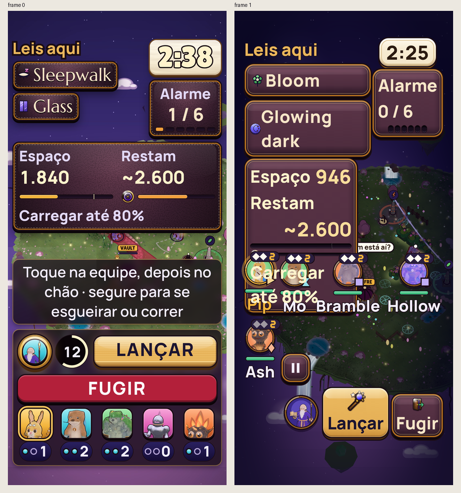
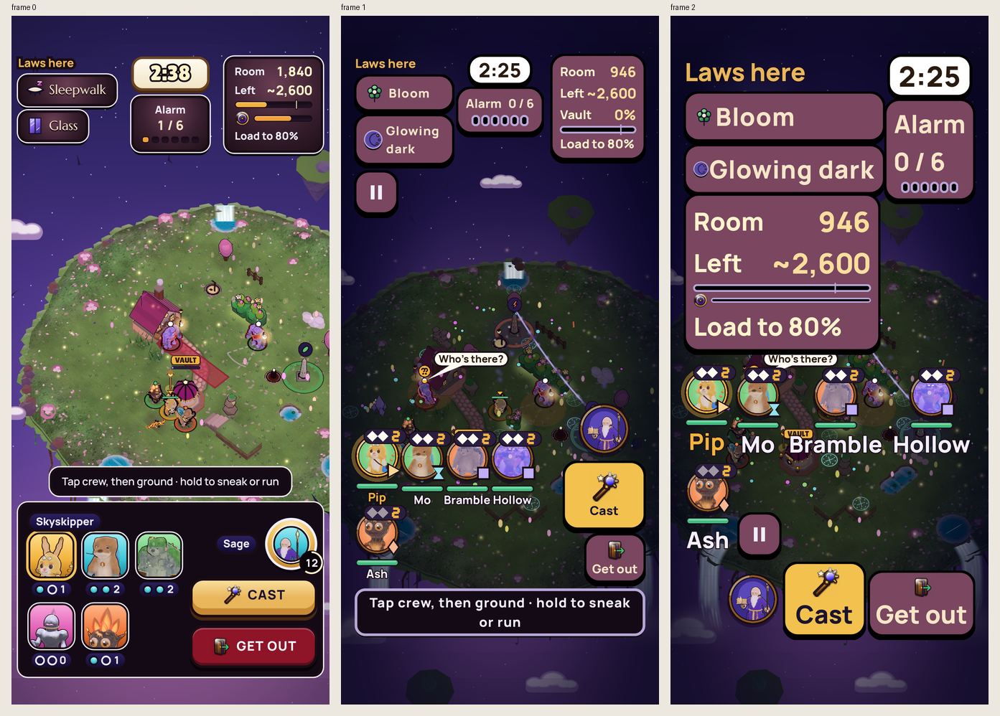
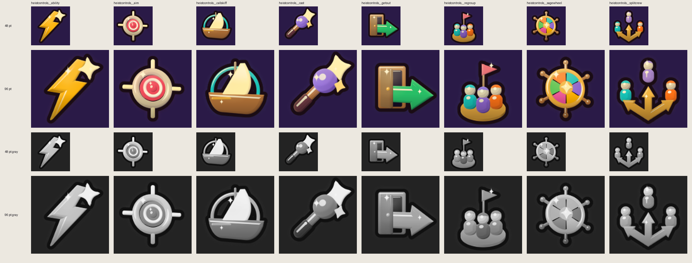
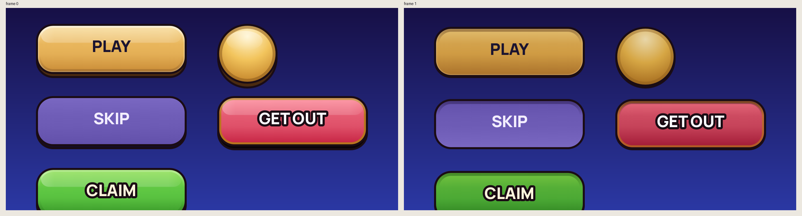

# Board 1: the kit and the heist

Posted by AD, P1-AD-board-1, 11 November 2026, on main at `d880807e`
(P1-S1-pilot-2 merged). This is O4's first family board (section 3.4 and step
7 of `../../report.md`). It holds nine items, each shown beside its golden
reference at phone size, with the gate's verdicts. AD checks every
owner-checked quality (`../calibration.md`: 1, 2, 3, 6, 8, 9, 13 and 14) and,
because this is board 1, quality 4 (press feedback) from a frame pair.

**Decision: the board does not stand.** Five objections are open (listed in
"Objections" below). Four are against the pilot heist and one against its
200% Portuguese layout. The kit and icon batches 1–2 stand on AD's check. Phase
2 waits for this board (section 3.8 of the report), so the objections go to
the lead as requests in `docs/progress/status/AD.json`, each with a default.

## How to read it

- **Golden reference.** For screens this is the heist key frame that AD
  approved in place of the owner (`../approvals/O2.md`), at
  `art/ui/keyframes/02-heist*.png`. For the kit and the icons it is the style
  board, `art/ui/board/board.png`. The rubric's pass and fail anchors
  (`../rubric.md`) are the bar for each quality.
- **Candidate.** The screens are S1's committed stills on main,
  `docs/art/shots/heist-pilot/after-*.png` (P1-S1-pilot-2). AD re-rendered
  the same five shots on main's integrated head (`tools/render/shoot.sh
  client/tests/shots/screen_heist.gd`, with `MOMENT`, `TEXT`, `CONTRAST` and
  `LOCALE`). They match S1's stills except where something animates: the
  mean difference is 0.25–0.51 levels, and 0.6–1.2% of pixels differ by more
  than 16. So S1's stills stand for the integrated build.
- **Images.** All are made with `tools/ui_gate/sheet.py` and are in
  [`board-1/`](board-1/). A strip puts the reference on the left (frame 0)
  and the candidate on the right, at the same height.
- **Verdicts** come from `../verdicts/<task>/<sha>.json`. Each result is
  written as pass, fail or unknown, with the votes in order. All of them are
  advice only, because every judged quality is owner-checked
  (`../calibration.md`).
- **AD's check** is written as stands, note or **objection**. A note is
  recorded for the next round and blocks nothing. An objection holds the
  board.

## The items

### 1. Heist at 100% text

Grayscale squint: [`1-heist-100-gray.png`](board-1/1-heist-100-gray.png).
Colour-vision sheet: [`1-heist-100-cvd.png`](board-1/1-heist-100-cvd.png).

Gate: `P1-S1-pilot-1/5470c4d3`, the 100% shot, before pilot-2's rework.
- Materials: pass (ppp).
- Display type: fail (fff).
- Icons: pass (pfpppp).
- Hierarchy: fail (fff).
- Colour: fail (ffppff).
- Character: fail (fff).
- Light: pass (ppp).
- One idea: fail (fff).

Pilot-2 (`a4d87d18`) reworked hierarchy and colour, and was judged in high
contrast and at 200% only.

| Quality | AD's check |
|---|---|
| 1 Materials | Stands. The panels, law chips, Cast and Get out carry a top-lit gradient, an inked rim and a lip. |
| 2 Display type | **Objection A.** The timer "2:25" is flat dark figures on a cream pill, with no ink outline, hard drop or gradient fill: the rubric's fail anchor. The key frame's timer is an inked, outlined display figure. The crew names (Pip, Mo, Bramble, Hollow, Ash) carry a thin plum ink outline and hold over the world; at 4× zoom it is about 2 px, lighter than the kit's GET OUT outline, but it reads. "Laws here" is gold on the plain night sky with no outline; it reads there, so it is a note, not part of the objection. |
| 3 Icons | Stands. The law and action icons are the rebaked toon icons. Bloom is the weakest but still reads. |
| 6 Hierarchy | Stands after pilot-2. In grayscale the gold Cast is now the lightest and largest control. Get out is leather and smaller. The two-line hint bar is the heaviest dark mass after the panels, which is noted under objection C. |
| 8 Colour | Stands after pilot-2. Gold fill is on Cast only, red is gone from Get out, and the school marks are shapes. On the CVD sheet, the crew rings still differ by hue, but each also has a name and a portrait, so no information is carried by colour alone. |
| 9 Character | **Objection D.** Hollow's dark purple body merges with its purple ring at phone size. Bramble is low in contrast against its ring. |
| 13 Light | Note. There is one top light on every piece. The night scene is much darker than the key frame's lit island. That suits a sneak at night, but the world reads as a backdrop rather than a stage. |
| 14 One idea | **Objection C.** There is no crew tray. The portraits float on the world, while the key frame seats them on a bottom panel with cards and pips. Ash wraps alone onto a second row even at 100%. The flat hint bar and the thin load bar read as generic chrome beside the inked kit. |

### 2. Heist at 200% text, English

Gate: `P1-S1-pilot-2/a4d87d18`.
- Display type: fail (fff).
- Hierarchy: pass (ppp).

The rest is from `P1-S1-pilot-1/5470c4d3` at 200%.
- Materials: fail (pffpff).
- Icons: fail (fff).
- Colour: fail (fff).
- Character: fail (fff).
- Light: pass (ppfppp).
- One idea: pass (ffpfpp).

| Quality | AD's check |
|---|---|
| 1 Materials | Stands after pilot-2. The Room panel carries a rim and a lip; no hint card shows at 200%. |
| 2 Display type | **Objection A**, the same as item 1: the flat timer. The names keep their thin ink outline at 200%. |
| 3 Icons | Stands. The Cast and Get out icons are back at 200%. |
| 6 Hierarchy | Stands, with a note. Cast leads. The loot panel and the law chips together take much of the top half. That is acceptable at 200%, but it should be measured against the HUD share in `../rubric.md` when the screen class checks it. |
| 8 Colour | Stands, as item 1. |
| 9 Character | **Objection D**, as item 1. |
| 13 Light | Stands, as item 1. |
| 14 One idea | **Objection C**, as item 1. |

### 3. Heist at 200% text, Portuguese (Brazil)

Gate: this shot was not judged on its own (pilot-2's 200% shot is English).

| Quality | AD's check |
|---|---|
| 2 Display type, layout | **Objection B, a hard defect.** "Carregar até 80%" spills out of the loot panel and overlaps Pip's portrait in the crew row. The guard's bubble "Quem está aí?" is clipped behind the panel. A string that leaves its panel fails §20.8's text scaling, whatever the quality scores. |
| 1, 3, 6, 8, 9, 13, 14 | As item 2. |

### 4. Heist in high contrast, at 100% and 200%

Gate: `P1-S1-pilot-2/a4d87d18`, high contrast.
- Hierarchy: pass (ppp).
- Colour: pass (ppp).

| Quality | AD's check |
|---|---|
| 1 Materials | Stands. Solid plum panels with inked rims, the high-contrast form on the style board. |
| 2 Display type | **Objection A** for the timer at 200%, as the judge found. The labels sit on solid fills in high contrast, so their missing outline matters less here. |
| 3 Icons | Stands. |
| 6 Hierarchy | Stands. Gold Cast leads in colour and in grayscale. |
| 8 Colour | Stands. |
| 9 Character | Stands. The high-contrast rings separate Hollow better, but objection D still holds in the normal mode. |
| 13 Light | Stands. |
| 14 One idea | **Objection C** (the crew tray), as item 1. |

### 5. Icons: heist controls (batch 1a)

Reference: the style board's hero icons (`art/ui/board/board.png`, the
outline and glint rules).

Gate: `P1-AIA2-icons-1a/c1d14d38` (and `5f759a03`).
- Materials: fail (fff).
- Icons: fail (fff).
- Colour: fail (fff).
- Light: pass (ppp).

These verdicts are on the first bake. The eight icons were rebaked after
it, with a softer toon ramp, a gloss band and a body gradient (`bef6eac2`,
`5ae7dbd5`). The sheet above is from main's current
`client/ui/art/icons_48.webp`.

| Quality | AD's check |
|---|---|
| 1 Materials | Stands. The current bake has a top-lit gradient, a gloss band, a dark outline and a soft drop on every icon. |
| 3 Icons | Stands. They are modelled toon objects with a top-left key light, glints and a 2 pt outline. Every silhouette reads at 48 pt and in grayscale. |
| 8 Colour | Note for the next round (AIA-2). The sagewheel's six wedges differ by hue alone and merge in grayscale. The wedges are decoration, not information, so this does not hold the board. The aim reticle's red and the get-out arrow's green borrow the alarm and success hues. Prefer gold or cream for the reticle, and keep the arrow green only if Get out keeps no success meaning. |
| 13 Light | Stands. |
| 14 One idea | Stands. One toon look, the same as batches 1b and 2. |

### 6. Icons: heist status, HUD and outcomes (batches 2a and 2b)

Gate:
- `P1-AIA2-icons-2a/ac4809ed` and `6a382d97`: all four judged qualities
  pass (ppp).
- `P1-AIA2-icons-2b/29e91db0`: all four pass (ppp).

| Quality | AD's check |
|---|---|
| 1, 3, 13, 14 | Stand. There is one toon look, one top-left light and an unbroken outline, and every silhouette holds at 48 pt and in grayscale. |
| 8 Colour | Stands. Red is kept to the alarm and danger ends, and each state also carries a shape. |

### 7. Icons: currencies, resources, alerts, season and crew pip (batch 1b and others)

Gate: `P1-AIA2-icons-1b/bef6eac2`, all four pass (ppp).

| Quality | AD's check |
|---|---|
| 1, 3, 13, 14 | Stand. |
| 8 Colour | Stands. Each currency has its own silhouette as well as its hue. Renown and starlight share gold, but their shapes differ (a medal and a sparkle). |

### 8. Kit pages beside the style board

High contrast: [`8-kit-hc.png`](board-1/8-kit-hc.png).

Frame 0 is the style board (material 1, enamel, and material 2, gold).
Frames 1–3 are K1's proof pages on main:
- `art/ui/kit_build/proof/faces_normal_normal.png`
- `art/ui/kit_build/proof_1b/controls_normal.png`
- `art/ui/kit_build/proof_2a/panels_normal.png`

AD also checked the reworked batch 2b page, `proof_2b/controls_normal.png`
and `tiles_normal.png`.

Gate:
- `P1-AIA-kit-1/c8915bc3`: materials pass, colour fail, light pass.
- `P1-AIA-kit-2/fccd4b89`: all pass.
- `P1-AIA-kit-3/3a04e828`, the numerals: display type pass, colour pass.
- `P1-AIA-kit-4/3eb4e200`: materials, display type and colour fail; light
  pass.
- `P1-AIA-kit-5/51269c72`: colour fail; the rest pass.
- `P1-AIA-kit-6/00571a44`: materials fail; the rest pass.
- `P1-AIA-kit-7/961c7905`: all pass.

| Quality | AD's check |
|---|---|
| 1 Materials | Stands. Buttons, discs, pills, tags, tiles and frames carry all four layers (gradient, gloss band, rim, lip), the same as the style board's enamel and gold. Kit-4's and kit-6's fails were reworked in kit-6 and kit-7: the album panel now has a frame and a well. |
| 2 Display type | Stands. Words over colour (GET OUT, CLAIM, the school ribbons, Chapter 3) carry a full ink outline. Dark words on gold or cream plates (PLAY, SKIP) follow the style board's own START HEIST. Kit-3's numerals, timer finish included, pass. |
| 8 Colour | Stands, with a note. Kit-5's gold fill on selected segments and chips was reworked: selection is now cream with a gold rim, as the board says ("a gold rim, never a glow"). Kit-1's sand tertiary on cream is a second warm family. Screens must never set it beside the gold primary (note to S1 and the screen builders). |
| 13 Light | Stands. One top light on every page and ground. |
| 14 One idea | Stands. One chunky, inked, toy-box idiom across the four grounds. |
| 3, 6, 9 | Do not apply to kit art (section 3.5 of the report). |

### 9. Press feedback (quality 4)

Frame 0 is `art/ui/kit_build/proof/faces_normal_normal.png` and frame 1 is
`faces_normal_pressed.png` (the top 560 px of each). The timing is in
`client/ui/tokens.json`: `press_ms` 180, `press_squash` 0.96. The motion is
`Motion.press` in `client/ui/motion.gd`, wired to every kit button in
`client/ui/kit_skin.gd`. The judge does not judge motion.

| Check | AD's check |
|---|---|
| Sinks 2–4 pt and darkens | Stands. The pressed face drops onto its lip, about 2.5 pt at 390 pt wide. The body darkens and the gloss band dims. The outline and label stay. |
| Release in 150–250 ms | Stands. The release takes 180 ms, easing out without overshoot. The press down takes 0.6 × 180 = 108 ms. |
| Note | This is a still pair, not a frame strip of the real kit in motion. The real-kit frame strips and clips belong on board 4 (result and motion), as step 8 of the report plans. Also, the space in "GET OUT" is tight on every face; widen the word space in the label style (K1, a note). |

## Objections

Each objection goes to the lead as a request in
`docs/progress/status/AD.json`, with a proposed owner and a default.

| ID | Item | Quality | Objection | Proposed fix | Owner |
|---|---|---|---|---|---|
| A | 1, 2, 4 | 2 | The heist timer is flat figures on a cream pill. | Draw the timer with `KitNumerals` (`client/ui/kit_numerals.gd`, the timer finish kit-3 passed), which no screen uses yet. Optional, not holding: give "Laws here" the kit's ink outline as on the crew names. | S1 |
| B | 3 | 2 / §20.8 | At 200% in pt_BR, "Carregar até 80%" leaves the loot panel and overlaps Pip, and the guard's bubble is clipped behind the panel. | Let the loot panel's line wrap or shrink within the panel, keep the crew row below the panel's measured height, and add a scripted check that no label leaves its panel at 200% in both locales. | S1 |
| C | 1–4 | 14 (and 6) | There is no crew tray: portraits float on the world, and Ash wraps alone onto a second row. The two-line dark hint bar and the thin load bar read as generic chrome. | Seat the crew on a bottom tray from the kit (`panel` with cards and pips, as the key frame shows), in one row at 100%. Make the hint a single kit pill. Use the kit's light bar for load. | S1 (kit pieces exist) |
| D | 1, 2 | 9 | Hollow merges with its purple ring, and Bramble is low in contrast. | Give each portrait ring a lighter inner rim or a cream mat, so that the body reads at 32 pt against the ring (ΔL* ≥ 20). | S1, with AIA-2 if the portrait art changes |
| E | flows | — | `MOMENT=alarm` at 100% shows "Alarm 0/6", the same as sneak, so the alarm moment shows no alarm state. | Make the shot script's alarm moment raise the alarm (or the HUD show it), so boards and the gate see the alarm state. | S1 |

Objection E came from the flow review, below. It holds the board only as far
as the alarm state cannot be checked.

Notes carried to the next round, which do not hold the board:
- The sagewheel's wedges are told apart by hue alone; the reticle is red and
  the get-out arrow green (AIA-2).
- Keep the sand tertiary away from the gold primary on screens (screen
  builders).
- Widen the word space in "GET OUT" (K1).
- Check the HUD share at 200% (the screen class).
- The night scene is dim against the key frame (S1, with the world team, if
  the art direction wants a lit stage).

## Flow review of the integrated build

See "Flow review" in `docs/progress/AD.md` for what AD ran and found. The
findings are requests to the lead in `docs/progress/status/AD.json`.

## When the board stands

The board stands when objections A–E are fixed and re-shot, and AD has
checked the new stills on this page. The lead seeds the fixes as phase 1
tasks. Under section 3.8 of the report, the board merges when AD lets it
stand, with no 24-hour wait.
