# Board 3: home

Posted by AD, P2-AD-board-3, 13 November 2026, on the integration branch at
`abbe59eb` (P2-S2-home-2 merged as `807d68a7`; the head at posting,
`29eb9c1a`, changes nothing under `client/`). This is the home family board
(section 3.4 of `../../report.md`). It holds nine items, each shown beside
its golden reference at phone size, with the gate's verdicts. AD checks every
owner-checked quality (`../calibration.md`: 1, 2, 3, 6, 8, 9, 13 and 14).

**Round 1 decision: the board does not stand.** Four objections are open
(listed in "Objections" below, in order of weight, M12). A is a hard defect:
at 200% text in pt_BR with a raid notice, Collect is gone. B and C are about
how the home lays out the world and what it drops at larger text and in
Portuguese. D is a small kit fault in the dock. What home-1 and home-2 were
asked to fix holds: the counts and "Keeper 24" now have the display finish,
and the keeper's companion is a live, framed toon character. Home-2 is
already merged, so each objection goes to the lead as a request for a
follow-up task in `docs/progress/status/AD.json`, each with a default. The
same findings answer S2-R18 (the preview of home part 2).

**Round 2 (board 3b, 16 November 2026): the board still does not stand.**
A's core, B, C at 100% and D are fixed. One objection, H, is open. See
["Round 2 (board 3b)"](#round-2-board-3b) at the end.

**Round 3 (board 3c, 16 November 2026): the board stands.** H is fixed:
at 200% the side buttons and the realm chips show in every case, with and
without the notice, and every render prints "fit ok". See
["Round 3 (board 3c)"](#round-3-board-3c).

## How to read it

- **Golden reference.** The home key frames that AD approved in place of
  the owner (`../approvals/O2.md`), at `art/ui/keyframes/01-home*.png`. The
  rubric's pass and fail anchors (`../rubric.md`) are the bar for each
  quality.
- **Candidate.** AD rendered the home on the integration branch with
  `tools/render/shoot.sh client/tests/shots/universe_home.gd` and `FIT=1`,
  with `TEXT`, `LOCALE`, `CONTRAST` and `NOTICE`. Every render printed
  "fit ok", including both 200% pt_BR renders. `FIT=1` checks that no label
  leaves its box; it does not check that a control is still on screen,
  which is how objection A passed it.
- **Data.** The shot's fixture (`universe_home.gd`, `keyframe()`) sets
  keeper 24, strain 82% and the producers, but no notifications, no shield
  and no locked realm. So the dock's count badges, the Defence timer
  "5 h 12 min" and Lantern Vale's "Opens at Keeper 28" are missing from the
  candidate for want of data. They are notes, not objections.
- **Images.** All are made with `tools/ui_gate/sheet.py` and are in
  [`board-3/`](board-3/). A strip puts the reference on the left (frame 0)
  and the candidate on the right, at the same height. The crops (items 7–9)
  put the reference above and the candidate below, at 3×.
- **Verdicts** come from `../verdicts/<task>/<sha>.json`. Each result is
  written as pass or fail, with the votes in order. All of them are advice
  only, because every judged quality is owner-checked (`../calibration.md`).
  Home-1's verdicts at `977edd5b` are on the build before home-2's rework;
  home-2 was judged at `3612e265` on the 100% shot only.
- **AD's check** is written as stands, note or **objection**. A note is
  recorded for the next round and blocks nothing. An objection holds the
  board.

## The items

### 1. Home at 100% text

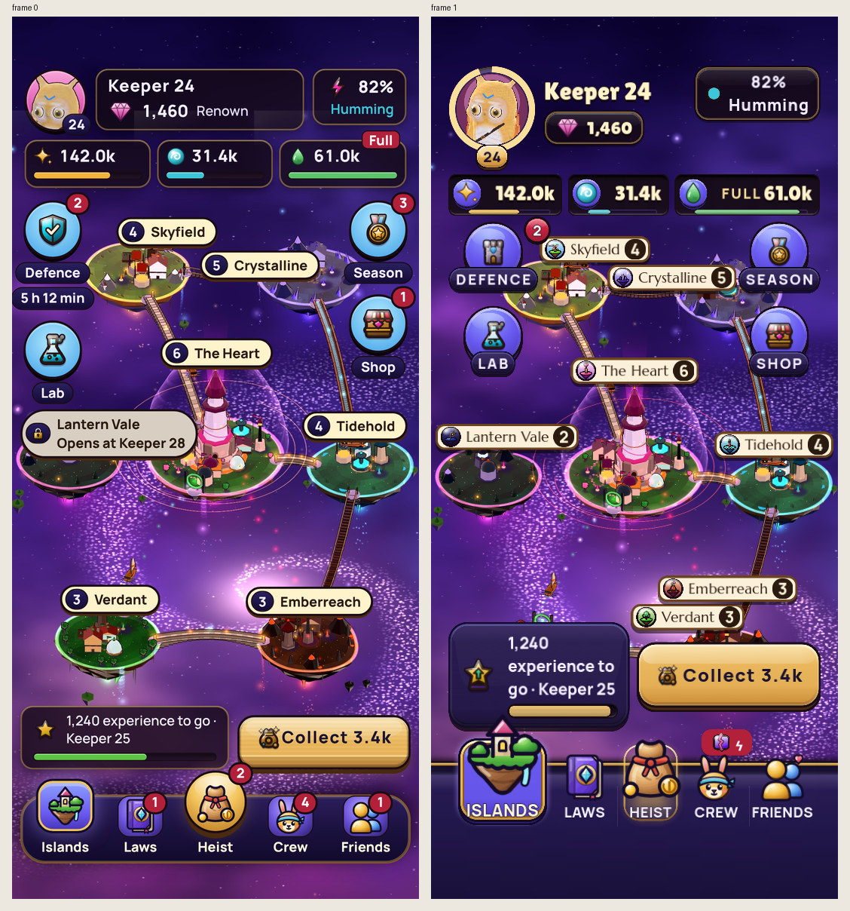

Grayscale squint: [`1-home-100-gray.png`](board-3/1-home-100-gray.png).
Colour-vision sheet: [`1-home-100-cvd.png`](board-3/1-home-100-cvd.png).

Gate: `P2-S2-home-2/3612e265`, the 100% shot.
- Character presence: pass (ppp).
- Hierarchy: pass (ppp).

The rest is from `P2-S2-home-1/977edd5b` at 100%, before home-2.
- Display type: fail (fff), on the flat cream counts.
- Character presence: fail (fff), on a small pale avatar.

| Quality | AD's check |
|---|---|
| 1 Materials | Stands. The purse, the counts, the goal panel and the side buttons sit on plates with an inked gold rim; Collect is a gold slab with a lip and a hard drop, as on the style board. |
| 2 Display type | Stands. "Keeper 24" and the counts (1,460, 142.0k, 31.4k, 61.0k) are the display face with an ink outline and a hard drop, which fixes home-1's fail. The strain figure "82%" is the display face too. |
| 3 Icons | Stands, with a note. The resource, side-button and dock icons are the toon set. The strain mark is a cyan dot, where the key frame has a pink bolt (note). |
| 6 Hierarchy | Stands. In grayscale Collect is the lightest large block and leads; the chosen Islands tile is second. The goal panel is heavier than in the key frame, which is part of objection B. |
| 8 Colour | Stands, with a note. Gold fill is on Collect and the chosen tab only, and red on the badges. On the protanopia and deuteranopia views the red Defence badge "2" and the Crew strain badge turn gray, but each also carries a number or a bolt, so nothing is carried by colour alone. |
| 9 Character | Stands. See item 7. |
| 13 Light | Stands. One top light on the plates and on the islands; the world is lit as a stage, as in the key frame. |
| 14 One idea, layout | **Objection B.** The world is framed too low: Verdant and Emberreach sit under the goal panel and Collect, their pins stack on top of each other just above the panels, and their islands are hidden. The key frame frames all seven realms between the purse and the bottom panels. The goal panel wraps to three lines and stands taller than Collect, where the key frame keeps it to one or two. |

### 2. Home at 200% text, English

Gate: none at 200% English for home-2. Home-1's 200% shot was pt_BR (item 3).

| Quality | AD's check |
|---|---|
| 1 Materials | Stands, as item 1. |
| 2 Display type | Stands. The counts and "Keeper 24" keep their outline at 200%. |
| 3 Icons | Stands. |
| 6 Hierarchy | **Objection C.** The caps side-button tags DEFENCE, SEASON, LAB and SHOP become the largest words on the screen after the title, larger than the counts, and compete with Collect for the eye. The key frame's side buttons at 200% are icons only (with the timer under Defence). Collect still leads. |
| 8 Colour | Stands. |
| 9 Character | Stands, as item 1. |
| 13 Light | Stands. |
| 14 One idea, content | **Objection C.** The goal panel, every realm pin and every dock label are gone, the chosen tab's label included. The key frame at 200% keeps the goal bar ("1,240 experience to go · Keeper 25" with its bar), numbered realm chips, and the chosen tab's label "Islands". (The purse taking three rows is acceptable; the key frame's takes three too.) |

### 3. Home at 200% text, Portuguese (Brazil)

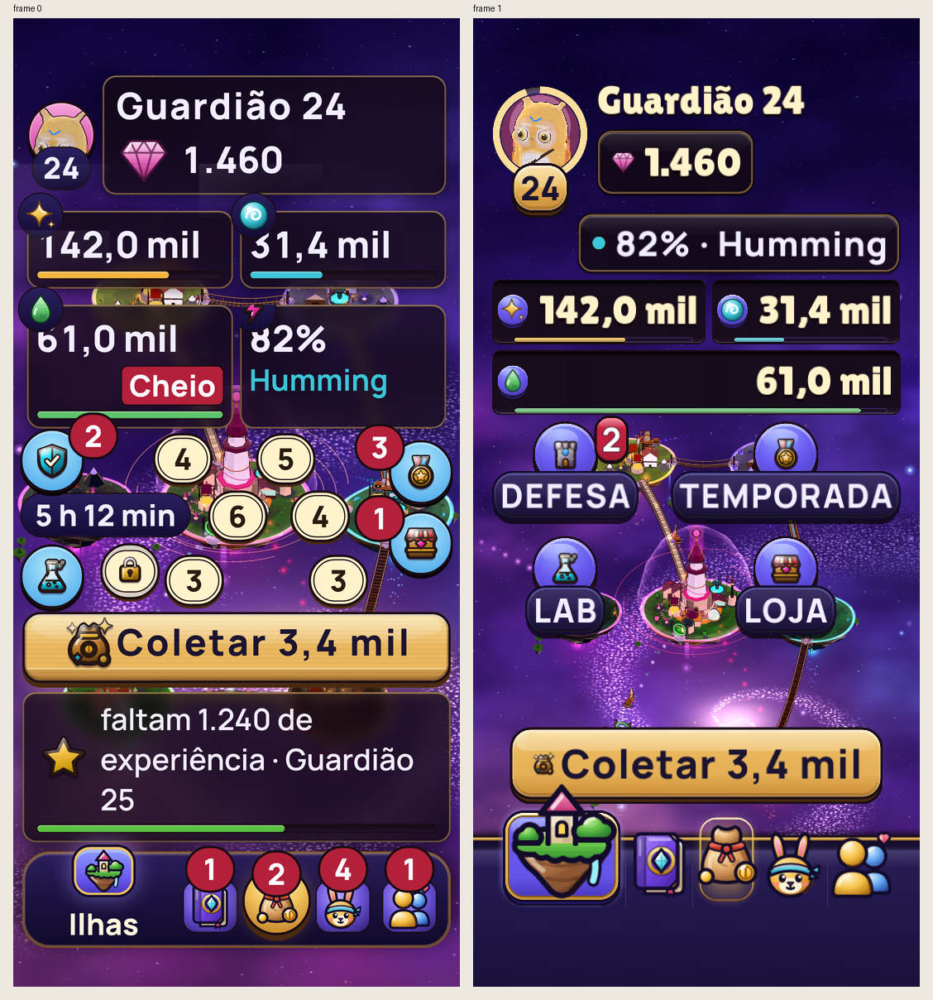

Gate: `P2-S2-home-1/977edd5b`, 200% pt_BR, before home-2.
- Display type: fail (fff), on the counts and "Guardião 24".
- Hierarchy: pass (ppp).

| Quality | AD's check |
|---|---|
| 2 Display type | Stands. "Guardião 24" and the counts now have the outline and the drop, which fixes home-1's fail. |
| 6 Hierarchy | **Objection C**, as item 2 (TEMPORADA, LOJA and DEFESA tags). |
| 14 One idea, content | **Objection C**, as item 2: no goal bar, no realm chips, no "Ilhas" label on the chosen tab. |
| 1, 3, 8, 9, 13 | As item 2. |

### 4. Home in high contrast, English and Portuguese

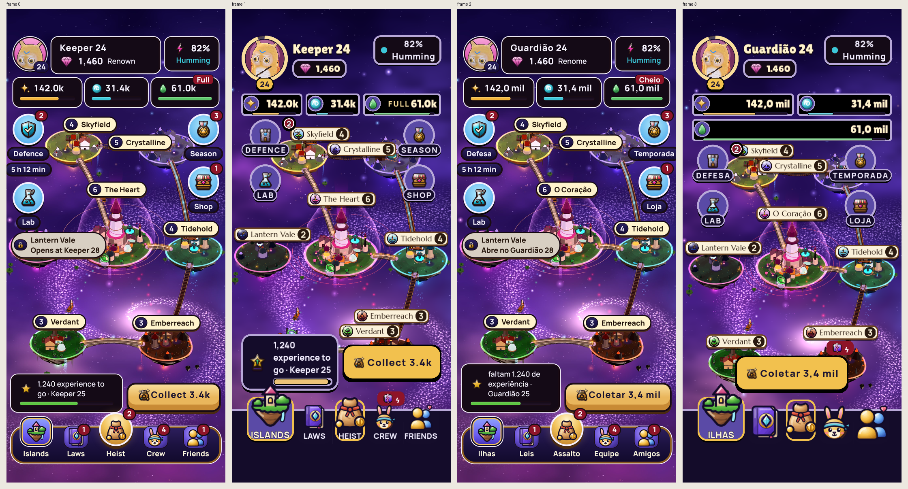

Gate: `P2-S2-home-1/977edd5b`, high contrast, before home-2.
- Colour roles and value: pass (ppp).
- Hierarchy: pass (ppp).

| Quality | AD's check |
|---|---|
| 1 Materials | Stands. Solid plum plates with purple inked rims, the high-contrast form on the style board. |
| 2 Display type | Stands. |
| 3 Icons | Stands. |
| 6 Hierarchy | Stands. Collect is solid gold with no shine (shine is off in high contrast) and leads. |
| 8 Colour | Stands. |
| 9 Character | Stands. The companion keeps its outline on the solid disc. |
| 13 Light | Stands. |
| 14 One idea, layout | **Objections B and C**, as items 1 and 5. The English frame shows item 1's framing (Verdant and Emberreach under the panels). The pt_BR frame shows item 5's: no goal panel, only "ILHAS" in the dock, and the Defence badge on the Skyfield pin. |

### 5. Home at 100% text, Portuguese (Brazil)

Gate: this shot was not judged.

| Quality | AD's check |
|---|---|
| 6 Hierarchy | Stands. Collect ("Coletar 3,4 mil") leads. |
| 14 One idea, content | **Objection C.** The goal panel is gone at 100% text, and the dock loses every label except "ILHAS". The key frame in pt_BR keeps the goal bar and all five labels. |
| 14 One idea, layout | **Objection B.** As item 1: Verdant and Emberreach under Collect. The Defence badge "2" collides with the Skyfield pin. |
| 1, 2, 3, 8, 9, 13 | As item 1. |

### 6. The raid notice, at 100% and at 200% pt_BR

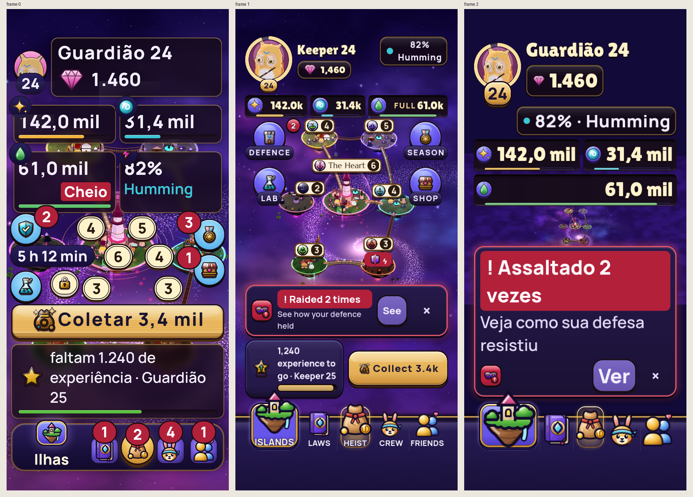

Reference: `01-home_text200_pt_BR.png` (the key frame has no notice state;
it is the bar for what the 200% pt_BR home must keep). The candidate is
`NOTICE=1`.

Gate: home-1's first build (`71d51d7f`) was judged with a raid banner; its
critiques were about the build before Collect existed.

| Quality | AD's check |
|---|---|
| 6 Hierarchy, layout | **Objection A, a hard defect.** At 200% in pt_BR with the notice, Collect is not on the screen. The notice fills the lower third: "! Assaltado 2 vezes" wraps to two lines on its red plate, "Veja como sua defesa resistiu" takes two more, and "Ver" and the ✕ sit on a third row. The world shrinks to a thumbnail and the side buttons go. The screen's main action must stay on screen in every state and at every text size. The ✕ is a bare glyph with no plate and a small target. |
| 14 One idea | Stands at 100%. The notice is a kit panel with a red tag and a purple "See" button, the goal panel and Collect stay below it, and the realms are framed well in this state, which shows that item 1's framing can be done. |
| 1, 2, 3, 8, 13 | Stand, as items 1 and 3. |

### 7. The companion (quality 9)

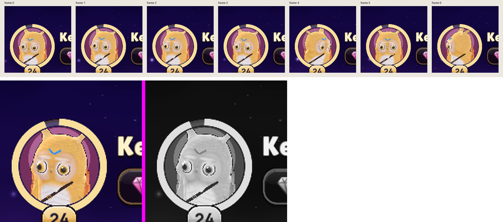

Reference: rubric quality 9's pass anchor (a live character node on home,
reading at 32 pt as a dark shape, framed or lit; toon, no physically based
material, no smudge) and the key frame's portrait band.

Gate: `P2-S2-home-2/3612e265`, Character presence: pass (ppp).

| Quality | AD's check |
|---|---|
| 9 Character | Stands. The featherkin is a live node: it breathes and turns over the seven frames. It is framed in a gold ring on a plum disc, fills about 63% of its stage, carries a dark outline and stepped toon shading, and its face reads at phone size. The soft fur is the toon look, as calibrated. Note: its idle turns the head to profile and nearly to the back (frames 4 and 6), so the face is lost for part of the cycle, and a blue stripe shows at the rim in frame 6. Prefer an idle that keeps the face toward the camera, or clamp the yaw. |
| 13 Light | Stands. One top light on the figure, and the rim of the disc catches it. |

### 8. The dock

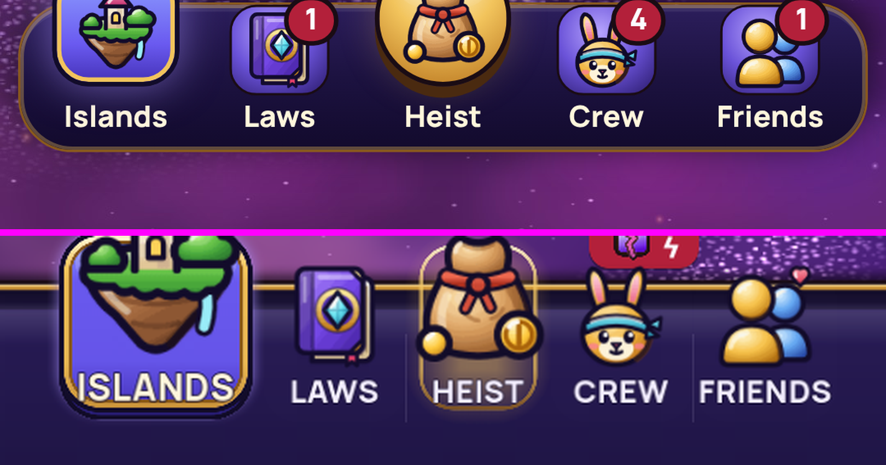

Gate: not judged on its own.

| Quality | AD's check |
|---|---|
| 1 Materials | Stands. The chosen tile is a raised plate with a gold rim; the others are icons on the dock, with hairline dividers. |
| 2 Display type, layout | **Objection D.** The labels "ISLANDS" (chosen) and "HEIST" sit across the bottom gold rim of their tiles, so the rim runs through the letters. The key frame sets each label below its tile. Note: the build's caps labels differ from the key frame's sentence case; that is the kit's tag style and is not an objection. |
| 3 Icons | Stands. The same toon icons as the key frame. |
| 6 Hierarchy | Stands. The chosen tile leads the dock; Heist is second, with a gold outline. |

### 9. The top bar

| Quality | AD's check |
|---|---|
| 2 Display type | Stands. "Keeper 24" in the build is the display face with an outline and a drop, where the key frame's header is a plain sans; the build is nearer the style board. |
| 3 Icons | Note. The strain mark is a cyan dot; the key frame has a pink bolt. The dot reads as a status light and is not wrong, but the bolt also names the stat. |
| 9 Character | Stands. The companion's ring carries the level as a gold progress arc and a "24" tag. |

## Objections

In order of weight. Home-2 is merged, so each objection goes to the lead as
a request in `docs/progress/status/AD.json` for a follow-up task, with a
proposed owner and a default.

| ID | Item | Quality | Objection | Proposed fix | Owner |
|---|---|---|---|---|---|
| A | 6 | 6 / §20.8 | At 200% text in pt_BR with the raid notice, Collect is off the screen, the world shrinks to a thumbnail and the side buttons go. The notice takes the lower third; its ✕ has no plate. | At 200%, collapse the notice to a one-line banner (tag, "Ver", ✕ on a kit plate) above the goal bar, and keep Collect on screen in every state. Add a scripted check to the home shot that Collect's rect is inside the viewport at 200% in both locales, with and without the notice. | S2 |
| B | 1, 4, 5 | 14 (and 6) | At 100% the world is framed too low: Verdant and Emberreach sit under the goal panel and Collect, and their pins stack. In pt_BR the Defence badge collides with the Skyfield pin. The goal panel wraps to three lines. | Fit the world camera to the space between the purse and the bottom panels, as the notice state already does, so that all seven realms and their pins are clear. Keep the goal panel to one or two lines (number first, as the key frame). Keep pins clear of the side buttons and their badges. | S2 |
| C | 2, 3, 5 | 14 and 6 | Content is dropped at larger text and in pt_BR: the goal panel (at 100% pt_BR and at 200%), the realm pins (at 200%) and the dock labels, the chosen tab's included. At 200% the caps side-button tags become the largest words after the title. | Keep the goal bar at every size: on one or two lines at 100% (number first), and wrapping at 200% as the key frame does. At 200%, show numbered realm chips in place of the pins, keep the chosen tab's label, and make the side buttons icon-only (with the Defence timer). Keep all five dock labels at 100% in pt_BR. | S2 |
| D | 8 | 2 | The labels "ISLANDS" (chosen) and "HEIST" sit across the bottom gold rim of their tiles. | Set the label below the tile's rim, or inside it with clear space, in `client/ui/kit_tabs.gd`. | K1 |

Notes carried to the next round, which do not hold the board:
- The companion's idle turns the face away for part of the cycle; keep the
  face toward the camera or clamp the yaw (S2, or AIA if the idle clip
  changes).
- The strain mark is a cyan dot where the key frame has a pink bolt (S2).
- The home shot's fixture has no notifications, shield or locked realm, so
  the dock badges, the Defence timer and Lantern Vale's lock cannot be
  checked. Add them to `keyframe()` (S2), and add the shield timer to the
  home if the design keeps it.
- Collect's shine (a 250 ms sweep every 2.4 s) did not fall in AD's frames
  0.4 s apart. Quality 7 is not owner-checked, and the kit's motion test
  covers it.

## When the board stands

The board stands when objections A–D are fixed and re-shot, and AD has
checked the new stills on this page. Under section 3.8 of the report, the
board merges when AD lets it stand, with no 24-hour wait.

## Preview of home-3 (S2-R25)

AD re-checked S2-R22's objections (a) to (e) on `claude/ui-screens-home` at
`823d2eac`, against this board's full list (M23). The full answer is S2-R25
in `docs/progress/status/AD.json`. (a), (c), (d) and (e) stand as fixed. One
objection, (f), holds P2-S2-home-3 until S2 fixes it: in German at 200%
every realm pin is a wide, empty cream plate, with the level number drawn
over the realm's icon.

At 200% text: English, German, high contrast.

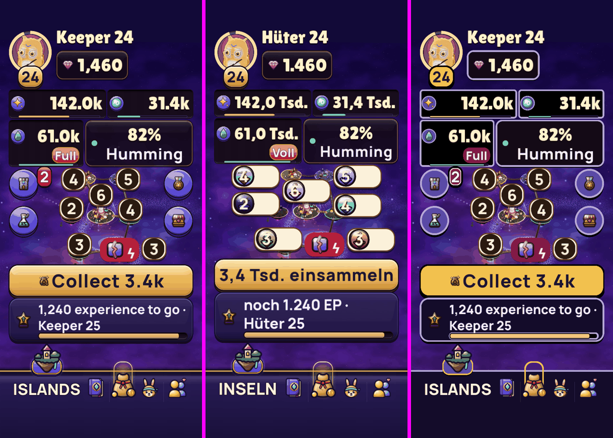

German at 200%, the pins.

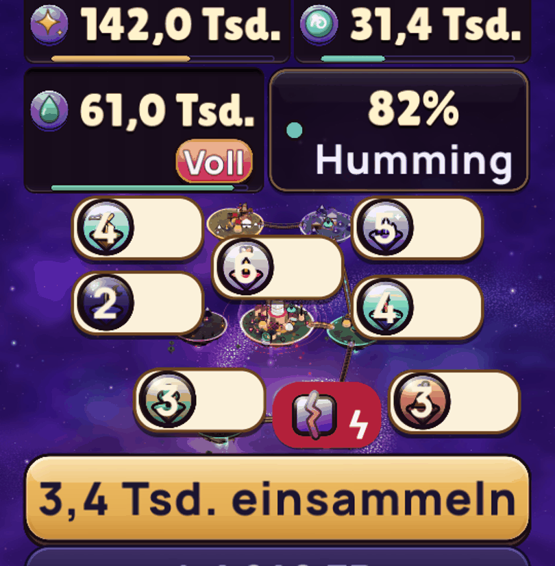

At 200% with the notice: en, de, pt_BR, fr, then en at 900 tall. AD
accepts this for home-3: in pt_BR, fr and en at 900 the realm chips give
way all together. It does not stand for board 3b, which re-checks these
cases once S2-R24 (KitTabs) gives back dock height.

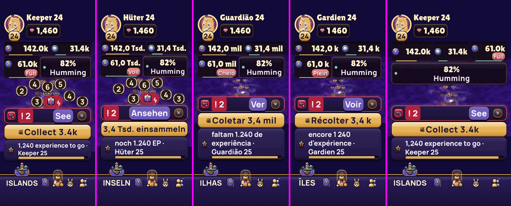

German and English at 100%, the purse in one row:
[`r2-home-100-purse.png`](board-3/r2-home-100-purse.png).

## Re-check of objection (f) (S2-R27)

AD re-checked objection (f) on `claude/ui-screens-home` at `8ff5ee23`, and
the screen at 200% against this board's full list (M23). The full answer
is S2-R27 in `docs/progress/status/AD.json`.

**(f) stands as fixed.** With `FIT=1 TEXT=200 LOCALE=de`, each realm pin
is the realm's icon and its level's disc on a plate of their size: no
empty half, no level over the icon (fit ok, 118 calls). English at 200%
keeps its seven numbered chips (fit ok, 119 calls).

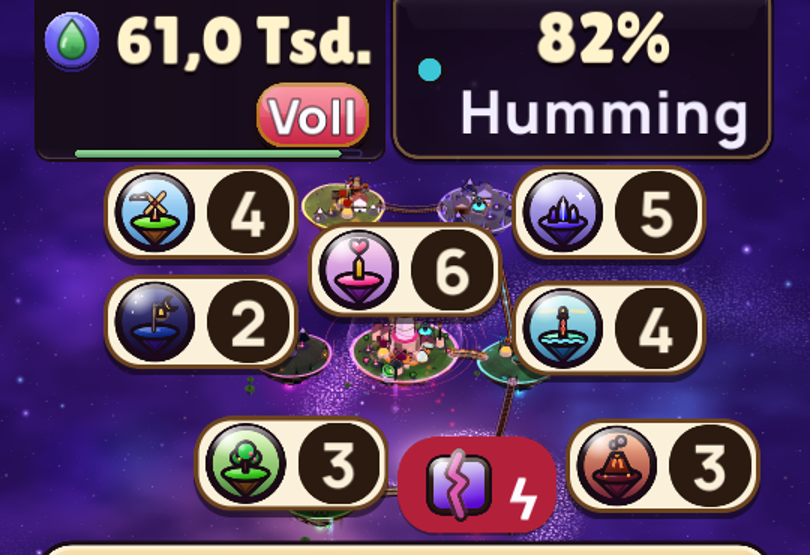

**One objection, (g), holds P2-S2-home-3.** It was already there at
`823d2eac`, and AD missed it then. At 200% text in pt_BR and German,
without the notice, the four side buttons are gone: Defence with its raid
badge and timer, Season, Lab and Shop. AD-R24 (in home-3's done_when) asks
for them as icon-only discs at 200%. Both 200% key frames keep them at the
edges, with the realm chips between them. English at 200% keeps them.

From left: key frame 200% pt_BR, then the build at 200% in pt_BR, German
and English.

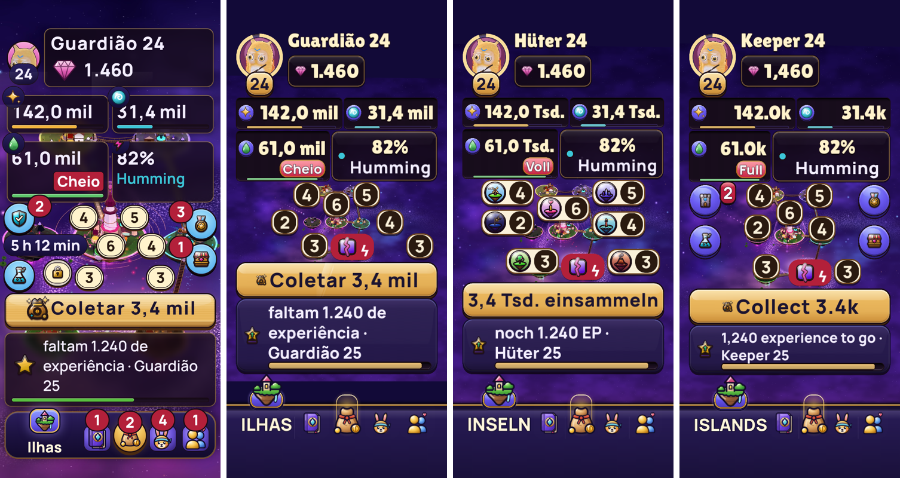

## Re-check of objection (g) (S2-R28)

AD re-checked only objection (g) on `claude/ui-screens-home` at `398a38cb`,
the commit S2's handoff names for (g). S2 then had its pre-check running
and had not yet filed the request. The answer holds for `398a38cb` and for
any later head of home-3 whose client files do not differ from it. Since
`8ff5ee23` the only client changes are in `home.gd` and `universe_pins.gd`
(M23). The full answer is S2-R28 in `docs/progress/status/AD.json`.

AD rendered with `FIT=1`, and every shot printed "fit ok": 200% in German,
German high contrast, English, English high contrast, pt_BR and French;
200% in German with the notice; 100% in English and German; and 100% in
pt_BR with the notice.

**(g) stands as fixed in German, as the trade allows elsewhere.**

- **German.** At 200% without the notice, German and German high contrast
  keep the four side buttons as icon-only discs in two edge columns:
  Defence with its raid badge, and Lab, on the left; Season and Shop on
  the right. The realms take seven numbered chips between the columns,
  which is what AD-R24 and both 200% key frames ask. German now matches
  English, which keeps the same layout, in high contrast too.
- **pt_BR, pt_PT and French.** These three still give the side buttons
  away at 200%, and each one stays on the badge's menu. Their goal keeps
  three lines, so the realms' band is about 100 px shorter than German's.
  S2 measured the nearest miss: 149 px free where a chip needs 152. AD
  accepts this as the trade the S2-R27 answer allowed for pt_BR. pt_PT
  and French have the same cause, so the same trade covers them. It lasts
  until P2-K1-tabs-2 (S2-R24) gives the tab its height back. Board 3b
  re-checks all three, together with the notice cases of (a).
- **With the notice up at 200%,** the side buttons give way in German too,
  as the S2-R27 answer accepted until P2-K1-tabs-2.

At 100% nothing has changed in shape. P2-S2-home-3 has no open AD
objection.

From left, at 200%: German, German high contrast, English, pt_BR, French,
then German with the notice.

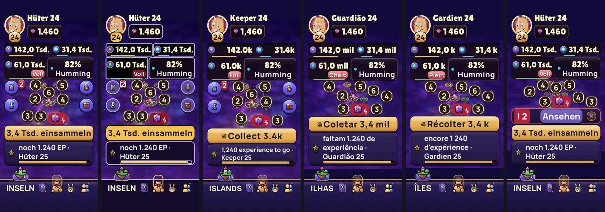

Carried to board 3b, which do not hold home-3:

- the three 200% locales without side buttons (above);
- the (a) notice cases;
- the darker band of the galaxy's plane at 200% in pt_BR (S2-R24).

## Round 2 (board 3b)

Posted by AD, P2-AD-board-3b, 16 November 2026, on the integration branch
at `ee31b0d9`, with P2-S2-home-3 (`d6f0bad3`), P2-K1-tabs and
P2-K1-tabs-2 (`000a7140`) merged. As M12 asks, only what the fixes changed
is re-checked: objections A to D, and the items carried from the S2-R28
re-check. Each is set beside key frame 01.

AD rendered with `FIT=1` at 100% in English, pt_BR, pt_PT, French, German,
high contrast and high-contrast pt_BR, and with the notice in English,
pt_BR and German. At 200% AD rendered English, pt_BR, pt_PT, French,
German, high contrast and high-contrast pt_BR, and with the notice in
English, pt_BR, pt_PT, French and German, plus English at 900 pt tall.
Every render printed "fit ok" except four notice cases at 200%: pt_BR,
pt_PT, French, and English at 900 tall. Each of those printed "fit FAIL no
realm marked over the whole universe".

**Round 2 decision: the board does not stand.** B and D are fixed. A's
hard defect is gone: Collect is on screen in every state. What is still
open is one cause in two places, so it is a single objection, H, below.
At 200%, home holds about 68 px over the tab bar for the chosen tab's
raised tile. The key frame does not hold this space. Without it, the
realms' band is too short in three places:

- the side buttons in pt_BR, pt_PT and French;
- the side buttons in every notice case;
- the realm chips in four of the notice cases.

### A to D

| ID | Round 1 | Round 2 |
|----|---------|---------|
| A | At 200% pt_BR with the notice, Collect is gone. | **Fixed in its core.** Collect is on screen in every state rendered. The notice is now a one-line banner: the raid icon, "!2", See/Ver/Voir/Ansehen and a ✕ on a plate. **Still open (H):** with the notice up at 200%, the four side buttons go in every locale. In pt_BR, pt_PT and French, and in English at 900 tall, the world is a thumbnail with no realm chip. FIT fails there. |
| B | At 100% the world is crowded: the Defence badge collides with Skyfield, and the goal runs into the realms. | **Fixed.** In English and pt_BR the world sits between the purse and the bottom panels. Verdant and Emberreach are clear of the goal and Collect. Defence's "2" is clear of the Skyfield pin (checked zoomed in). The goal is two lines beside Collect in English. In pt_BR it is one line under a full-width Collect. |
| C | Content is dropped: the goal bar, the chips at 200%, the side buttons, and the dock labels in pt_BR. | **Fixed at 100%** (all five pt_BR dock labels and the goal bar are kept). **Fixed at 200%** in English, German and high contrast: numbered chips, icon-only side buttons in two edge columns, and the chosen tab's name. **Still open (H):** at 200% in pt_BR, pt_PT and French, the side buttons are still given away. That trade (S2-R28) was to last until P2-K1-tabs-2, and tabs-2 has now merged. |
| D | The dock's labels run across the tiles' rims. | **Fixed.** The labels sit under the tiles at 100% and 200%. |

### Objection

| ID | Item | Quality | Objection | Proposed fix | Owner |
|----|------|---------|-----------|--------------|-------|
| H | Home at 200%: pt_BR, pt_PT and French, and every notice case | 8 content kept, 2 framing | The column holds about 68 px (49 pt) of empty space between the goal card and the tab bar's gold edge. In pt_BR at 200% without the notice, measured on the right half, the goal card ends at y 920 and the gold edge is at 991 (540×1170 render). It is there for the chosen tab's picture, which stands above the bar (`HomeParts.reserve_lift`). The 200% pt_BR key frame keeps the chosen tab inside its plate, and it uses that height for the side buttons. Because of this space, the realms' band misses the chips' 152 px by 3 px, so the side buttons go in pt_BR, pt_PT and French. With the notice banner up, the band also loses the side buttons in English and German, and loses every realm chip in pt_BR, pt_PT, French and short English. | At 200%, keep the chosen tab's picture inside the bar's height, as the key frame does (K1, in `kit_tabs.gd`'s rise for the larger text sizes). Then home drops or shrinks `reserve_lift` and gives the height to the realms' band (S2, in `home.gd` and `home_parts.gd`). The four side buttons and the realm chips must then show at 200% in pt_BR, pt_PT and French, with and without the notice. Add those cases to the fit check, so that "no realm marked" and a missing side button fail it. | K1, then S2 |

The dock's foot is not part of H. Under the labels, the bar runs about
108 px to the screen's edge. That is §21.1's 44-point safe area plus the
20-point `tab_bar_lift` (8% of the frame), as the tokens set it. AD does
not object to it.

From left: key frame 200% pt_BR, then the build at 200% in pt_BR, pt_PT
and French. The chips are back. The side buttons are not.

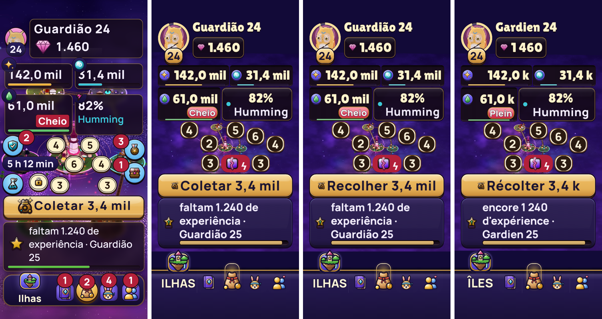

The 200% notice cases, from left: English, German, pt_BR, pt_PT, French,
and English at 900 tall. Collect and the banner hold. The side buttons go
in all six cases, and the chips go in the last four.

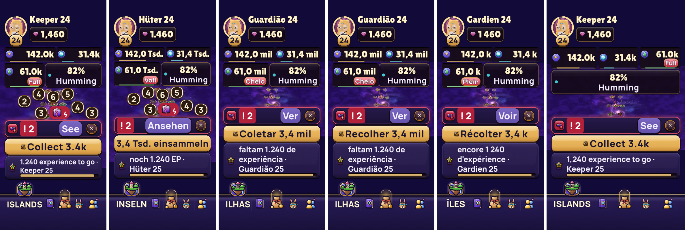

What is fixed, from left: key frame 100%, then the build at 100% in
English, pt_BR and high-contrast pt_BR (B, C at 100%, D).

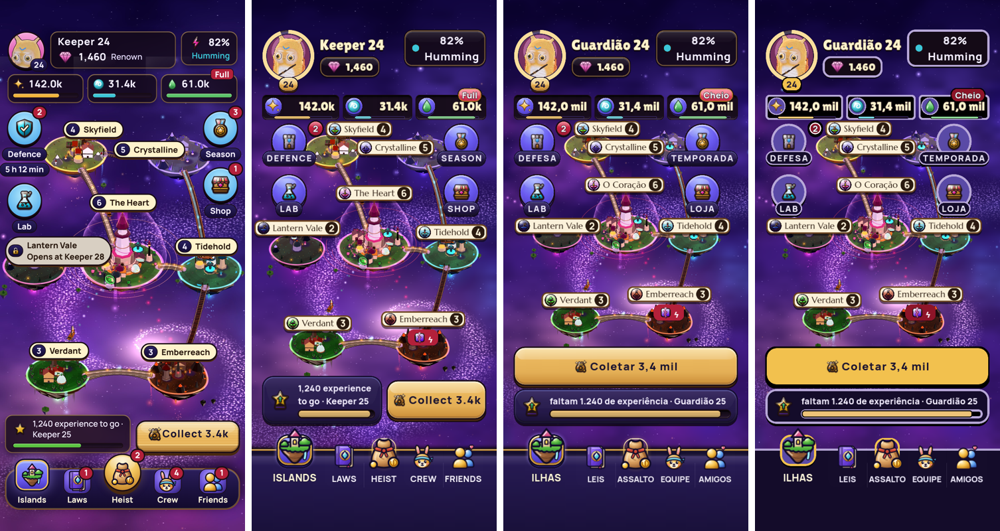

At 200% in English, German and high contrast, from left: key frame 200%,
then English, German and high contrast. These match the key frame's
layout.

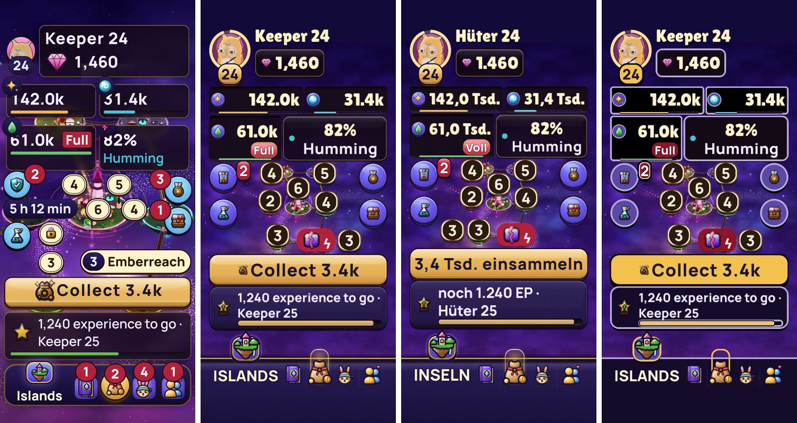

The dock, from left: the key frame at 100%, the build at 100% pt_BR, and
the build at 200% pt_BR with the notice.

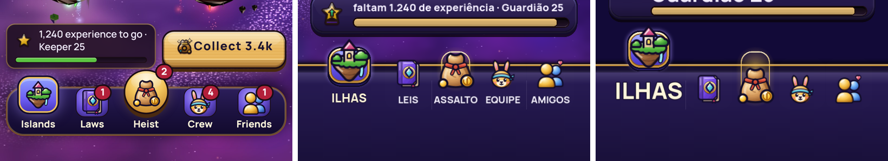

### Notes carried

- The fixture still has no notifications, no shield and no locked realm.
  So the dock's count badges, the Defence timer "5 h 12 min" and Lantern
  Vale's lock are still unchecked. Board 3c, or the first home shot with
  that data, checks them.
- The darker band of the galaxy plane at 200% in pt_BR (from S2-R28) is
  the same 68 px gap as H. It goes when H is fixed.
- The Heist tab is a raised capsule outline in the bar, where the key frame
  has a gold disc. This is light, and it is K1's to weigh with H.
- From round 1: the companion's yaw, the strain mark's cyan dot against
  the key frame's pink bolt, and Collect's shine.

### When the board stands

When P2-K1-tabs-3 and P2-S2-home-4 (AD-R38 and AD-R39, or the tasks the
lead opens in their place) are merged, AD re-checks only H, at 200% in
pt_BR, pt_PT, French, English and German, with and without the notice,
and in English at 900 tall. The board then stands if the side buttons and
the realm chips show in every case and FIT prints "fit ok" for each.

## Preview of home-4 (S2-R31)

AD previewed P2-S2-home-4 at 1697a6c6 on `claude/ui-screens-home` on
16 November 2026. This is the home half of H only. K1's half (tabs-3)
is not part of it. Each case was rendered with
`FIT=1 TEXT=200 LOCALE=<loc> [NOTICE=1] [TALL=900] bash tools/render/shoot.sh client/tests/shots/universe_home.gd`.

**All 12 cases print "fit ok":** pt_BR, pt_PT and French with and
without the notice, English and German with the notice, and English at
900 tall with and without the notice. In every case the four side
buttons show as whole discs. Defence and Lab sit in the left column,
and Season and Shop sit at the top right, beside the keeper plate. All
seven realms show as numbered chips, and none is cut by the frame or
covered by another part. That meets the condition in "When the board
stands" for home's half of H.

**The place trade is accepted.** At text sizes of 150% and more, Season
and Shop move from a column beside the realms' band to the top row. The
key frames draw them in the column, but at 200% with the notice up, a
column on both sides leaves the realms no room. The top right is a clear
place within reach of the thumb, and the discs keep their size and their
faces. At 100% and 125% the column stays as the key frames draw it. The
board takes this as the layout at large text, so it is not an objection.

From left: key frame at 200% pt_BR, then the build without the notice in
pt_BR, pt_PT and French.

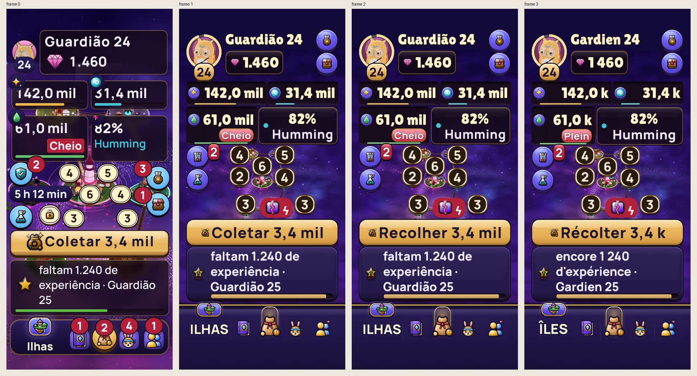

With the notice, from left: English, German, pt_BR, pt_PT, French, and
English at 900 tall.

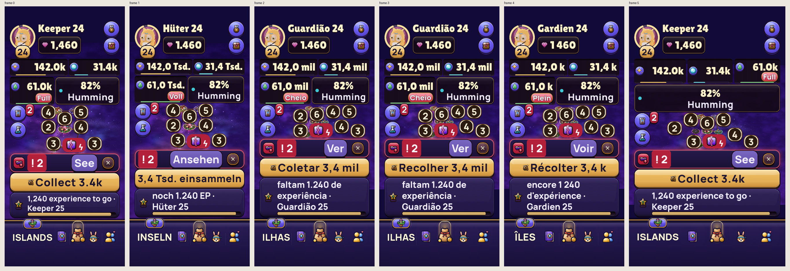

From left: key frame at 200%, then English, German, and English at 900
tall, all without the notice.

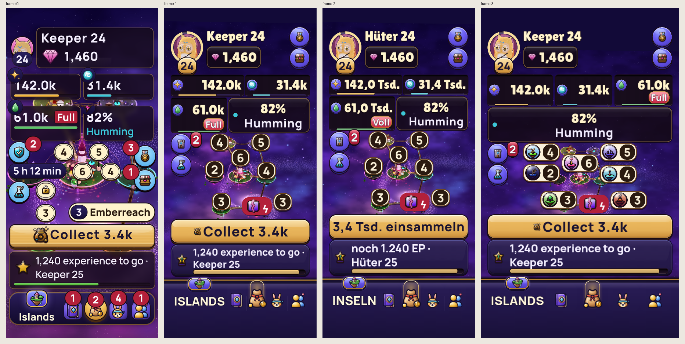

### Notes, not holding

- With the notice up, the seven chips pack tightly over the world art in
  two rows, and the strain mark sits between them. They do not overlap,
  but the islands show only at the chips' edges. This is light. A later
  pass can weigh dropping the island pictures from the chips at 200%.
- At 200%, the chosen tab's picture (Islands) straddles the bar's gold
  edge. That is K1's half (AD-R38, P2-K1-tabs-3), and board 3c checks it.
- In German at 200% with the notice up, the notice drops its red disc,
  and in English at 900 tall strain moves to its own row. Both read
  cleanly.
- S2 lists these as still open, and the board does not hold on them: the
  goal keeps three lines at 200% in pt_BR, pt_PT and French, and the
  home/200 draw calls go from 119 to 121 (S2-R30 to the lead).
- The notes carried above still stand: the dock's badges, the shield
  timer and the locked realm are unchecked, the Heist tab, the
  companion's yaw, the strain mark's dot, and Collect's shine.

So S2's default holds. S2 sends the gate request at the pre-checked
commit. Board 3c re-checks H once P2-K1-tabs-3 and P2-S2-home-4 are both
merged.

## Round 3 (board 3c)

Posted by AD, P2-AD-board-3c, 16 November 2026, on the integration branch
at `837835c3`, with P2-K1-tabs-3 (`1053266f`) and P2-S2-home-4
(`5803122d`) merged. The head at posting, `2e93d4a3`, changes nothing
under `client/`. As M12 asks, only H is re-checked, in the cases that
"When the board stands" names, each beside key frame 01 at 200% text.

AD rendered home at 200% with `FIT=1` in pt_BR, pt_PT, French, English
and German, with and without the notice, and in English at 900 tall with
and without the notice. AD added high-contrast pt_BR at 200% and English
at 100% as a check that nothing else moved. **All 14 renders print "fit
ok".**

**Round 3 decision: board 3 stands.** H is fixed. The space that home
held over the tab bar (`HomeParts.reserve_lift`) is gone: the goal card
now ends just above the bar's gold edge. In every 200% case the four side
buttons show as whole discs: Defence and Lab in the left column, Season
and Shop at the top right (the place trade accepted in the preview of
home-4). All seven realms show as numbered chips, none cut by the frame
or covered. That meets the condition in "When the board stands". With
A to D fixed in round 2, no objection is open on board 3.

| ID | Round 2 | Round 3 |
|----|---------|---------|
| H | At 200% home holds about 68 px over the tab bar, so the side buttons go in pt_BR, pt_PT, French and every notice case, and the chips go in four notice cases. | **Fixed.** The side buttons and the realm chips show in all twelve cases named, and FIT prints "fit ok" for each. The chosen tab no longer rises at large text (`kit_tabs.gd`, `lifts()`), and home gives the height to the realms' band. |

From left: key frame at 200% pt_BR, then the build without the notice in
pt_BR, pt_PT and French.

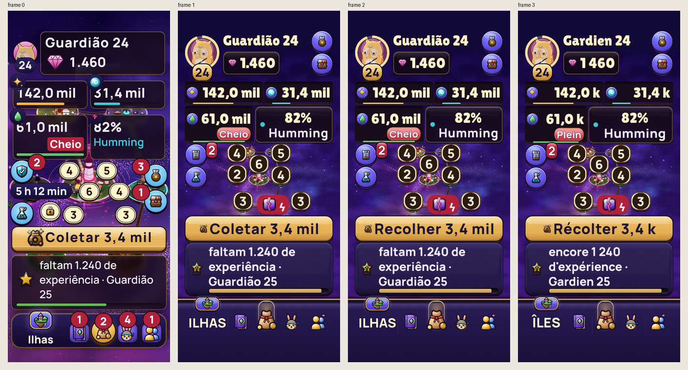

With the notice, from left: English, German, pt_BR, pt_PT, French, and
English at 900 tall.

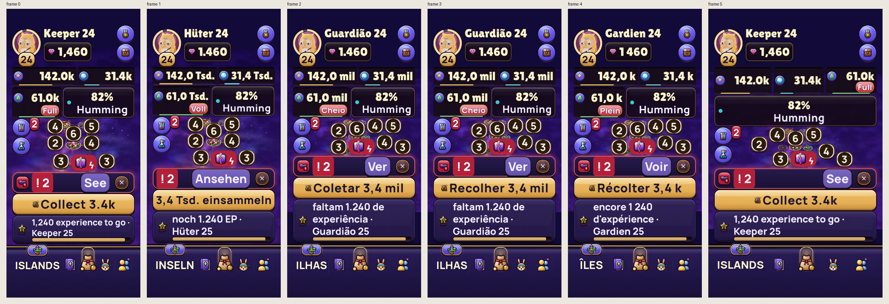

From left: key frame at 200%, then English, German, English at 900 tall,
and high-contrast pt_BR, all without the notice.

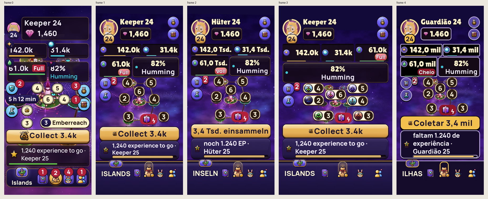

### Notes, not holding

- The chosen tab's tile (Islands) still stands a little proud of the
  bar's gold edge in home: its rim's top is about 7 px (5 pt) above the
  edge in every 200% case, and the rest of the tile sits inside the bar.
  It clears the goal card in every case, high contrast included. The
  cause is home's raised Heist tab: the bar's inset is set from the
  tallest tab, so the gold edge sits lower than the chosen tile's top.
  In the key frame the tile sits wholly inside the plate. This is light
  and does not cost any content, so it is K1's to weigh with the Heist
  capsule note at the next kit pass. It is not a new objection (M23).
- Home-4's advisory verdict at `1697a6c6`: hierarchy passes 3 of 3, and
  display type passes on a split (3 of 6 fail). The judges read the
  currency counts as flat cream and ask for a clearer hard drop. That is
  advice only (display type is owner-checked), and AD reads the counts
  as finished at phone size. A later pass can weigh it.
- The notes carried from round 2 and the preview still stand: the
  fixture has no notifications, no shield and no locked realm, so the
  dock's badges, the Defence timer and Lantern Vale's lock are unchecked;
  the Heist capsule against the key frame's gold disc; the companion's
  yaw; the strain mark's cyan dot; Collect's shine; and the tight chips
  over the world art with the notice up at 200%.
