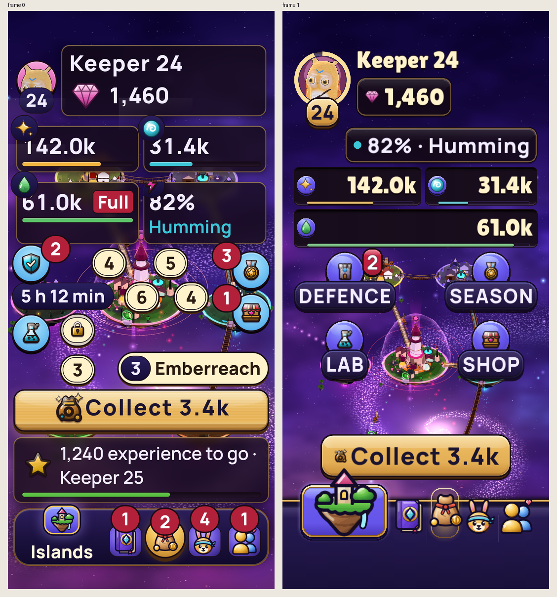
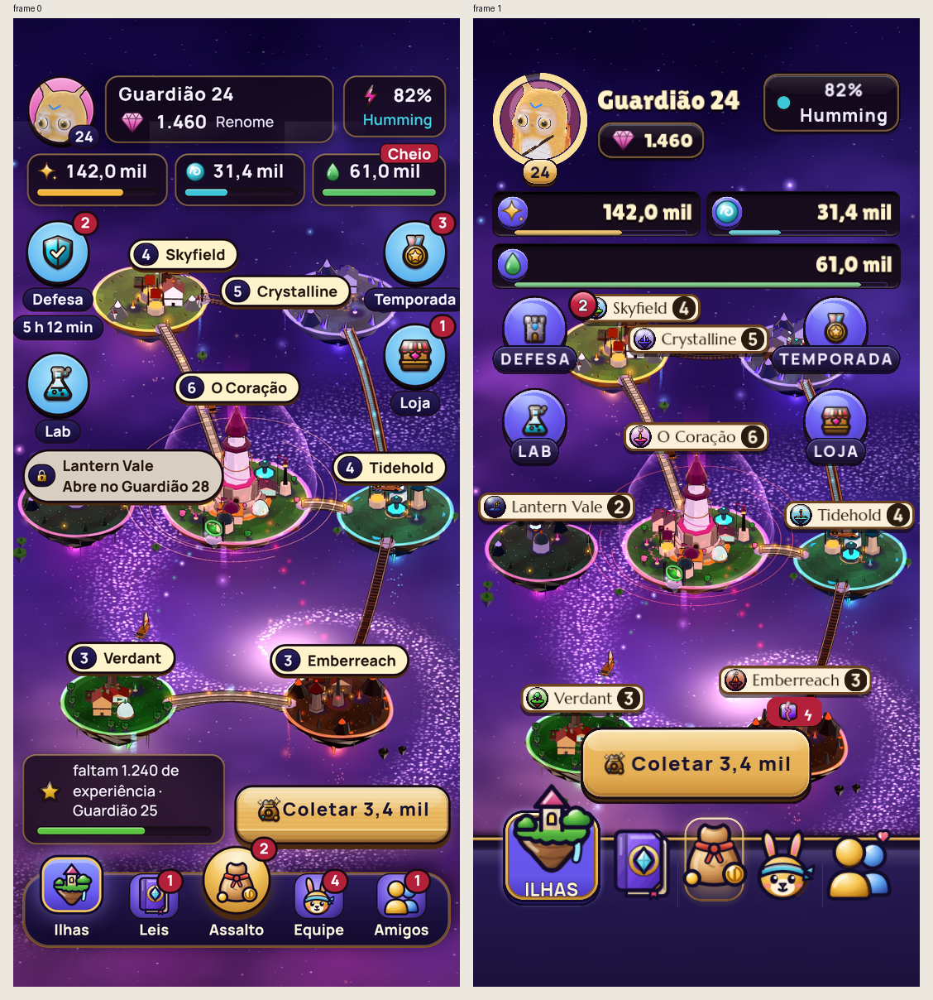
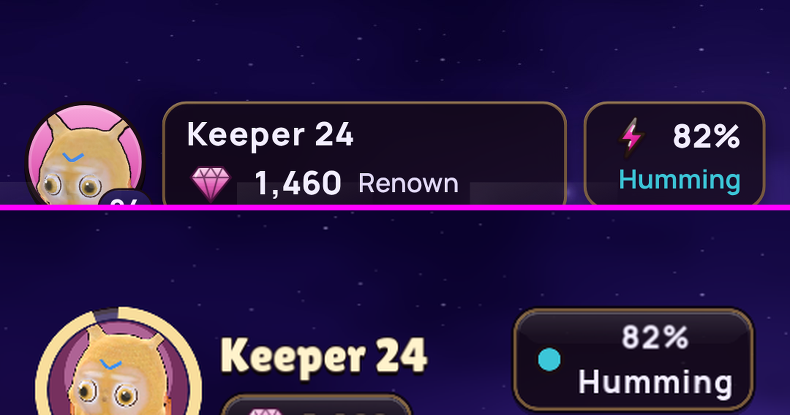

# Board 3: home

Posted by AD, P2-AD-board-3, 13 November 2026, on the integration branch at
`abbe59eb` (P2-S2-home-2 merged as `807d68a7`; the head at posting,
`29eb9c1a`, changes nothing under `client/`). This is the home family board
(section 3.4 of `../../report.md`). It holds nine items, each shown beside
its golden reference at phone size, with the gate's verdicts. AD checks every
owner-checked quality (`../calibration.md`: 1, 2, 3, 6, 8, 9, 13 and 14).

**Round 1 decision: the board does not stand.** Four objections are open
(listed in "Objections" below, in order of weight, M12). A is a hard defect:
at 200% text in pt_BR with a raid notice, Collect is gone. B and C are about
how the home lays out the world and what it drops at larger text and in
Portuguese. D is a small kit fault in the dock. What home-1 and home-2 were
asked to fix holds: the counts and "Keeper 24" now have the display finish,
and the keeper's companion is a live, framed toon character. Home-2 is
already merged, so each objection goes to the lead as a request for a
follow-up task in `docs/progress/status/AD.json`, each with a default. The
same findings answer S2-R18 (the preview of home part 2).

## How to read it

- **Golden reference.** The home key frames that AD approved in place of
  the owner (`../approvals/O2.md`), at `art/ui/keyframes/01-home*.png`. The
  rubric's pass and fail anchors (`../rubric.md`) are the bar for each
  quality.
- **Candidate.** AD rendered the home on the integration branch with
  `tools/render/shoot.sh client/tests/shots/universe_home.gd` and `FIT=1`,
  with `TEXT`, `LOCALE`, `CONTRAST` and `NOTICE`. Every render printed
  "fit ok", including both 200% pt_BR renders. `FIT=1` checks that no label
  leaves its box; it does not check that a control is still on screen,
  which is how objection A passed it.
- **Data.** The shot's fixture (`universe_home.gd`, `keyframe()`) sets
  keeper 24, strain 82% and the producers, but no notifications, no shield
  and no locked realm. So the dock's count badges, the Defence timer
  "5 h 12 min" and Lantern Vale's "Opens at Keeper 28" are missing from the
  candidate for want of data. They are notes, not objections.
- **Images.** All are made with `tools/ui_gate/sheet.py` and are in
  [`board-3/`](board-3/). A strip puts the reference on the left (frame 0)
  and the candidate on the right, at the same height. The crops (items 7–9)
  put the reference above and the candidate below, at 3×.
- **Verdicts** come from `../verdicts/<task>/<sha>.json`. Each result is
  written as pass or fail, with the votes in order. All of them are advice
  only, because every judged quality is owner-checked (`../calibration.md`).
  Home-1's verdicts at `977edd5b` are on the build before home-2's rework;
  home-2 was judged at `3612e265` on the 100% shot only.
- **AD's check** is written as stands, note or **objection**. A note is
  recorded for the next round and blocks nothing. An objection holds the
  board.

## The items

### 1. Home at 100% text

Grayscale squint: [`1-home-100-gray.png`](board-3/1-home-100-gray.png).
Colour-vision sheet: [`1-home-100-cvd.png`](board-3/1-home-100-cvd.png).

Gate: `P2-S2-home-2/3612e265`, the 100% shot.
- Character presence: pass (ppp).
- Hierarchy: pass (ppp).

The rest is from `P2-S2-home-1/977edd5b` at 100%, before home-2.
- Display type: fail (fff), on the flat cream counts.
- Character presence: fail (fff), on a small pale avatar.

| Quality | AD's check |
|---|---|
| 1 Materials | Stands. The purse, the counts, the goal panel and the side buttons sit on plates with an inked gold rim; Collect is a gold slab with a lip and a hard drop, as on the style board. |
| 2 Display type | Stands. "Keeper 24" and the counts (1,460, 142.0k, 31.4k, 61.0k) are the display face with an ink outline and a hard drop, which fixes home-1's fail. The strain figure "82%" is the display face too. |
| 3 Icons | Stands, with a note. The resource, side-button and dock icons are the toon set. The strain mark is a cyan dot, where the key frame has a pink bolt (note). |
| 6 Hierarchy | Stands. In grayscale Collect is the lightest large block and leads; the chosen Islands tile is second. The goal panel is heavier than in the key frame, which is part of objection B. |
| 8 Colour | Stands, with a note. Gold fill is on Collect and the chosen tab only, and red on the badges. On the protanopia and deuteranopia views the red Defence badge "2" and the Crew strain badge turn gray, but each also carries a number or a bolt, so nothing is carried by colour alone. |
| 9 Character | Stands. See item 7. |
| 13 Light | Stands. One top light on the plates and on the islands; the world is lit as a stage, as in the key frame. |
| 14 One idea, layout | **Objection B.** The world is framed too low: Verdant and Emberreach sit under the goal panel and Collect, their pins stack on top of each other just above the panels, and their islands are hidden. The key frame frames all seven realms between the purse and the bottom panels. The goal panel wraps to three lines and stands taller than Collect, where the key frame keeps it to one or two. |

### 2. Home at 200% text, English

Gate: none at 200% English for home-2. Home-1's 200% shot was pt_BR (item 3).

| Quality | AD's check |
|---|---|
| 1 Materials | Stands, as item 1. |
| 2 Display type | Stands. The counts and "Keeper 24" keep their outline at 200%. |
| 3 Icons | Stands. |
| 6 Hierarchy | **Objection C.** The caps side-button tags DEFENCE, SEASON, LAB and SHOP become the largest words on the screen after the title, larger than the counts, and compete with Collect for the eye. The key frame's side buttons at 200% are icons only (with the timer under Defence). Collect still leads. |
| 8 Colour | Stands. |
| 9 Character | Stands, as item 1. |
| 13 Light | Stands. |
| 14 One idea, content | **Objection C.** The goal panel, every realm pin and every dock label are gone, the chosen tab's label included. The key frame at 200% keeps the goal bar ("1,240 experience to go · Keeper 25" with its bar), numbered realm chips, and the chosen tab's label "Islands". (The purse taking three rows is acceptable; the key frame's takes three too.) |

### 3. Home at 200% text, Portuguese (Brazil)

Gate: `P2-S2-home-1/977edd5b`, 200% pt_BR, before home-2.
- Display type: fail (fff), on the counts and "Guardião 24".
- Hierarchy: pass (ppp).

| Quality | AD's check |
|---|---|
| 2 Display type | Stands. "Guardião 24" and the counts now have the outline and the drop, which fixes home-1's fail. |
| 6 Hierarchy | **Objection C**, as item 2 (TEMPORADA, LOJA and DEFESA tags). |
| 14 One idea, content | **Objection C**, as item 2: no goal bar, no realm chips, no "Ilhas" label on the chosen tab. |
| 1, 3, 8, 9, 13 | As item 2. |

### 4. Home in high contrast, English and Portuguese

Gate: `P2-S2-home-1/977edd5b`, high contrast, before home-2.
- Colour roles and value: pass (ppp).
- Hierarchy: pass (ppp).

| Quality | AD's check |
|---|---|
| 1 Materials | Stands. Solid plum plates with purple inked rims, the high-contrast form on the style board. |
| 2 Display type | Stands. |
| 3 Icons | Stands. |
| 6 Hierarchy | Stands. Collect is solid gold with no shine (shine is off in high contrast) and leads. |
| 8 Colour | Stands. |
| 9 Character | Stands. The companion keeps its outline on the solid disc. |
| 13 Light | Stands. |
| 14 One idea, layout | **Objections B and C**, as items 1 and 5. The English frame shows item 1's framing (Verdant and Emberreach under the panels). The pt_BR frame shows item 5's: no goal panel, only "ILHAS" in the dock, and the Defence badge on the Skyfield pin. |

### 5. Home at 100% text, Portuguese (Brazil)

Gate: this shot was not judged.

| Quality | AD's check |
|---|---|
| 6 Hierarchy | Stands. Collect ("Coletar 3,4 mil") leads. |
| 14 One idea, content | **Objection C.** The goal panel is gone at 100% text, and the dock loses every label except "ILHAS". The key frame in pt_BR keeps the goal bar and all five labels. |
| 14 One idea, layout | **Objection B.** As item 1: Verdant and Emberreach under Collect. The Defence badge "2" collides with the Skyfield pin. |
| 1, 2, 3, 8, 9, 13 | As item 1. |

### 6. The raid notice, at 100% and at 200% pt_BR

Reference: `01-home_text200_pt_BR.png` (the key frame has no notice state;
it is the bar for what the 200% pt_BR home must keep). The candidate is
`NOTICE=1`.

Gate: home-1's first build (`71d51d7f`) was judged with a raid banner; its
critiques were about the build before Collect existed.

| Quality | AD's check |
|---|---|
| 6 Hierarchy, layout | **Objection A, a hard defect.** At 200% in pt_BR with the notice, Collect is not on the screen. The notice fills the lower third: "! Assaltado 2 vezes" wraps to two lines on its red plate, "Veja como sua defesa resistiu" takes two more, and "Ver" and the ✕ sit on a third row. The world shrinks to a thumbnail and the side buttons go. The screen's main action must stay on screen in every state and at every text size. The ✕ is a bare glyph with no plate and a small target. |
| 14 One idea | Stands at 100%. The notice is a kit panel with a red tag and a purple "See" button, the goal panel and Collect stay below it, and the realms are framed well in this state, which shows that item 1's framing can be done. |
| 1, 2, 3, 8, 13 | Stand, as items 1 and 3. |

### 7. The companion (quality 9)

Reference: rubric quality 9's pass anchor (a live character node on home,
reading at 32 pt as a dark shape, framed or lit; toon, no physically based
material, no smudge) and the key frame's portrait band.

Gate: `P2-S2-home-2/3612e265`, Character presence: pass (ppp).

| Quality | AD's check |
|---|---|
| 9 Character | Stands. The featherkin is a live node: it breathes and turns over the seven frames. It is framed in a gold ring on a plum disc, fills about 63% of its stage, carries a dark outline and stepped toon shading, and its face reads at phone size. The soft fur is the toon look, as calibrated. Note: its idle turns the head to profile and nearly to the back (frames 4 and 6), so the face is lost for part of the cycle, and a blue stripe shows at the rim in frame 6. Prefer an idle that keeps the face toward the camera, or clamp the yaw. |
| 13 Light | Stands. One top light on the figure, and the rim of the disc catches it. |

### 8. The dock

Gate: not judged on its own.

| Quality | AD's check |
|---|---|
| 1 Materials | Stands. The chosen tile is a raised plate with a gold rim; the others are icons on the dock, with hairline dividers. |
| 2 Display type, layout | **Objection D.** The labels "ISLANDS" (chosen) and "HEIST" sit across the bottom gold rim of their tiles, so the rim runs through the letters. The key frame sets each label below its tile. Note: the build's caps labels differ from the key frame's sentence case; that is the kit's tag style and is not an objection. |
| 3 Icons | Stands. The same toon icons as the key frame. |
| 6 Hierarchy | Stands. The chosen tile leads the dock; Heist is second, with a gold outline. |

### 9. The top bar

| Quality | AD's check |
|---|---|
| 2 Display type | Stands. "Keeper 24" in the build is the display face with an outline and a drop, where the key frame's header is a plain sans; the build is nearer the style board. |
| 3 Icons | Note. The strain mark is a cyan dot; the key frame has a pink bolt. The dot reads as a status light and is not wrong, but the bolt also names the stat. |
| 9 Character | Stands. The companion's ring carries the level as a gold progress arc and a "24" tag. |

## Objections

In order of weight. Home-2 is merged, so each objection goes to the lead as
a request in `docs/progress/status/AD.json` for a follow-up task, with a
proposed owner and a default.

| ID | Item | Quality | Objection | Proposed fix | Owner |
|---|---|---|---|---|---|
| A | 6 | 6 / §20.8 | At 200% text in pt_BR with the raid notice, Collect is off the screen, the world shrinks to a thumbnail and the side buttons go. The notice takes the lower third; its ✕ has no plate. | At 200%, collapse the notice to a one-line banner (tag, "Ver", ✕ on a kit plate) above the goal bar, and keep Collect on screen in every state. Add a scripted check to the home shot that Collect's rect is inside the viewport at 200% in both locales, with and without the notice. | S2 |
| B | 1, 4, 5 | 14 (and 6) | At 100% the world is framed too low: Verdant and Emberreach sit under the goal panel and Collect, and their pins stack. In pt_BR the Defence badge collides with the Skyfield pin. The goal panel wraps to three lines. | Fit the world camera to the space between the purse and the bottom panels, as the notice state already does, so that all seven realms and their pins are clear. Keep the goal panel to one or two lines (number first, as the key frame). Keep pins clear of the side buttons and their badges. | S2 |
| C | 2, 3, 5 | 14 and 6 | Content is dropped at larger text and in pt_BR: the goal panel (at 100% pt_BR and at 200%), the realm pins (at 200%) and the dock labels, the chosen tab's included. At 200% the caps side-button tags become the largest words after the title. | Keep the goal bar at every size: on one or two lines at 100% (number first), and wrapping at 200% as the key frame does. At 200%, show numbered realm chips in place of the pins, keep the chosen tab's label, and make the side buttons icon-only (with the Defence timer). Keep all five dock labels at 100% in pt_BR. | S2 |
| D | 8 | 2 | The labels "ISLANDS" (chosen) and "HEIST" sit across the bottom gold rim of their tiles. | Set the label below the tile's rim, or inside it with clear space, in `client/ui/kit_tabs.gd`. | K1 |

Notes carried to the next round, which do not hold the board:
- The companion's idle turns the face away for part of the cycle; keep the
  face toward the camera or clamp the yaw (S2, or AIA if the idle clip
  changes).
- The strain mark is a cyan dot where the key frame has a pink bolt (S2).
- The home shot's fixture has no notifications, shield or locked realm, so
  the dock badges, the Defence timer and Lantern Vale's lock cannot be
  checked. Add them to `keyframe()` (S2), and add the shield timer to the
  home if the design keeps it.
- Collect's shine (a 250 ms sweep every 2.4 s) did not fall in AD's frames
  0.4 s apart. Quality 7 is not owner-checked, and the kit's motion test
  covers it.

## When the board stands

The board stands when objections A–D are fixed and re-shot, and AD has
checked the new stills on this page. Under section 3.8 of the report, the
board merges when AD lets it stand, with no 24-hour wait.
