# Board 4: result and motion

Posted by AD, P2-AD-board-4, 13 November 2026, on the integration branch at
`3374eae1` (P2-S1-result-2 merged as `135a49b2`, P2-AIA-motion-2 merged as
`0bc0fbb9`). This is the result and motion board (section 3.4 of
`../../report.md`). It holds ten items: five result stills beside their
golden references at phone size, the reward card at 3×, the reward
sequence's full and reduced frame strips with their clips, and AIA's motion
strips and clips for the reward tiers, the press, the shine and the screen
change. AD checks the owner-checked qualities 1, 2, 3, 6, 8, 9, 13 and 14
on the stills, and qualities 4, 5 and 7 on the strips and clips. Under the
report's table, motion is scripted (timings, reduced forms, flashes, shake)
and judged by no one but this board.

**Round 1 decision: the board does not stand.** Five objections are open
(listed in "Objections" below, in order of weight, M12). A is the lead
reward's type: "+2,310" is the weakest word on the result screen where the
key frame makes it the strongest. B is AD-R26: at 200% in German, Essenz and
Ruhm are below the fold. C and D are about the reward sequence: every step
is there, but the gather and the burst are too quiet to read, and the coins
land on the digits they are meant to roll. E is a hierarchy slip at 200% in
English. The rest holds: the layout, the portraits, the law chips, the
moment card, high contrast, the reduced reward form, the press and the
shine. Result-2 and motion-2 are merged, so each objection goes to the lead
as a request for a follow-up task in `docs/progress/status/AD.json`, each
with a default.

**Round 2 decision (board 4b, 16 November 2026): the board stands.**
Objections A to E are met on the integration branch at `6b30142b`
(P2-S1-result-3 merged as `19cfe498`, P2-AIA-motion-3 merged as
`746c0651`), re-shot and checked in "Round 2" at the foot of this page.
Nothing new holds the board; six notes carry to later work.

## How to read it

- **Golden reference.** The result key frames that AD approved in place of
  the owner (`../approvals/O2.md`), at `art/ui/keyframes/03-result*.png`,
  and the rubric's pass and fail anchors (`../rubric.md`). For motion, the
  rubric's quality 4, 5 and 7 anchors and the curves in
  `art/ui/motion/curves.json` are the bar; a still key frame cannot show
  motion.
- **Candidate.** AD rendered the result on the integration branch with
  `tools/render/shoot.sh` on the result shot and `FIT=1`, with `TEXT`,
  `LOCALE` and `CONTRAST`. Every render printed "fit ok". The draw calls
  with `SERVER=1` were 120 (en 100%), 108 (en 200%), 109 (pt_BR 200%) and
  97 (de 200%), under the budget.
- **Frame strips.** Items 7 and 8 are AD's own renders of the reward
  sequence with `STRIP=1` (full: 80 frames over 1.93 s; reduced motion: 32
  frames over 0.37 s), cut down with the commands in
  `docs/art/tracks/result-screen.md` and laid out with `sheet.py strip`.
  Each has a short clip beside it. Items 9 and 10 link AIA's strips and
  clips in `art/ui/motion/` as built by `strips.sh`; they are not copied.
- **Images.** AD's images are in [`board-4/`](board-4/). A still strip puts
  the reference on the left and the candidate on the right, at the same
  height. The crops of item 6 put the reference above the candidate.
- **Verdicts** come from `../verdicts/<task>/<sha>.json`, written as pass or
  fail with the votes in order. All are advice only, because every judged
  quality is owner-checked (`../calibration.md`). Result-1 was
  judged at `8bec0d84` (before result-2's rework); result-2 at `aed28321`
  and `71167028`, on the 100% shot. Motion has no verdicts: the judge does
  not see motion.
- **AD's check** is written as stands, note or **objection**. A note is
  recorded for the next round and blocks nothing. An objection holds the
  board.

## The items

### 1. Result at 100% text

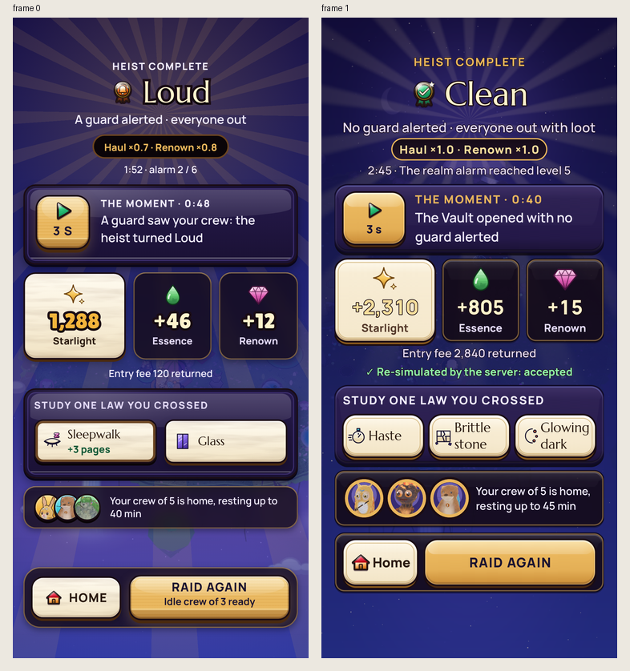

Grayscale squint: [`1-result-100-gray.png`](board-4/1-result-100-gray.png).
Colour-vision sheet: [`1-result-100-cvd.png`](board-4/1-result-100-cvd.png).

Gate: `P2-S1-result-2/71167028` and `aed28321`, the 100% shot.
- Hierarchy: pass (ppp), both.
- Character presence: pass (ppp), both.

From `P2-S1-result-1/8bec0d84` at 100%, before result-2:
- Hierarchy: pass.
- Display type: fail, on the headings without the ink outline (fixed in
  result-2).
- Character presence: fail, on small portraits (fixed in result-2).

| Quality | AD's check |
|---|---|
| 1 Materials | Stands. The haul card, the moment card, the crew card and the action bar are kit plates with inked rims; Collect is the gold slab with a lip and a hard drop. |
| 2 Display type | **Objection A.** The lead reward "+2,310" is pale gold (`gold_top`) with thin strokes and a thin outline on the parchment card, and no drop. In grayscale it is about the card's own value. The key frame's lead figure is the heaviest word on the screen: a deep gold display face with a thick ink outline and a hard drop. "+805" and "+15" have thinner outlines than the key frame's "+46" and "+12". The title and the headings now carry the outline (result-1's fail is fixed). |
| 3 Icons | Stands. Starlight, Essence and Renown are the toon set. |
| 6 Hierarchy | Stands, with A. Collect leads in grayscale, then the moment card's gold 3 s button. The haul should be second, and with A fixed it would be. |
| 8 Colour | Stands. Gold is on Collect, the 3 s button and the rewards; red only on the alarm peak. On the protanopia and deuteranopia views nothing depends on colour alone. |
| 9 Character | Stands. The crew portraits are large, framed and outlined, as the key frame. Result-1's fail is fixed. |
| 13 Light | Stands. One top light on the plates and the sunburst behind the medal. |
| 14 One idea | Stands. Haul, moment, crew, actions, in the key frame's order. Note: the action bar sits about 50 px above the screen's foot. |

### 2. Result at 100% text, Portuguese (Brazil) and German

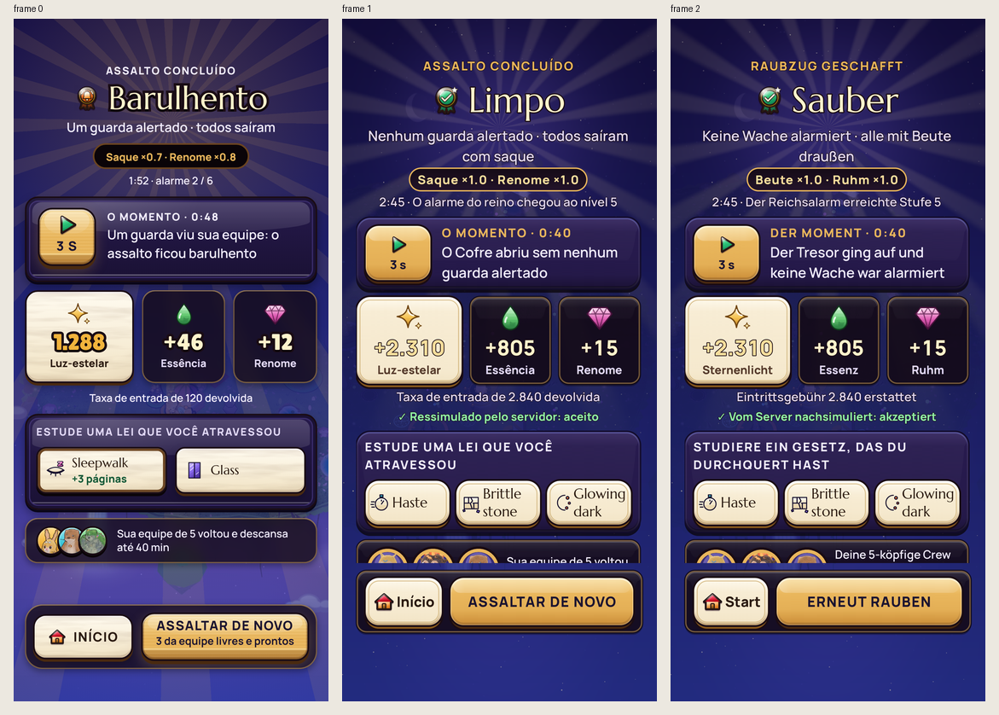

Gate: these shots were not judged.

| Quality | AD's check |
|---|---|
| 2 Display type | **Objection A**, as item 1. |
| 14 One idea, layout | Stands, with a note. In both locales the crew card is cut in half by the action bar. S1's track note says the screen scrolls under the bar by design (`_fit_actions`), and the key frame in pt_BR is shorter (no server line, two law chips). Note: prefer a fold that does not cut faces in half, e.g. end the first screen on the crew card's header. |
| 1, 3, 6, 8, 9, 13 | As item 1. |

### 3. Result at 200% text, Portuguese (Brazil) and English

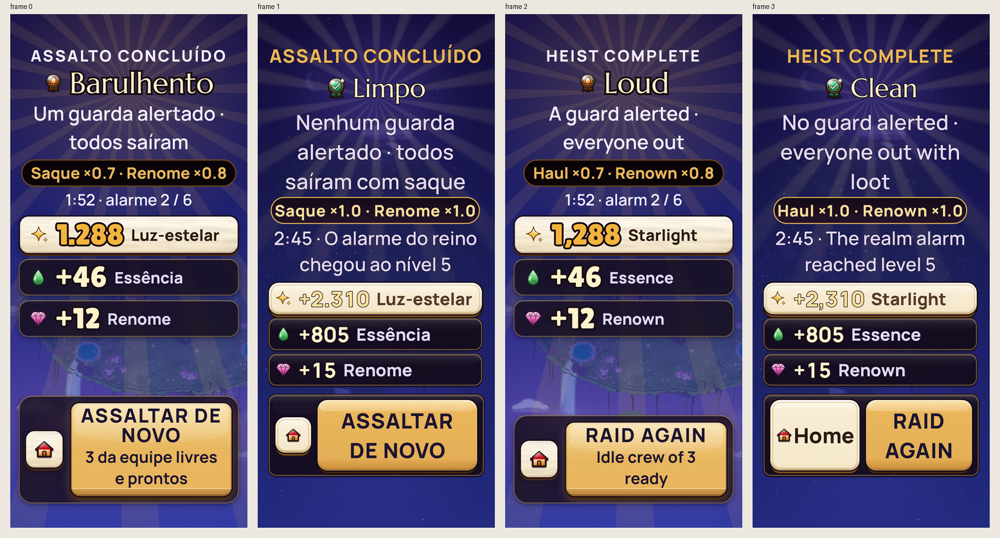

Gate: `P2-S1-result-1/8bec0d84`, 200% pt_BR, before result-2.
- Display type: fail, on a clipped "3 s" chip (fixed: the chip fits).
- Hierarchy: pass.

| Quality | AD's check |
|---|---|
| 2 Display type | **Objection A**, as item 1. The "3 s" chip now fits. |
| 6 Hierarchy | **Objection E** (English). The Home button grows to about 45% of the action bar with its icon and the word "Home", and it is the lightest block in grayscale, level with Collect. In pt_BR it is icon only, as in both key frames, and Collect leads. |
| 14 One idea | Stands. All three reward rows, the moment card and the actions are on the first screen in both locales, as the key frames. |
| 1, 3, 8, 9, 13 | As item 1. |

### 4. Result at 200% text, German (AD-R26)

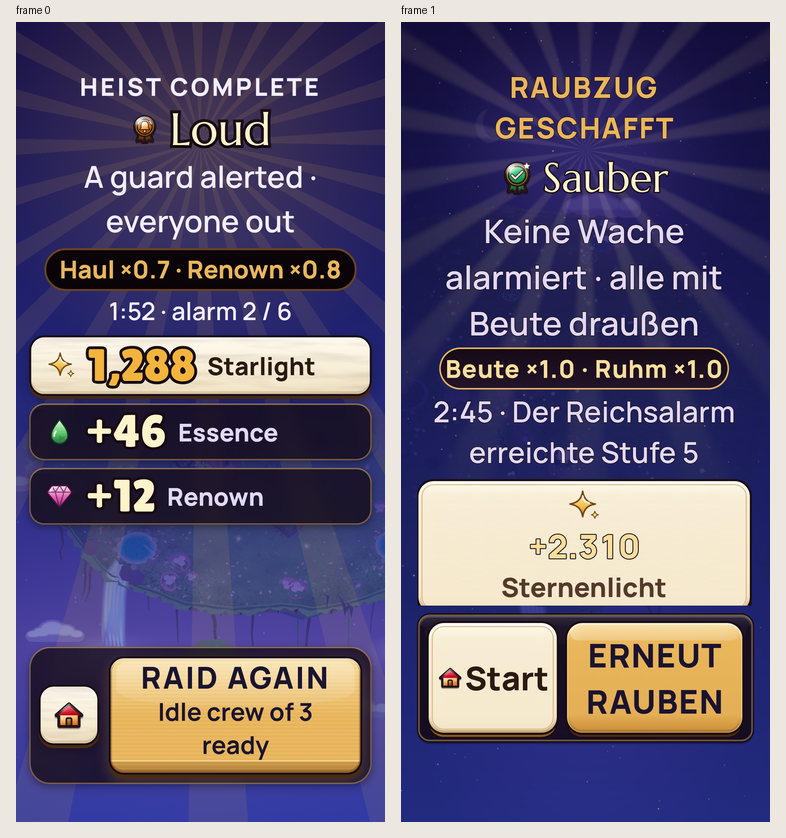

Reference: `03-result_text200.png` (there is no German key frame; it is the
bar for what the 200% result must keep). Gate: not judged.

| Quality | AD's check |
|---|---|
| 14 One idea, content | **Objection B.** The title takes two lines, the subtitle three and the time line two; the reward tiles fall back to full-width columns (ResultFit, because "Sternenlicht" will not fit a row) and the Starlight card takes its large stacked form. Essenz and Ruhm are not on the first screen. The key frame keeps all three rewards above the actions. |
| 6 Hierarchy | Stands. Collect leads. |
| 1, 2, 3, 8, 9, 13 | As item 1 (A applies). |

### 5. Result in high contrast, English and Portuguese

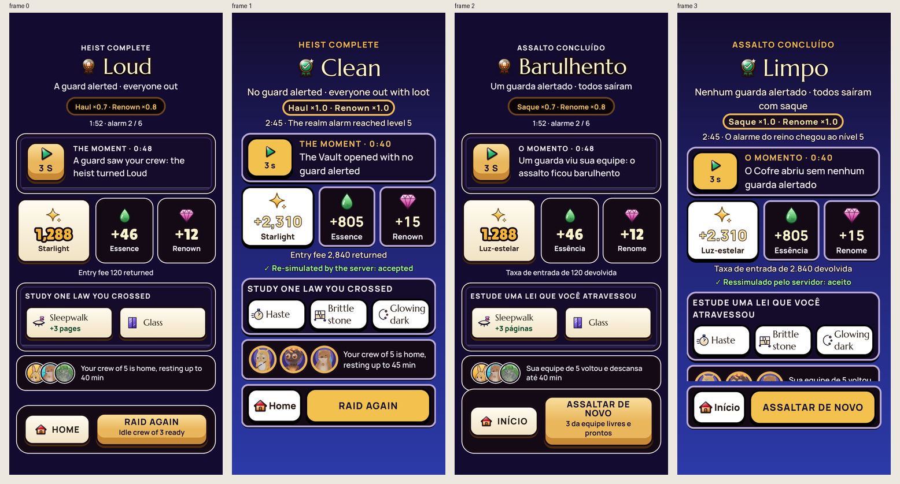

Gate: `P2-S1-result-1/8bec0d84`, high contrast, before result-2.
- Colour roles and value: pass.
- Hierarchy: pass.

| Quality | AD's check |
|---|---|
| 1 Materials | Stands. Solid plates with inked rims, the high-contrast form. |
| 2 Display type | **Objection A.** "+2,310" is drawn as an outline only on white; it is the thinnest figure on the screen. The key frame keeps it solid with the outline. |
| 6 Hierarchy | Stands. Collect is solid gold with no shine and leads. |
| 8 Colour | Stands. |
| 14 One idea | Stands. The layout matches the key frames; in pt_BR the crew card is cut as item 2 (note). |
| 3, 9, 13 | As item 1. |

### 6. The reward card, at 3×

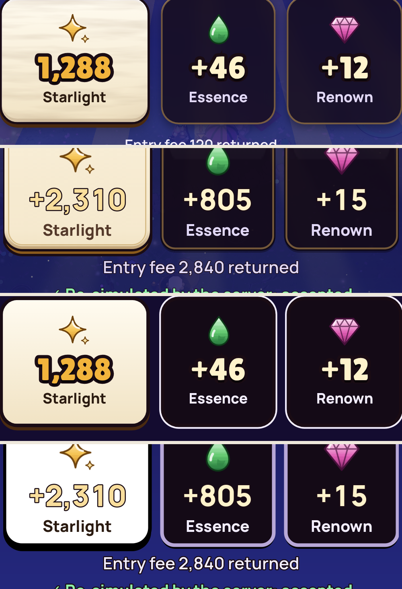

Gate: not judged on its own.

| Quality | AD's check |
|---|---|
| 2 Display type | **Objection A.** Here it is plain: the key frame's "1,288" is a heavy display face, deep gold, with a thick ink outline and a hard drop; the build's "+2,310" is a light pale gold with a hairline outline that melts into the parchment. In high contrast, the build's figure is hollow. Use the same finish as "Keeper 24" on the home (deeper gold fill, heavy outline, hard drop). S1 left the drops off for the draw-call budget; the 200% renders are at 97 to 109 draw calls and en 100% at 120, so the three labels' drops fit. |
| 3 Icons | Stands. |
| 13 Light | Stands. |

### 7. The reward sequence, full

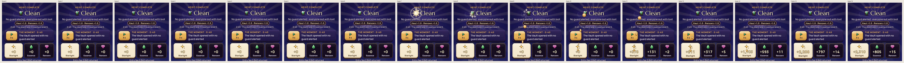

Clip: [`7-reward-full.mp4`](board-4/7-reward-full.mp4) (1.93 s). The
counters step +378, +911, +1,703, +2,288, +2,310 (S1's track note); every
step of the rubric's sequence is there.

| Quality | AD's check |
|---|---|
| 5 Reward juice, anticipation and burst | **Objection C.** The anticipation reads as a still pause: from about frame 10 to frame 32 the medal barely changes, with a slight brightening just before the burst at about frame 33. The rubric asks for a visible gather. The burst then covers only about the medal's own size and barely reaches the sunburst. The rubric's pass is "a burst on a sunburst". |
| 5 Reward juice, arcs and roll | **Objection D.** The coins fly in arcs, but they land on the counters' digits: in frames 42 to 60 a coin covers "+153", "+636" and "+1,346" as they roll, so the roll, the step the coins are there to show, is hidden at each landing. The tile's pulse on landing is there. |
| 5 Flashes | Stands. One burst and one brightening, under three a second. |
| 7 Motion | Stands. The sequence runs inside the screen; no shake. |

### 8. The reward sequence, reduced motion

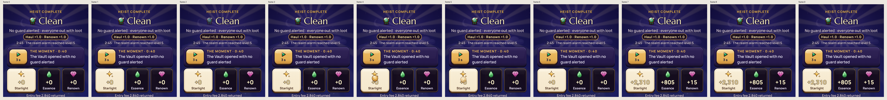

Clip: [`8-reward-reduced.mp4`](board-4/8-reward-reduced.mp4) (0.37 s).

| Quality | AD's check |
|---|---|
| 5 Reward juice, reduced | Stands. No anticipation and no burst: the prize cross-fades in, one coin drops into the Starlight tile, and the counters show their final values. This is the rubric's reduced form. |
| 7 Motion, reduced | Stands. A cross-fade, no scale, no shake. |

### 9. The reward tiers (AIA)

Strips: [common](../../../../../art/ui/motion/strips/reward_common.png),
[rare](../../../../../art/ui/motion/strips/reward_rare.png),
[epic](../../../../../art/ui/motion/strips/reward_epic.png),
[epic in high contrast](../../../../../art/ui/motion/strips/reward_epic_hc.png),
[reduced](../../../../../art/ui/motion/strips/reward_reduced.png).
Clips: [common](../../../../../art/ui/motion/clips/reward_common.gif),
[rare](../../../../../art/ui/motion/clips/reward_rare.gif),
[epic](../../../../../art/ui/motion/clips/reward_epic.gif),
[epic in high contrast](../../../../../art/ui/motion/clips/reward_epic_hc.gif),
[reduced](../../../../../art/ui/motion/clips/reward_reduced.gif).

The scripted checks cover the timings, the flashes and the reduced forms:
`art/ui/motion/check_curves.py` (run by `tools/ui_bake/guard.sh`; AD re-ran
it at `3374eae1`: "ok") checks the curves, and `check_frames.py` checks each
strip's frame log as `strips.sh` makes it.

| Quality | AD's check |
|---|---|
| 5 Rarer is stronger | **Objection C.** The tiers differ in anticipation (300, 450 and 700 ms) and in particle counts (4, 6 and 10 sparkles), but the burst's size only goes from 0.85 to 1.15 and stays about the chest's own size in every tier, so at phone size epic barely reads as stronger than common. The epic burst should reach well past the prize onto the sunburst, and the gather should be visible on the prize (a squash, a glow building, sparkles drawn in) through the anticipation. |
| 5 Arcs | **Objection D**, as item 7: in AIA's strips the coins also land over the counter's "120". |
| 5 Reduced | Stands. One coin and the final value. |
| 8 Colour, high contrast | Stands. The epic tier in high contrast plays on black with an inked burst, and the counter keeps its rimmed plate. Its burst is the chest's size too (objection C). |

### 10. Press, shine and screen change (AIA)

Strips: [press](../../../../../art/ui/motion/strips/press_full.png),
[press reduced](../../../../../art/ui/motion/strips/press_reduced.png),
[shine](../../../../../art/ui/motion/strips/shine_full.png),
[shine in high contrast](../../../../../art/ui/motion/strips/shine_hc.png),
[shine reduced](../../../../../art/ui/motion/strips/shine_reduced.png),
[screen change](../../../../../art/ui/motion/strips/screen_full.png),
[screen change reduced](../../../../../art/ui/motion/strips/screen_reduced.png).
Clips: the same names in [`art/ui/motion/clips/`](../../../../../art/ui/motion/clips/).

| Quality | AD's check |
|---|---|
| 4 Press | Stands, with a note. Collect and Back sink and darken by 50 to 100 ms and are back by 250 to 300 ms, with no overshoot; the reduced form sinks and darkens with no squash. Note: at strip size the full and reduced forms look alike; the sink is at the low end of 2 to 4 pt. Release ends near the top of 150 to 250 ms. |
| 7 Shine | Stands. One faint sweep across Play at about 800 to 933 ms, well under three a second. The high-contrast and reduced forms have no shine, as they should. |
| 7 Screen change | Stands, with a note. The old screen fades out over 160 ms and the new one fades in from 0.985 scale, inside 150 to 250 ms; the reduced form is a cross-fade. Both screens ghost over each other in frames 1 to 4. Note: the full form is barely distinct from the reduced one; a little more travel or scale would give it the screen-class feel the rubric's pass describes. |

## Objections

In order of weight. Result-2 and motion-2 are merged, so each objection
goes to the lead as a request in `docs/progress/status/AD.json` for a
follow-up task, with a proposed owner and a default.

| ID | Item | Quality | Objection | Proposed fix | Owner |
|---|---|---|---|---|---|
| A | 1, 2, 3, 5, 6 | 2 (and 6) | The lead reward "+2,310" is pale gold with thin strokes and a thin outline on the parchment card, about the card's own value in grayscale, and hollow in high contrast. "+805" and "+15" have thinner outlines than the key frame's. The key frame makes the lead figure the heaviest word on the screen. | In `client/scripts/result_screen.gd` (the `_display` call on the reward labels), give the three reward figures the home's "Keeper 24" finish: a deep gold (lead) or cream (others) fill, a heavy ink outline and a hard drop; solid with the outline in high contrast. The draw-call budget allows it (97 to 120 measured). | S1 |
| B | 4 | 14 | AD-R26: at 200% in German the reward tiles fall back to full-width columns, the Starlight card takes its large stacked form, the title, subtitle and time line take seven lines, and Essenz and Ruhm are below the fold. | Keep all three rewards on the first screen at 200% in every locale: a row with the word on a second line, or a smaller icon, before the column fallback in `client/scripts/result_fit.gd`; let the title and subtitle shrink first. Add the German 200% shot to the result's scripted fit check with "all three rewards inside the viewport". | S1 |
| C | 7, 9 | 5 | The anticipation reads as a still pause, and the burst covers about the prize's own size in every tier (0.85 to 1.15), so the burst does not reach the sunburst and epic barely reads as stronger than common. | In `art/ui/motion/curves.json` and the burst sprite, make the gather visible on the prize (a squash, a building glow, sparkles drawn in) and widen the tier spread so the epic burst reaches well past the prize onto the sunburst; re-make the strips and clips. S1's result screen then picks up the curves. | AIA (S1 consumes) |
| D | 7, 9 | 5 | The coins land on the counters' digits and hide the roll at each landing (frames 42 to 60; "120" in AIA's strips). | Land the coins on the tile's icon above or beside the digits, and start the roll as the coin lands, in `client/scripts/result_screen.gd`; AIA's strip shot uses the same target. | S1 (with AIA's strips) |
| E | 3 | 6 | At 200% in English, Home grows to about 45% of the action bar with its icon and word and is as light as Collect in grayscale. | Make Home icon-only at 200% in every locale, as pt_BR already is and both key frames show. | S1 |

Notes carried to the next round, which do not hold the board:
- At 100% in pt_BR and German, and in high contrast pt_BR, the action bar
  cuts the crew card's faces in half. Prefer a fold at the card's header
  (S1).
- At 100% English the action bar sits about 50 px above the screen's foot
  (S1).
- The result shot's fixture has no idle crew, so the "Idle crew of N
  ready" line cannot be checked. Add an idle crew to the shot (S1).
- The press's sink is at the low end of 2 to 4 pt, and full and reduced
  look alike at strip size (AIA).
- The full screen change is barely distinct from the reduced cross-fade
  (AIA).

## When the board stands

The board stands when objections A–E are fixed and re-shot (the stills of
items 1 to 6 and the strips and clips of items 7 and 9), and AD has checked
the new stills and strips on this page. Under section 3.8 of the report,
the board merges when AD lets it stand, with no 24-hour wait.

## Round 2 (board 4b)

Posted by AD, P2-AD-board-4b, 16 November 2026, on the integration branch at
`6b30142b`. The stills, strips and clips below were re-shot on that commit
with the commands of `docs/art/tracks/result-screen.md`: the result shot
with `SERVER=1 FIT=1` in English, Portuguese (Brazil) and German at 100%
and 200% text and in high contrast in English and Portuguese, and the full
and reduced strips with `STRIP`. Every still printed "fit ok". Draw calls:
126, 128 and 128 at 100%; 113, 115 and 114 at 200%; 68 and 70 in high
contrast, as S1's track records. Each still sits beside its golden
reference (M12), and the check runs against the board's full list (M23),
not only A to E.

### Round 2 items

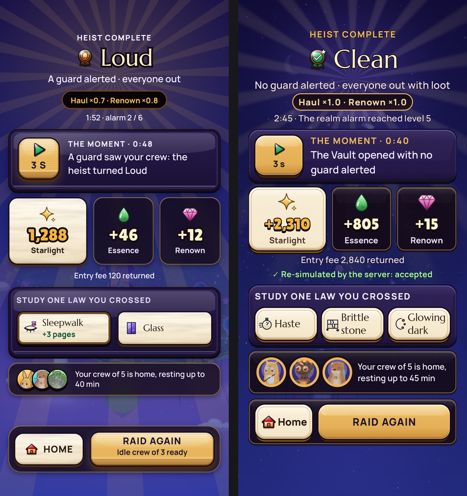

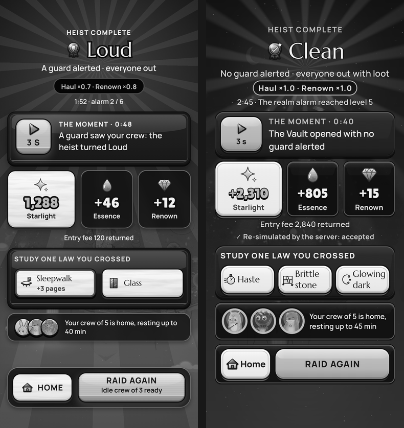

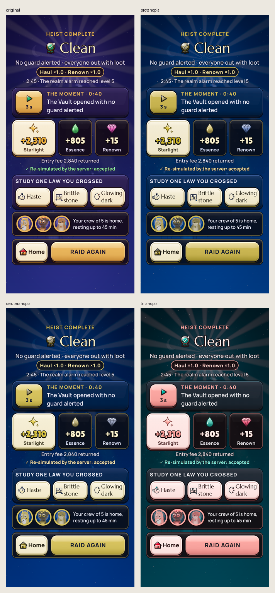

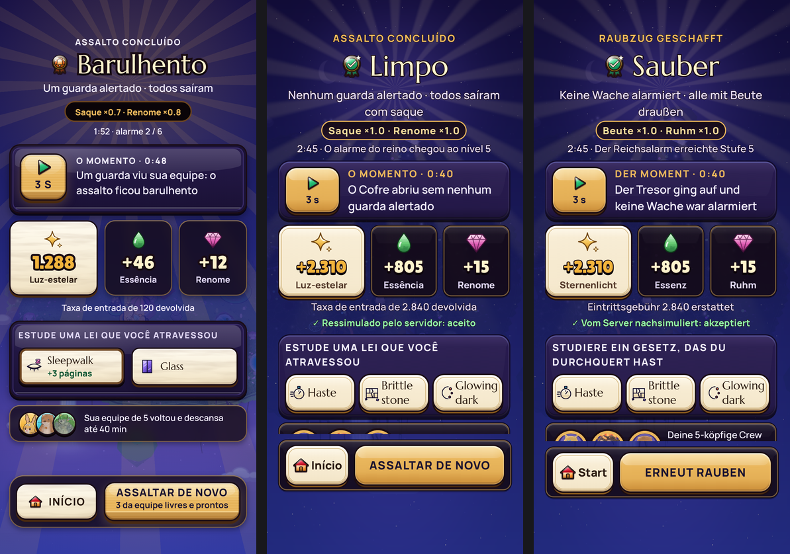

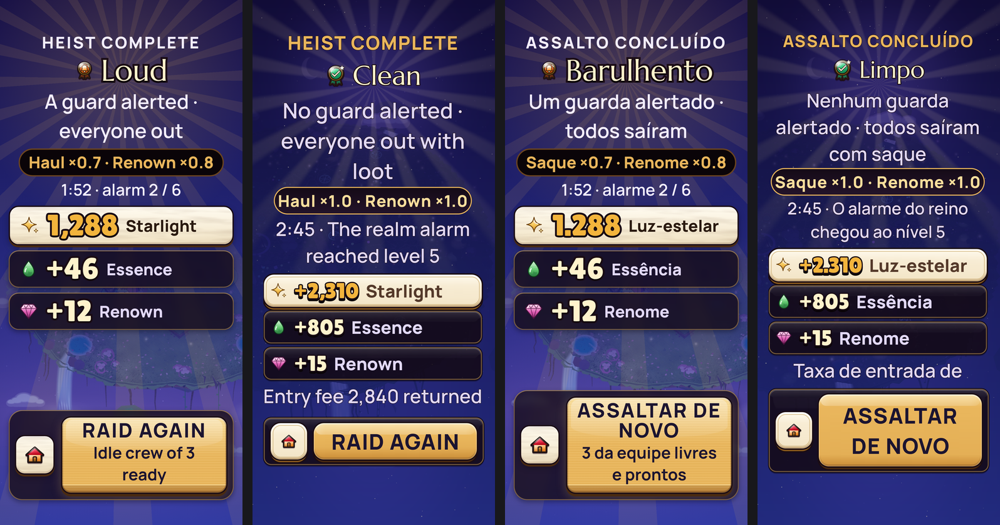

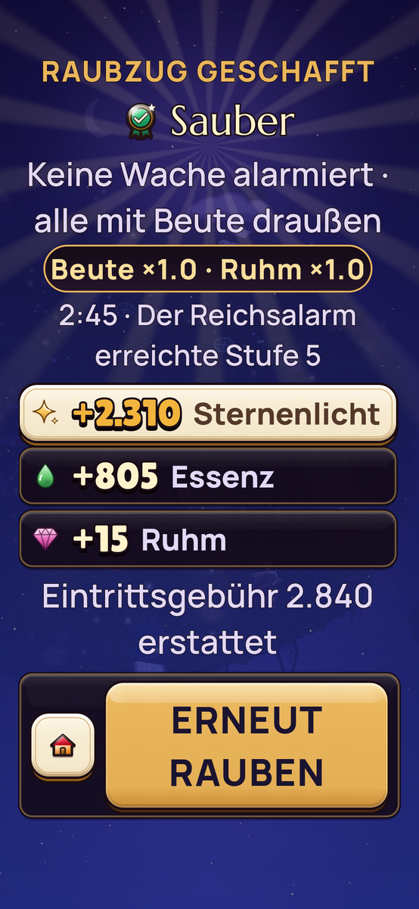

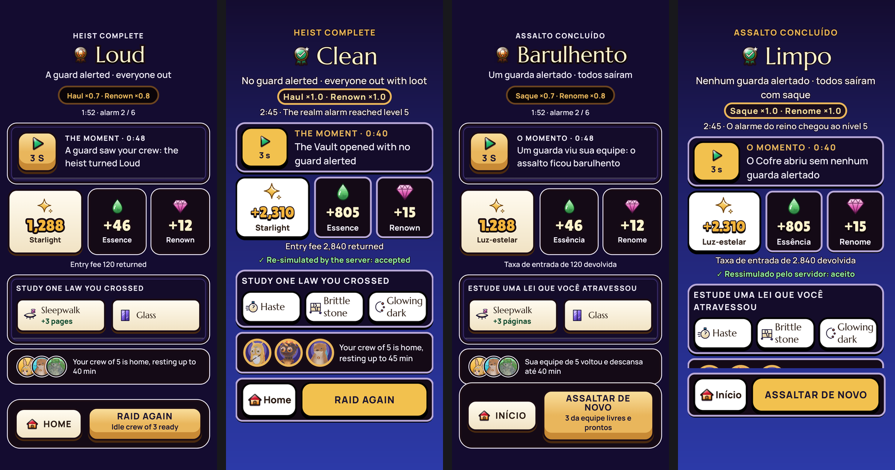

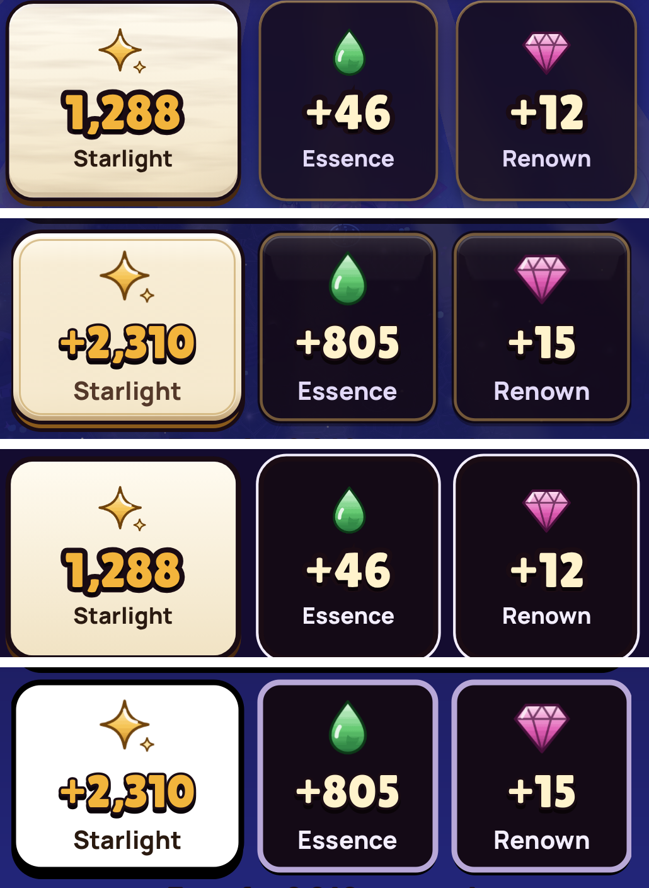

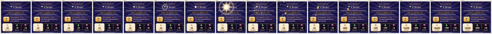

Clip: [r4-7-reward-full.mp4](board-4/r4-7-reward-full.mp4) (80 frames, the reward over in 1.93 s).

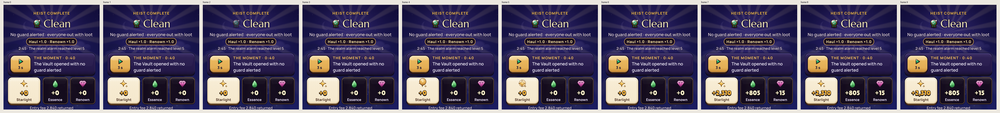

Clip: [r4-8-reward-reduced.mp4](board-4/r4-8-reward-reduced.mp4) (32 frames, the reward over in 0.37 s).

Item 9's tier strips are AIA's, re-made in P2-AIA-motion-3 and merged
unchanged: `art/ui/motion/strips/reward_{common,rare,epic,epic_hc,reduced}.png`
and their clips in `art/ui/motion/clips/`. AD checked them in AIA-R26
(`docs/progress/status/AD.json`) and on the real screen in
[r2-epic-burst-joint.png](board-4/r2-epic-burst-joint.png).

### The objections, re-checked

| ID | Quality | Round 2 | What the re-shot shows |
|---|---|---|---|
| A | 2 (and 6) | **Met** | "+2,310" is now deep gold with a heavy ink outline and a hard drop on the cream Starlight card, the heaviest word on the screen as in the key frame; "+805" and "+15" are cream with the same outline and drop (r4-6). In high contrast the three figures are solid with the outline, not hollow. In grayscale the lead figure reads by its outline. Under the colour-blindness filters nothing depends on colour alone. |
| B | 14 | **Met** | At 200% in German, Sternenlicht, Essenz and Ruhm stand in one row above the action bar; the title steps down first (r4-4). English and Portuguese keep the row too (r4-3). The result shot's fit check now asserts that every reward tile ends above the first screen's edge on every `FIT` run. |
| C | 5 | **Met** | On the screen, the prize gathers before the reveal: sparkles draw in on the medal (strip frame 5), then the burst opens well past the prize onto the sunburst and the title (frame 7) and clears before the coins (r4-7). The tier spread runs from about the chest's size in common to about 2.5 times it in epic, in AIA's strips and in their high-contrast form (AIA-R26). |
| D | 5 | **Met** | The coins arc from the medal onto the Starlight star above the figure, and the figure rolls as they land: +0, +378, +911, +1,703, +2,288, +2,310, with Essence and Renown alongside. No frame shows a coin on a rolling digit (r4-7). Reduced: one coin on the icon, then the figures are set once (r4-8). |
| E | 6 | **Met** | At 200%, Home is the icon square in English, Portuguese and German, and Raid again leads the bar (r4-3, r4-4). |

Outside A to E, the rest stands as in round 1: the layout, the portraits,
the law chips, the moment card, high contrast, the reduced reward form, the
press and the shine. Objection F (the fold at 200%, S1-R29) stays met as in
S1-R30. No new objection.

### Notes carried, which do not hold the board

- **The crew card at the fold, 100%, Portuguese and German** (S1). The bar
  no longer cuts the faces in half, but a sliver of the card still shows
  above it: in Portuguese and in high contrast Portuguese, the card's top
  rim and the tops of the three portrait rings; in German, the rings to the
  forehead and the line "Deine 5-köpfige Crew" (r4-2, r4-5). The fold rule
  (`ResultFit.part_line`, less than one line of body text) does not count
  the rings as a cut. Prefer ending the first screen at the card's header,
  or hiding the sliver, as round 1 noted.
- **The bar's gap at the foot, 100% English** (S1). The bar ends about
  241 px (87 pt) above the screen's foot, against about 111 px (40 pt) in the
  key frame. Round 1's "about 50 px" understated the same gap.
- **"Taxa de entrada de" at 200%, Portuguese** (S1, from S1-R30). The first
  screen ends on an unfinished phrase; keep a label's lines together at
  the fold if it costs no draw call.
- **The lead figure in grayscale** (S1). It reads by its ink outline at
  mid-gray, lighter than the key frame's near-black "1,288". A deeper gold
  would close the gap; it does not hold the board.
- **No idle crew in the shot's fixture** (S1). The "Idle crew of N ready"
  line under Raid again still cannot be checked.
- **The press and the screen change** (AIA). As round 1: the press's sink is
  at the low end of 2 to 4 pt, and the full screen change is barely distinct
  from the reduced cross-fade.

Under section 3.8 of the report, the board merges when AD lets it stand,
with no 24-hour wait. AD lets it stand.

## Preview of result-4 (S1-R31)

AD previewed P2-S1-result-4 at 8753618a on `claude/ui-screens-heist` on
16 November 2026, against board 4's full list (M23). Each still was
rendered with `SERVER=1 FIT=1 [TEXT=200] [LOCALE=<loc>] [CONTRAST=1]
[STATE=<state>] bash tools/render/shoot.sh client/tests/shots/screen_result.gd`.

**All ten stills print "fit ok":** English at 100%; pt_BR, German and
English at 200%; high contrast in English and pt_BR; and, for M26, the
states refused (German 200%), testing (German 200%), confirming (pt_BR
200%) and play (pt_BR 200%).

What stands:

- **Home and the law pills** take the kit's tertiary (violet ghost) face,
  and at 200% Home stays the icon square (E). Raid again leads the bar.
- **The fold at 200% in pt_BR** now ends on the Renome tile, and
  "Taxa de entrada de" no longer ends the first screen. This closes
  round 2's note.
- **The reward tiles** keep their currency icons, with no character frame.
  The lead figure "+2.310" is still the heaviest word (A).
- **The other states** fit at 200%. "Veröffentlichen" stays whole on its
  button in German testing, and Home and Again stack in play.

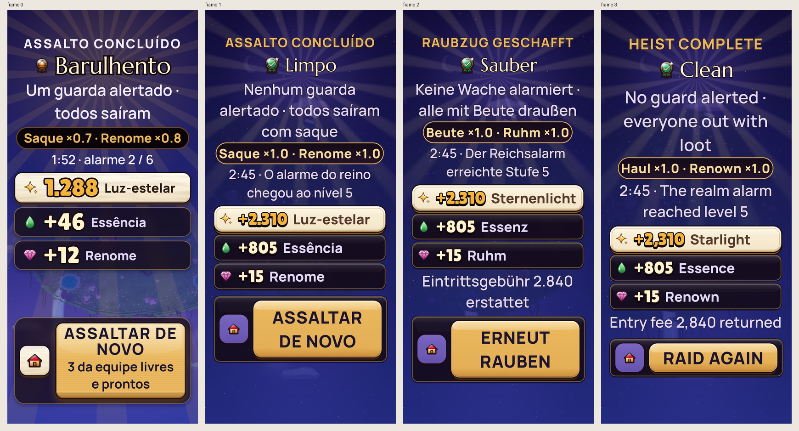

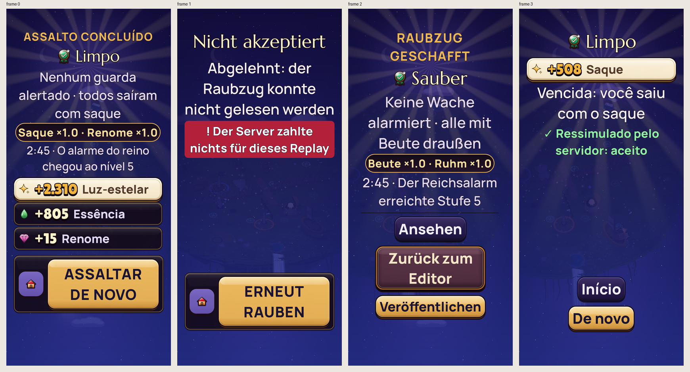

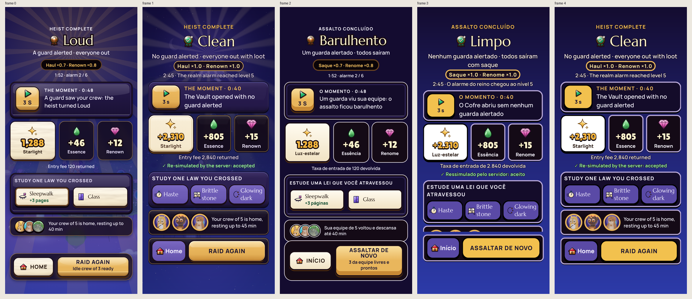

### Objection G (Display type, the words over the sky)

The advisory gate (M30) fails Display type 3 of 3 at 200% pt_BR, and AD
agrees. In the crop below, the key frame is on top and the build at
200% pt_BR is below.

- **The gold kicker** "ASSALTO CONCLUÍDO" stands on the sunburst with no
  ink outline, and its gold melts into the rays. The key frames draw the
  kicker in cream.
- **The grade word** "Limpo" keeps a thin outline, where the key frame's
  "Barulhento" carries a heavy one.
- **The summary and time lines** keep a hairline edge, about 2 to 3 px
  on 45 px glyphs, which does not grow at 200%.
- **The same lines** show in the refused, testing and play states, and in
  the fee line and the green "Ressimulado" line.

The rulings (v2) treat the sky with rays as art, so every word over it
needs an outline of at least 1.5 pt or 12% of its size, whichever is
larger.

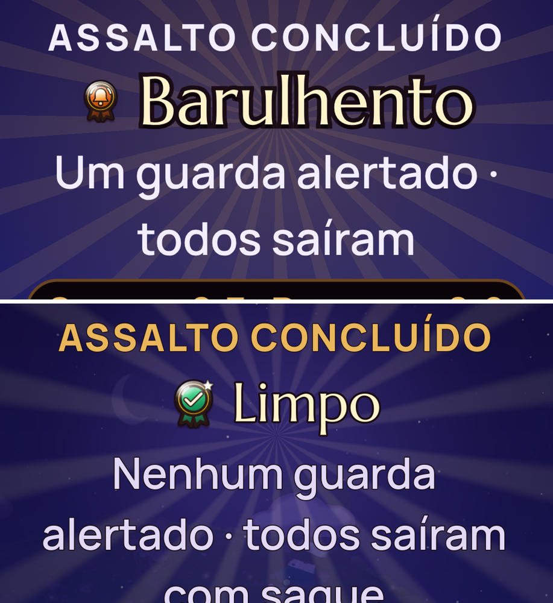

**The fix (S1, `client/scripts/result_screen.gd`, where the labels over
the sky are set up):**

- Give every label that sits straight on the sky a dark ink outline of
  max(1.5 pt, 12% of the font size), worked out after the text scale so
  it grows at 150% and 200%. These are the kicker, the grade word, the
  summary, the time line, the fee line, the server line, and the
  headings and lines in the refused, testing, confirming and play states.
- Turn the kicker cream, as the key frames draw it, or keep its gold
  with the same outline.
- Labels on a card or a plate keep their faces.
- Re-render 200% in pt_BR, German and English, and high contrast. Then
  send the gate request for Display type at 200% pt_BR.

Hierarchy passes in both items, and nothing else holds.

### Notes carried, which do not hold the board

- **The crew card at the fold, high contrast pt_BR, 100%.** The top rim of
  the card and the tops of the rings still show above the bar, as in round
  2.
- **Round 2's other notes stand:** the bar's gap at the foot in English at
  100%, the lead figure in grayscale, no idle crew in the fixture, and the
  press and the screen change (AIA).

So S1's default ("the gate runs on 8753618a as it stands") does not
hold. S1 fixes G inside P2-S1-result-4, then sends the gate request at
the new head. AD-R42 tells the lead.
