# Board 5: character and settings

Posted by AD, P2-AD-board-5, 15 November 2026, on the integration branch
at `b2adaf6a` (P2-S3-character merged as `f41d100e`, P2-S3-settings merged
as `f6f9f71a`). This is the character and settings board. It holds ten
items: the character screen and the settings screen beside their golden
references at phone size, at 100% and 200% text, in English, Portuguese
(Brazil) and German, and in high contrast. AD checks the owner-checked
qualities 1, 2, 3, 6, 8, 9, 13 and 14 on each.

**Round 1 decision: the board does not stand.** Seven objections are open
(listed in "Objections" below, in order of weight, M12). A is the Level up
button at 200%: in English the price chip covers the label, and in German
the label breaks mid-word and the level line spills out of its panel (the
shot's fit check fails). B and C are the fold: at 200% the tabs and the
ability header fall below the first screen, and at 100% the character's
info cards and the settings' second section are cut. D is display type on
the level badge and the price. E is the German settings title breaking
mid-word at 200%. F and G are light: the settings screen has no lead in
grayscale, and the character's stage ends in a hard edge. The rest holds:
the kit plates, the icons, the character on the pedestal, the colour
roles, high contrast, and the settings layout in English and Portuguese.
Character and settings are merged, so each objection goes to the lead as a
request for a follow-up task in `docs/progress/status/AD.json`, each with
a default.

**Round 2 decision (board 5b, 16 November 2026): the board does not
stand yet.** A to G stand as fixed; two new objections, K (the highest
level at 200% runs off the screen) and L (the profile row's value step),
are open. See "Round 2 (board 5b)" at the end.

## How to read it

- **Golden reference.** The character and settings key frames that AD
  approved in place of the owner (`../approvals/O2.md`), at
  `art/ui/keyframes/04-character*.png` and `05-settings*.png`, and the
  rubric's pass and fail anchors (`../rubric.md`). There is no German key
  frame; for German, the English key frame at the same text size is the
  bar.
- **Candidate.** AD rendered both screens on the integration branch with
  `tools/render/shoot.sh` on the character and settings shots and `FIT=1`,
  with `TEXT`, `LOCALE` and `CONTRAST`. Every render printed "fit ok"
  except the character in German at 200%, which printed "fit FAIL" on the
  Level up button's level line (objection A). The draw calls with
  `SERVER=1` were 81 (character, 100%), 59 to 61 (character, 200%), 59 to
  63 (settings, 100%) and 36 to 42 (settings, 200%), under the budget.
- **Size.** The project renders at 540×1170 (the window override in
  `project.godot`), half the key frames' 1080×2340. Each strip scales both
  to 960 px high, so they sit at the same size; the build's edges are a
  little softer for it. That is enough to judge at phone size.
- **Images.** AD's images are in [`board-5/`](board-5/), laid out with
  `tools/ui_gate/sheet.py strip`. A strip puts the key frame first (frame
  0) and the builds after it, at the same height, in the order the
  caption gives. The grayscale squint and the colour-vision sheets are
  `sheet.py still --gray` and `sheet.py cvd` of the 100% English build.
- **Verdicts** come from `../verdicts/<task>/<sha>.json`, written as pass
  or fail with the votes in order. All are advice only, because every
  judged quality is owner-checked (`../calibration.md`). The character was
  judged at `f1251e68` and at its ready sha `6f6a3b15`; settings at
  `eed8b817`, `f5719f28` and its ready sha `f0a36a41`. The verdicts below
  are the ready shas'; the earlier fails they fixed are named in brackets.
- **AD's check** is written as stands, note or **objection**. A note is
  recorded for the next round and blocks nothing. An objection holds the
  board.

## The items

### 1. Character at 100% text

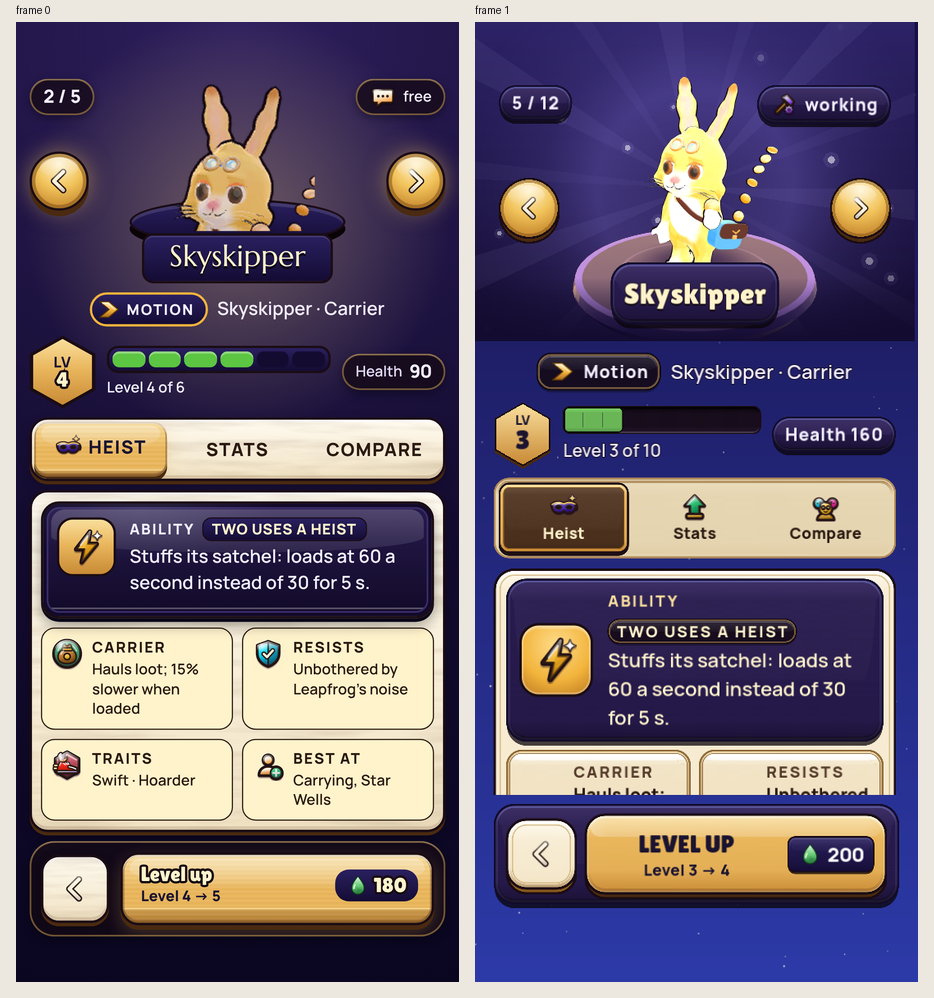

Grayscale squint: [`1-character-100-gray.png`](board-5/1-character-100-gray.png).
Colour-vision sheet: [`1-character-100-cvd.png`](board-5/1-character-100-cvd.png).

Gate: `P2-S3-character/6f6a3b15`, the 100% shot.
- Hierarchy: pass (ppp). (`f1251e68` failed it; fixed.)
- Display type: fail (fff): "'Skyskipper · Carrier' and 'Level 3 of 10'
  sit on the starfield gradient with no ink outline… and the 'NV'/'LV' tag
  runs over the badge edge. Fix: outline the words over the backdrop, or
  set them on a plate."
- Character presence: pass (ppp).

| Quality | AD's check |
|---|---|
| 1 Materials | Stands. The stat cards, the ability card, the info cards and the action bar are kit plates with inked rims; Level up is the gold slab with a lip and a hard drop. |
| 2 Display type | **Objection D**, in part. The name "Skyskipper" carries the display face and the outline. The plain subtitle and level line on the backdrop match the key frame, which sets them the same way, so at 100% AD lets them stand and overrules the gate on that point. The level tag runs over the hexagon badge's top edge, as the gate says. The Level up label is uppercase with no outline, where the key frame sets "Level up" in the display face with an outline (folded into D). |
| 3 Icons | Stands. The schools row and the tab icons are the toon set. |
| 6 Hierarchy | Stands. Level up leads in grayscale, then the character and the name. |
| 8 Colour | Stands. Gold is on Level up and the stat arrows only. On the protanopia and deuteranopia views nothing depends on colour alone. |
| 9 Character | Stands. The character is large, on a lit pedestal, as the key frame (gate pass). |
| 13 Light | **Objection G** (light). The stage behind the character is a rectangle that ends in a hard horizontal edge about a third of the way down, then the blue backdrop starts. The key frame's sky runs on without a seam. |
| 14 One idea, fold | **Objection C.** The fourth info card is cut mid-line ("Hauls loot:") by the action bar. The tab strip (icons stacked over labels) and the ability card ("TWO USES A HEIST" on a line of its own) are taller than the key frame's, where all four info cards are on the first screen. Note: the action bar sits about 65 pt above the screen's foot, against about 40 pt in the key frame. |

### 2. Character at 100% text, Portuguese (Brazil) and German

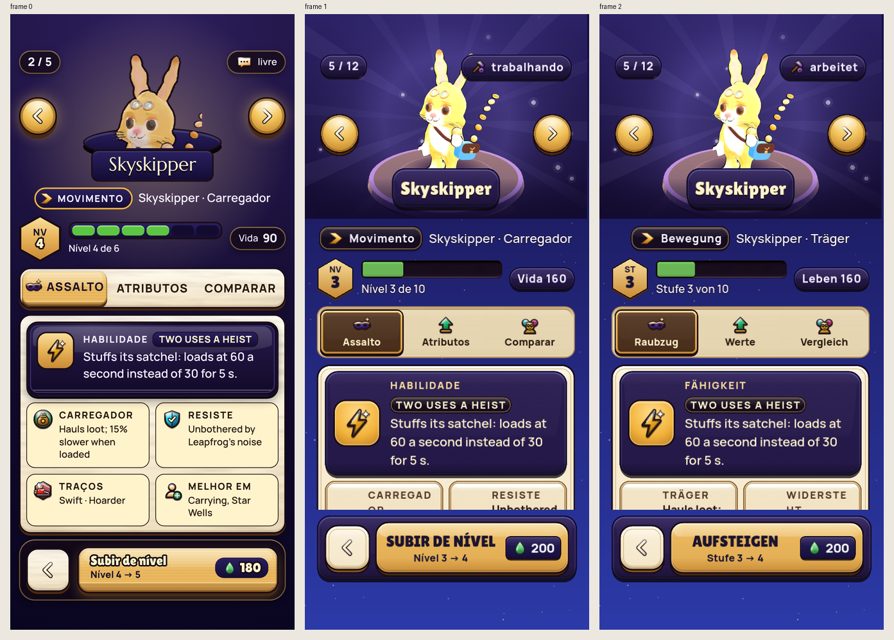

Gate: these shots were not judged.

| Quality | AD's check |
|---|---|
| 14 One idea, fold | **Objection C**, as item 1: the last info card is cut in both locales. |
| 13 Light | **Objection G**, as item 1. |
| 2 Display type | **Objection D**, as item 1. "NÍVEL" and "AUFSTEIGEN" fit at 100%. |
| 1, 3, 6, 8, 9 | As item 1. Note: the ability prose, "TWO USES A HEIST" and "Hauls loot" are in English in both locales; the pt_BR key frame is in English there too, so this is content localisation, not the screen. |

### 3. Character at 200% text, Portuguese (Brazil) and English

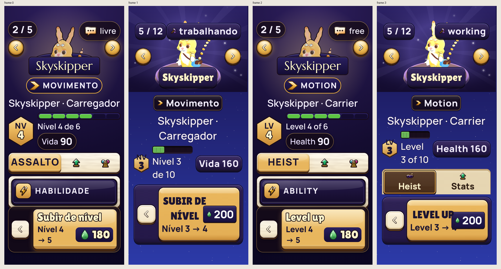

The action bars at 2×, English then German:
[`3-character-200-foot.png`](board-5/3-character-200-foot.png).

Gate: `P2-S3-character/6f6a3b15`, 200% pt_BR.
- Display type: fail (fff): "…the 'NV' tag's dark glyphs merge into the
  badge, and the 200 price is a flat white figure. Fix: as at 100%, and
  give the price the display treatment."
- Hierarchy: pass (ppp).

| Quality | AD's check |
|---|---|
| 2 Display type, fit | **Objection A** (English). The "200" price chip sits over the Level up label ("LEVEL UF" shows) and over the "4" of "Level 3 → 4". pt_BR fits: "SUBIR DE / NÍVEL" on two lines with the price beside it. The key frame wraps the label above, with the level line and the price side by side below it. |
| 2 Display type | **Objection D.** The level tag is clipped at the badge's top edge ("LV" cut in English; "NV" merges into the badge in pt_BR, as the gate says). The price is a flat white figure. The subtitle and the level line are larger at 200% and still have no outline; here they want the kit's outline, as the gate asks. |
| 14 One idea, fold | **Objection B.** pt_BR: the subtitle takes two lines and "Nível 3 / de 10" two, and the tabs and the ability header fall below the first screen. English: the tabs are on the first screen, but only Heist and Stats show; Compare is cut at the right edge. The key frame keeps a compact strip (the selected tab's word plus two icon-only tabs) and the ability header above the actions. |
| 6 Hierarchy | Stands. Level up leads (gate pass). |
| 1, 3, 8, 9, 13 | As item 1 (G applies). |

### 4. Character at 200% text, German

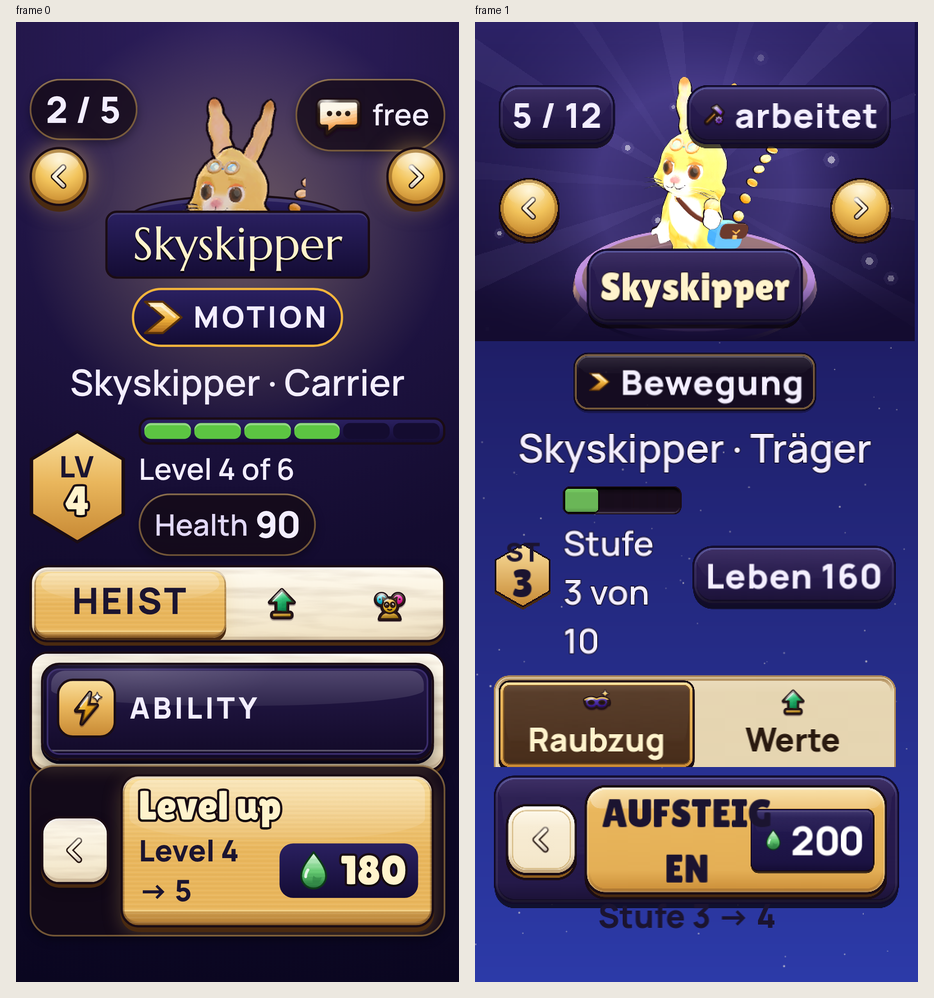

Reference: `04-character_text200.png`. Gate: not judged. The shot's fit
check fails on the Level up button's level line.

| Quality | AD's check |
|---|---|
| 2 Display type, fit | **Objection A.** The label breaks mid-word, "AUFSTEIG / EN", and "Stufe 3 → 4" spills below the button, outside its panel (the "fit FAIL"). |
| 14 One idea, fold | **Objection B.** "Stufe / 3 von / 10" takes three lines; only Raubzug and Werte show in the tab strip; the ability header is below the first screen. |
| 2 Display type | **Objection D**, as item 3. |
| 1, 3, 6, 8, 9, 13 | As item 1. |

### 5. Character in high contrast, English and Portuguese

Gate: `P2-S3-character/6f6a3b15`, high contrast.
- Colour roles: pass (ppp).
- Hierarchy: pass (fppfpp, four of six).

| Quality | AD's check |
|---|---|
| 8 Colour | Stands. Solid white plates with dark rims and dark text; the selected tab has a gold rim; Level up stays gold. |
| 6 Hierarchy | Stands (gate pass, four of six). Level up leads. |
| 13 Light | Note. The backdrop keeps the night gradient's royal blue lower half, where the high-contrast key frame is near-black. The gradient is tokens.json's "night" under the owner's C75 (closed as A: §21.2's linear values); whether high contrast should darken it is K1's and C75's, not this screen's. |
| 1, 2, 3, 9, 14 | As item 1 (C, D and G apply). |

### 6. Settings at 100% text

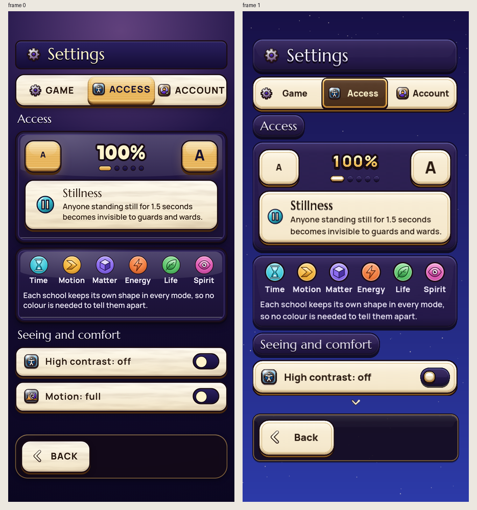

Grayscale squint: [`6-settings-100-gray.png`](board-5/6-settings-100-gray.png).
Colour-vision sheet: [`6-settings-100-cvd.png`](board-5/6-settings-100-cvd.png).

Gate: `P2-S3-settings/f0a36a41`, the 100% shot.
- Hierarchy: pass, narrowly (ppffpf, three fails of six; a fail needs
  four). The weak point is the dark "Access" and "Seeing and comfort"
  header pills, which weigh less in grayscale than the bright cream rows.
- Display type: pass (ppp). (`eed8b817` failed it on the "100%" readout;
  fixed.)

| Quality | AD's check |
|---|---|
| 1 Materials | Stands. The tab strip, the rows, the steppers and Back are kit plates with inked rims. |
| 2 Display type | Stands. The title has the display face and outline; the "100%" readout is outlined. |
| 3 Icons | Stands. The gear, the tab icons and the row icons are the toon set. |
| 6 Hierarchy | **Objection F** (light). In the grayscale squint every cream plate (the tab strip, the A−/A+ steppers, Stillness, High contrast, Back) has the same value, and nothing leads; the gate passed it by one vote. The key frame gives the A−/A+ steppers and the selected tab a gold fill. |
| 8 Colour | Stands. On the protanopia and deuteranopia views the switches read by their knob and word, not by colour. |
| 9 Character | Not on this screen. |
| 13 Light | Stands. One top light on the plates. |
| 14 One idea, fold | **Objection C.** The "Motion: full" row is below the fold (a chevron shows). The key frame has both switch rows on the first screen. |

### 7. Settings at 100% text, Portuguese (Brazil) and German

Gate: these shots were not judged.

| Quality | AD's check |
|---|---|
| 14 One idea, fold | **Objection C.** In both locales the whole "Visão e conforto" / second section is below the first screen. The pt_BR key frame shows both switch rows. |
| 2, 6 | As item 6 (F applies). Note: "Stillness" and its text are in English in both locales (content localisation, as item 2). |
| 1, 3, 8, 13 | As item 6. |

### 8. Settings at 200% text, Portuguese (Brazil) and English

Gate: `P2-S3-settings/f0a36a41`, 200% pt_BR.
- Display type: pass (ppp).
- Hierarchy: pass (ppfppp). (`f5719f28` failed the header outline and
  this hierarchy; fixed.)

| Quality | AD's check |
|---|---|
| 14 One idea | Stands. The title, the tabs, the text size stepper and the first switch rows are on the first screen in both locales, close to the key frames. |
| 2 Display type | Stands. Note: the title's gear is smaller than the key frame's at 200%. |
| 6 Hierarchy | Stands (gate pass); F applies at 100%. |
| 1, 3, 8, 13 | As item 6. |

### 9. Settings at 200% text, German

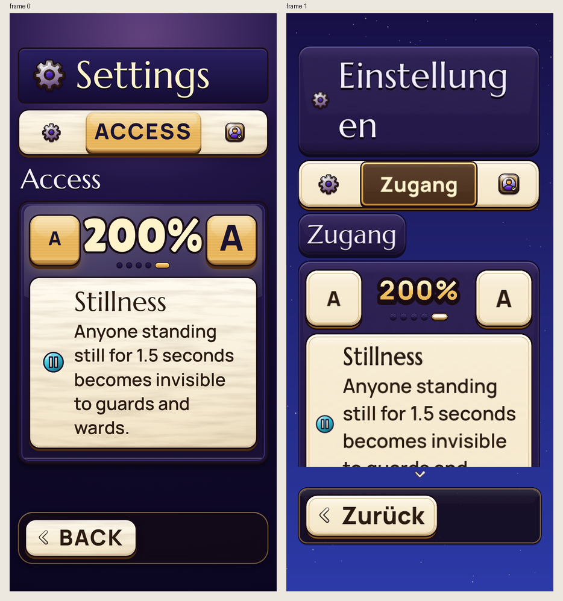

Reference: `05-settings_text200.png`. Gate: not judged.

| Quality | AD's check |
|---|---|
| 2 Display type, fit | **Objection E.** The title breaks mid-word, "Einstellung / en", beside a tiny gear. The Stillness card's text is cut at "to guards and". |
| 14 One idea | Stands, with E. The tabs and the stepper are on the first screen. |
| 1, 3, 6, 8, 13 | As item 6. |

### 10. Settings in high contrast, English and Portuguese

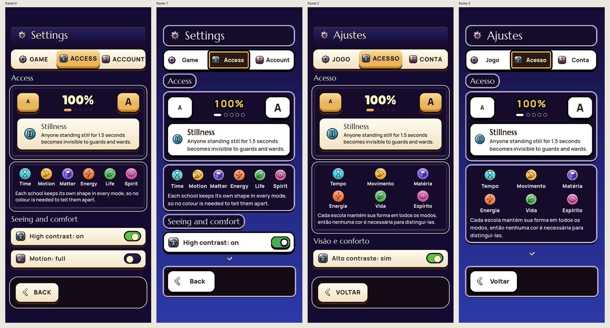

Gate: `P2-S3-settings/f0a36a41`, high contrast.
- Colour roles: pass (ppp).
- Hierarchy: pass (ppp).

| Quality | AD's check |
|---|---|
| 8 Colour | Stands. Solid plates with dark rims; the switches read by knob and word. |
| 6 Hierarchy | Stands (gate pass). |
| 13 Light | Note, as item 5: the backdrop keeps the night gradient (K1, C75). |
| 1, 2, 3, 14 | As item 6 (C applies to the fold in pt_BR). |

## Objections

In order of weight. Character and settings are merged, so each objection
goes to the lead as a request in `docs/progress/status/AD.json` for a
follow-up task, with a proposed owner and a default.

| ID | Item | Quality | Objection | Proposed fix | Owner |
|---|---|---|---|---|---|
| A | 3, 4 | 2, 14 | At 200% the Level up button does not fit its words. English: the "200" price chip covers the label ("LEVEL UF") and the "4" of "Level 3 → 4". German: the label breaks mid-word ("AUFSTEIG / EN") and "Stufe 3 → 4" spills below the button outside its panel, so the shot's fit check fails. | In `client/scripts/character_screen.gd`, measure the label against the width left after the price chip; wrap at word boundaries only, shrink the label, or stack the price under it as the key frame does. Add the English and German 200% shots to the character's scripted fit check. | S3 |
| B | 3, 4 | 14 | At 200% the tabs and the ability header fall below the first screen (pt_BR), or the tab strip is cut to two tabs with Compare off the edge (English, German). The subtitle and level line take two or three lines. | At 200%, show the unselected tabs icon-only, as the key frame does; let the subtitle and level line shrink to one line; keep the tabs and the ability header on the first screen in every locale. | S3 (K1 if `kit_tabs.gd` needs an icon-only form) |
| C | 1, 2, 6, 7 | 14 | At 100% the first screen is cut short. Character: the fourth info card is cut mid-line in every locale, because the stacked tab strip and the ability card's own tag line are taller than the key frame's. Settings: "Motion: full" is below the fold in English, and the whole second section in pt_BR and German. | Character: put the tab icons inline with their words and the ability tag inline with its heading, as the key frame. Settings: tighten the vertical spacing and the group header pills so both switch rows fit at 100% in every locale. | S3 |
| D | 1, 2, 3, 4 | 2 | The level tag runs over the badge's top edge and is clipped or merges into it at 200%; the price is a flat white figure; at 200% the subtitle and level line on the backdrop have no outline; the Level up label has no outline. | Keep the tag inside the badge at every text size (scale the badge or set the tag above it); give the price and the Level up label the kit's display treatment (outline, drop); give the backdrop text the kit's outline at 200%. At 100% the plain subtitle and level line may stay, as the key frame. | S3 |
| E | 9 | 2 | At 200% in German the settings title breaks mid-word ("Einstellung / en") beside a tiny gear, and the Stillness card's text is cut. | In `client/scripts/settings_screen.gd`, wrap the title at word boundaries only or shrink it to fit the row; let the Stillness card grow to its text. Add the German 200% settings shot to the fit check. | S3 |
| F | 6 | 6 | In the grayscale squint no plate leads on settings: every cream plate has the same value, and the gate passed hierarchy by one vote. | Give the A−/A+ steppers the gold fill, as the key frame does, and/or strengthen the group header pills. | S3 |
| G | 1, 2, 3 | 13 | The character's stage ends in a hard horizontal edge about a third of the way down, then the blue backdrop starts; the key frame's sky runs on. | Fade the stage's bottom edge into the backdrop (a gradient mask or a soft lower edge) in `client/scripts/character_screen.gd`. | S3 |

Notes carried to the next round, which do not hold the board:
- The backdrop's royal blue lower half is tokens.json's "night" under the
  owner's C75. High contrast keeps it, where both high-contrast key frames
  are near-black; whether high contrast darkens the backdrop is for K1 and
  C75 (K1).
- The action bar sits about 65 pt above the screen's foot on both screens,
  against about 40 pt in the key frames: `client/scripts/ui.gd` sets the
  bottom safe margin from `safe_top_points` (44 pt). This also pushes the
  fold up (C). Board 4 noted the same on the result screen (K1, S3).
- The selected tab is the kit's dark brown where the key frames show gold.
  It is consistent across the kit and keeps a single gold lead per screen
  (K1).
- The ability prose, "TWO USES A HEIST", "Hauls loot", "Stillness" and its
  text are in English in pt_BR and German; the pt_BR key frames are in
  English there too (lead, content localisation).
- The settings title's gear is smaller than the key frame's at 200% (S3).

## When the board stands

The board stands when objections A–G are fixed and re-shot (the stills of
items 1 to 10), the character's German 200% shot prints "fit ok", and AD
has checked the new stills on this page. Under section 3.8 of the report,
the board merges when AD lets it stand, with no 24-hour wait.

## Preview of character-2 (S3-R15)

AD checked the character stills on `claude/ui-screens-meta` at `73afe675`
against objections A, B, C, D and G and this board's full list (M23). The
full answer is S3-R15 in `docs/progress/status/AD.json`. The scripted fit
check passes in all eight shots, and AD's renders match S3's stills pixel
for pixel. A, B, C, D and G stand as fixed. One new objection, H, holds
P2-S3-character-2 until S3 fixes it: at 200% the status chip covers the
character's face, all of it in pt_BR.

At 100%: the key frame, then en, pt_BR and de.

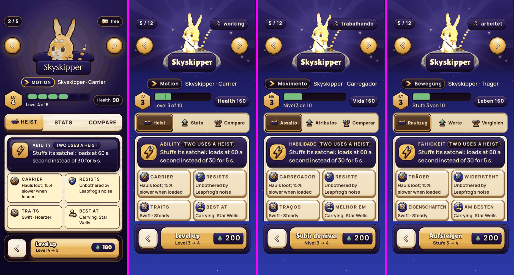

At 200%: the key frame, en, pt_BR, de, then the pt_BR key frame.

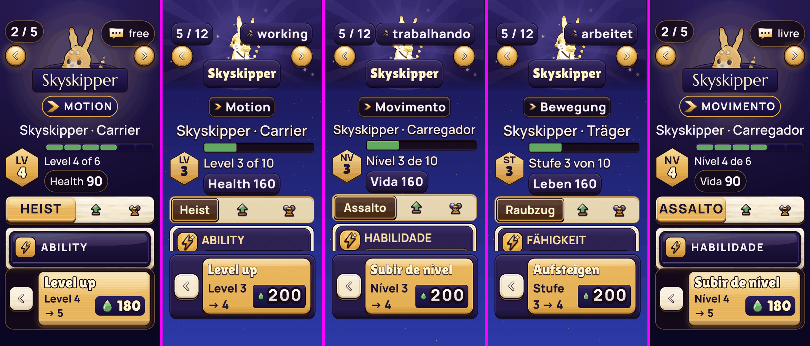

The stage at 200% (objection H): the key frame, then en, pt_BR, de, and
pt_BR on the Stats tab.

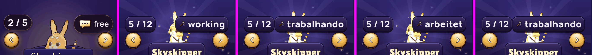

The Stats and Compare tabs at 100% en and 200% pt_BR:
[`r2-character-tabs.png`](board-5/r2-character-tabs.png).

## Re-check of objection H (S3-R16)

AD re-checked objection H only, the character's face at 200% text, on
`claude/ui-screens-meta` at `6b7e6b42`, against this board's full list
(M23). The full answer is S3-R16 in `docs/progress/status/AD.json`. AD
rendered the five 200% shots S3 named (en, pt_BR, de, and pt_BR with
`TAB=1` and `TAB=2`) with `FIT=1`; the three Heist-tab shots print "fit
ok", and all five match S3's stills pixel for pixel. The change touches
only the large-text branch of `_stand`, so the 100% and high-contrast
stills of round 2 stand unchanged.

**H stands as fixed.** At 200% the status pill keeps its top-right corner
as the state's icon alone (the working hammer), and the whole head, ears
to collar, stands clear between the count pill, the icon and the arrows in
every locale and on every tab. The state's words stay in the pill's
accessible name and tooltip, so no meaning rests on the icon's colour.
P2-S3-character-2 has no open AD objection.

The stage at 200%: en, pt_BR, de, then pt_BR on the Stats and Compare tabs.

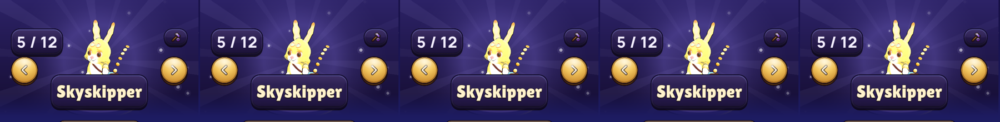

Note for board 5b, which holds nothing: the state icon's chip is the
smallest plate on the stage (about two thirds of the count pill's height),
readable as a hammer at phone size; board 5b checks that every state's
icon reads as well at that size.

## Preview of settings-2 (S3-R17)

AD previewed the settings stills for P2-S3-settings-2 on
`claude/ui-screens-meta` at `60560762`, and checked the screen against
this board's full list (M23). AD re-ran `fit_settings.sh`: all ten shots
print "fit ok". AD also rendered the Game and Account tabs at 100% in
English and German, Account at 200% in pt_BR and Game at 200% in English:
all fit ok. The full answer is S3-R17 in `docs/progress/status/AD.json`.

**C stands as fixed.** At 100%, English shows both switch rows above the
dock. pt_BR and German show the second heading and High contrast, with
Motion below the chevron, which is what the pt_BR key frame shows. Item 7
above was wrong to say the pt_BR key frame shows both switch rows: it
shows High contrast only.

From left: key frame, build in English, key frame pt_BR, build in pt_BR,
build in German.

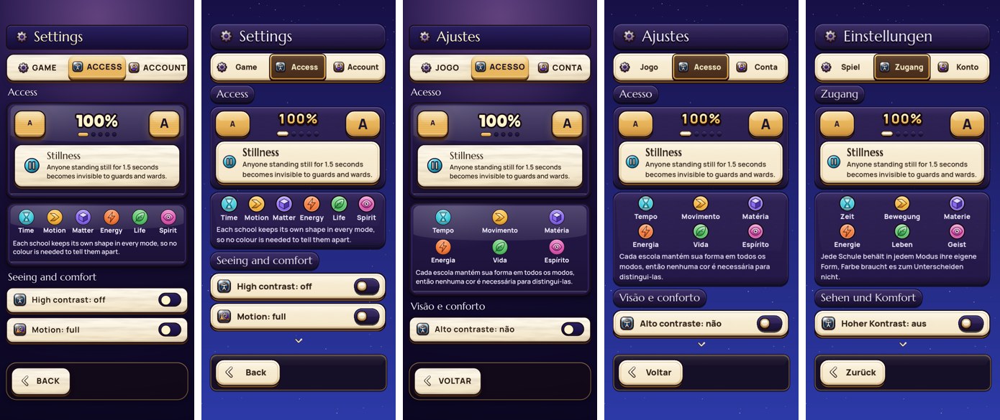

**E stands as fixed.** At 200% in German the title reads "Einstellungen"
whole, the gear is larger than at 100%, and the Stillness card shows its
whole law. English and pt_BR at 200% are close to their key frames.

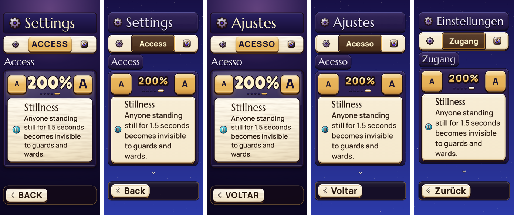

**F stands as fixed.** The small and large A are gold, as on key frames 05
and 05-settings_hc, and the text size now leads the Access tab. High
contrast keeps them gold.

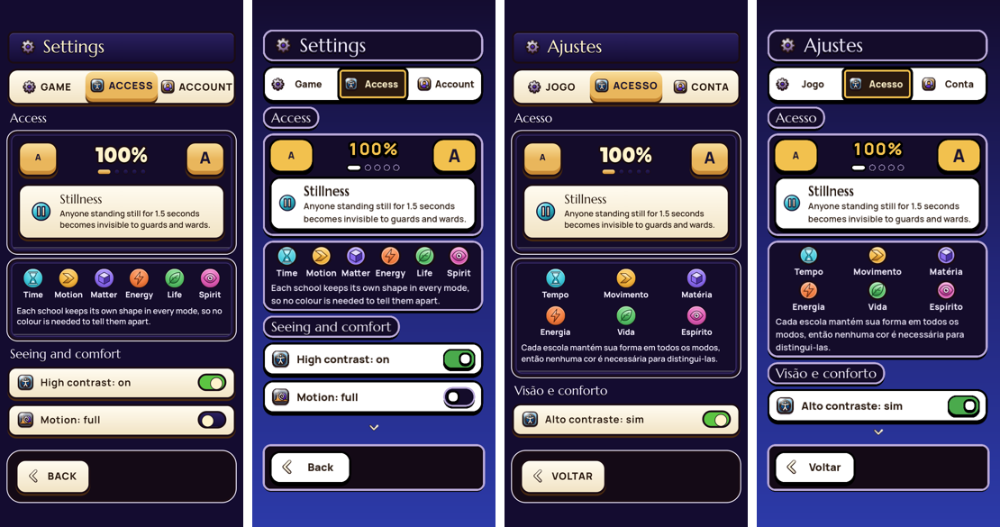

**One new objection, I (light), holds P2-S3-settings-2.** On the Account
tab the group heading is a small gold caps label ("ACCOUNT", "KONTO",
"CONTA"). Every other group on the screen (Access, Seeing and comfort,
Sound, Play) has the header pill. The screen should use one heading form
(qualities 2 and 6). From left: Game in English and German, Account in
English and German at 100%, then Game in English and Account in pt_BR at
200%.

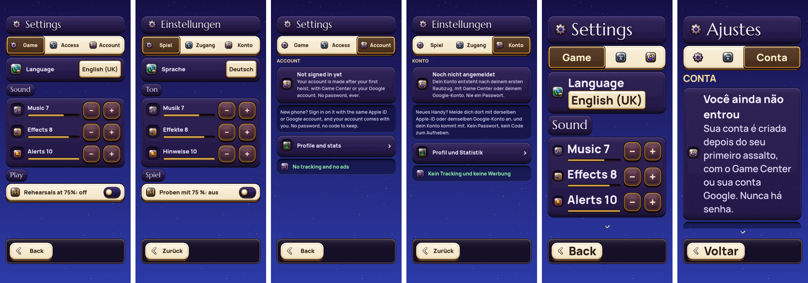

| ID | Quality | Objection | Proposed fix | Owner |
|---|---|---|---|---|
| I | 2, 6 | On the Account tab the group heading is a small gold caps label, where every other group heading on the screen is the header pill. | In `client/scripts/settings_screen.gd`, give the Account group the same header pill as Access, Sound and Play. | S3 |

Notes carried, which do not hold the board: the title's gear at 200% is
larger now but still smaller than the key frame's; the dock's height is
`ui.gd`'s bottom margin (K1); the selected tab is the kit's brown (K1).

## Re-check of objection I (S3-R19)

AD re-checked only objection I on `claude/ui-screens-meta` at `25ed9fd9`,
and at the branch's head `002b91db`, which adds only main's merge and S3's
progress files (no client file differs from `25ed9fd9`). Against this
board's full list (M23), the only client change since the preview at
`60560762` is `settings_screen.gd`: the Account group gets the header pill,
and AuthPanel's caps label is hidden. `fit_settings.sh` now renders twelve
shots, and all twelve print "fit ok". AD also rendered Account at 100% in
pt_BR, at 200% in pt_BR and English, and in high contrast in English: all
fit ok. The full answer is S3-R19 in `docs/progress/status/AD.json`.

**I stands as fixed.** On the Account tab the group heading is now the
header pill ("Account", "Konto", "Conta"), the same form as Access, Seeing
and comfort, Sound and Play. The small gold caps label is gone at 100%, at
200% and in high contrast. P2-S3-settings-2 has no open AD objection.

From left: Account at 100% in English, German and pt_BR, then at 200% in
German and pt_BR, then high contrast in English.

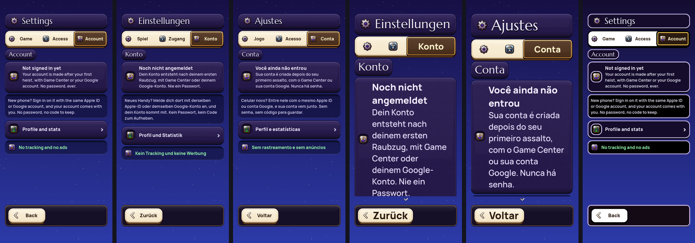

Notes carried, which do not hold the board. `_hide_kicker` hides
AuthPanel's first child each time one enters. The signed-out stills show
that this is the caps label. If the signed-in or device layout ever opens
with another node, that node would vanish. Board 5b checks the signed-in
Account tab. The earlier notes still stand: the gear at 200%, the dock's
height and the selected tab's brown (K1).

## Preview of the Hierarchy fixes (S3-R20)

AD previewed S3's answer to the gate's advisory Hierarchy fail at
`5fc97aac` (`verdicts/P2-S3-settings-2/5fc97aac.json`) on
`claude/ui-screens-meta` at `3854db00`. Against this board's full list
(M23), the only client change since `5fc97aac` is `settings_screen.gd`:
the title in the hero role (34 points) on `card_gold`, the group headings
at 22 points in the gold top with the display type's ink stroke, the
Stillness sample on `plate_dark`, and the tab strip on `seg_track_light`.
AD compared S3's nine re-shot stills with the stills at `5fc97aac` and key
frame 05, in colour and in the grayscale squint, and ran `checks.py all`
on seven of the shots. The full answer is S3-R20 in
`docs/progress/status/AD.json`.

**The Hierarchy fixes stand.** In the grayscale squint the title is now the
largest type at the top, at 100% and at 200%. Each group heading outranks
the rows it heads by size. At 200% the Stillness card no longer outweighs
the title: it is a dark plate holding its prose. The tab strip is a step
under the cards' cream. The card leaves key frame 05's cream sample, as the
gate's notes asked. From left: key frame, build at `5fc97aac`, build at
`3854db00`, in colour and in grayscale.

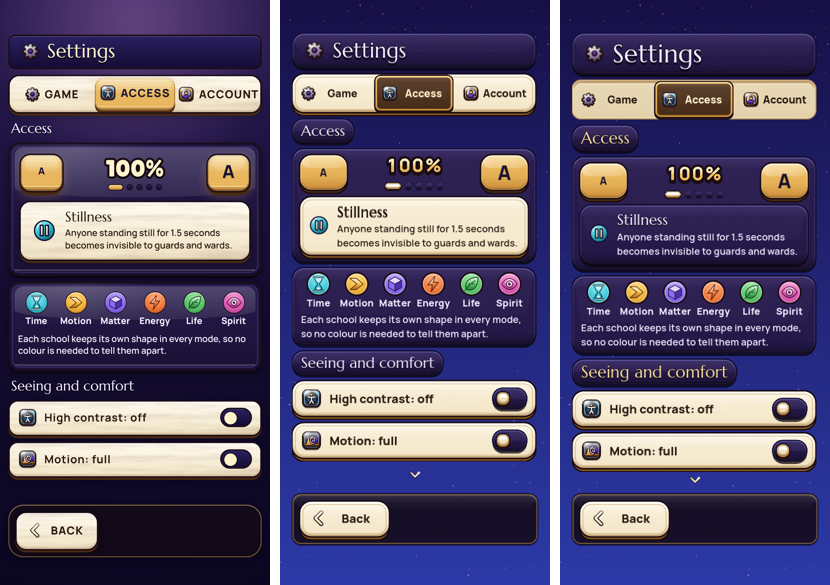

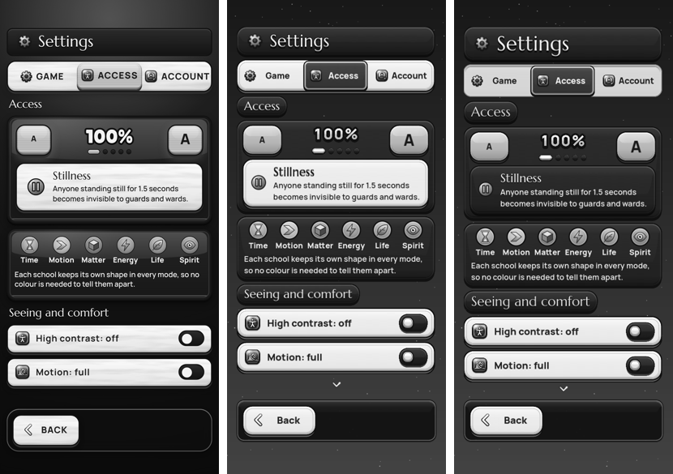

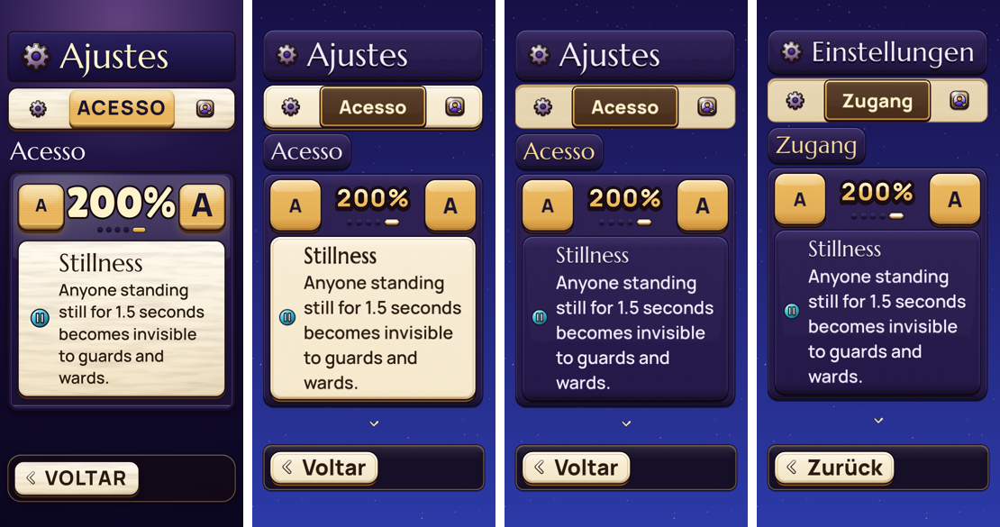

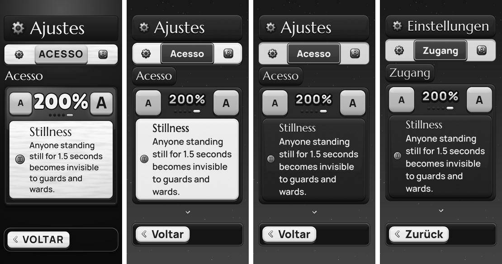

**E, F and I stand as fixed.** At 200% German reads "Einstellungen" whole,
and the whole Stillness law shows. The small and large A stay gold. The
Account tab keeps the header pill, now in the same gold type as the other
headings. From left: key frame in high contrast, high contrast in English,
then Account at 100% in English and German.

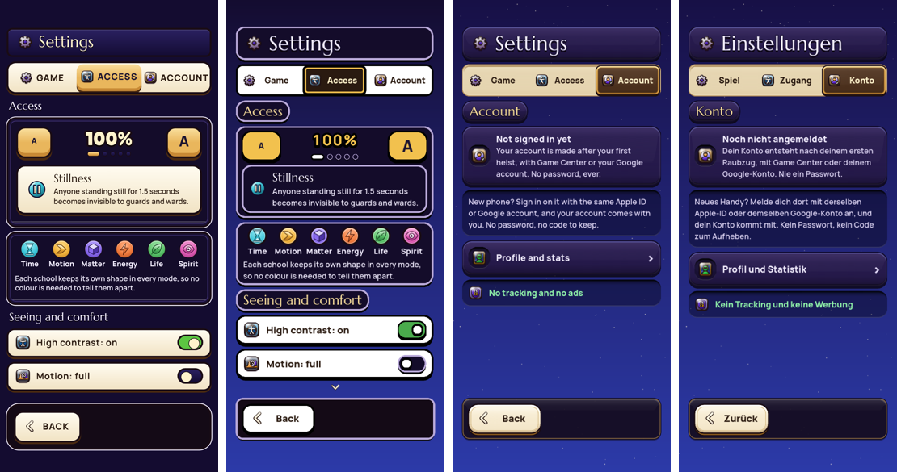

**C moved: one new objection, J, holds P2-S3-settings-2.** The taller
title plate (+9 points) and the two taller headings (+3 points each) push
the second section down about 15 points. At 100% in pt_BR, in German and in
high contrast pt_BR, the High contrast row has left the first screen. Only
the "Visão e conforto" / "Sehen und Komfort" heading stands above the
chevron, with nothing under it. At `5fc97aac` that row was on the first
screen, as on the pt_BR key frame (C's fixed state). The shots confirm it:
`settings-pt_BR`, `settings-de` and `settings-hc-pt_BR` now list no
switch row, and `checks.py all` reports six results where `5fc97aac` had
seven. English at 100% still shows both rows. From left: key frame pt_BR,
pt_BR at `5fc97aac`, then at `3854db00` pt_BR, German and high contrast
pt_BR.

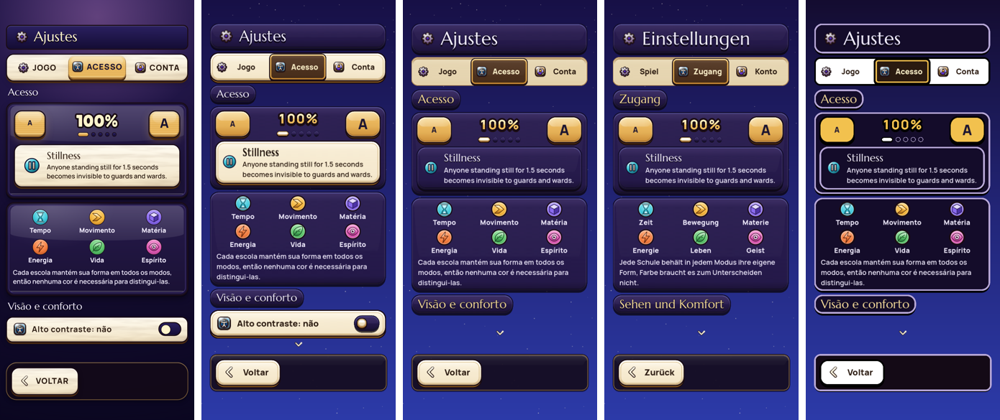

| ID | Quality | Objection | Proposed fix | Owner |
|---|---|---|---|---|
| J | 14 | At 100% in pt_BR, German and high contrast pt_BR the High contrast row has fallen below the fold, leaving the second heading alone above the chevron (C moved). | In `client/scripts/settings_screen.gd`, find about 15 points at 100% without undoing the Hierarchy fixes: tighten the title plate's and the heading plates' vertical padding, `TITLE_LEAD` and `HEADING_LEAD`, or the gaps between groups. If that is not enough, set the headings to the 20-point heading slot, keeping the gold top and the stroke. Check that `settings-pt_BR`, `settings-de` and `settings-hc-pt_BR` list the High contrast switch row again. | S3 |

Notes carried to board 5b, which do not hold the preview:
- `card_gold`'s rim is a 1.5-point gold at 70% alpha on `card_lit`. On
  the title plate it reads faintly, so the plate looks much as the dark
  plate did. The title leads by size, so this stands.
- The Account tab's profile row fails value-steps (S3-R18, en and de,
  ΔL* 2.5 and 3.6), in `screen_account.gd`, which is not settings-2's
  file. Board 5b lists it.
- Earlier notes stand: the gear at 200%, the dock's height and the
  selected tab's brown (K1), `_hide_kicker` on the signed-in Account tab.

## Re-check of objection J (S3-R21)

AD re-checked objection J only, as S3-R21 asked, on
`claude/ui-screens-meta` at `9e602fcc` (S3's pre-checked head: `d66e9521`
merged with main). Against this board's full list (M23), the only client
change since the S3-R20 preview at `3854db00` is in `settings_screen.gd`:
`PLATE_TOP` is 0, so the title plate and the heading plates have no top or
bottom padding. AD rendered the Access tab at `9e602fcc` with `FIT=1` at
100% in pt_BR, German and English and in high contrast pt_BR. All four
print "fit ok", and each is pixel-identical to S3's committed still (mean
difference 0.0). `checks.py all` passes on `settings-pt_BR`, `settings-de`,
`settings-hc-pt_BR` and `settings-100`.

**J stands as fixed.** At 100% the High contrast row is on the first screen
again in pt_BR, German and high contrast pt_BR, under its heading and above
the chevron, as on the pt_BR key frame. The three shot records list
switch-row 11 again (y 622 to 674 points of 845), and `checks.py` gives its
value step (ΔL* 67.2, 67.0 and 75.0). English at 100% still shows both
switch rows. The Hierarchy fixes are kept: the title is in the hero role on
`card_gold`, and the headings are at 22 points in gold with the stroke. With
no padding, the display face's line height still leaves room over and under
the words on every plate, at 100% and at 200% German ("Einstellungen"
whole), and on the Account tab. From left: key frame pt_BR, then the build
at `9e602fcc` in pt_BR, German and high contrast pt_BR.

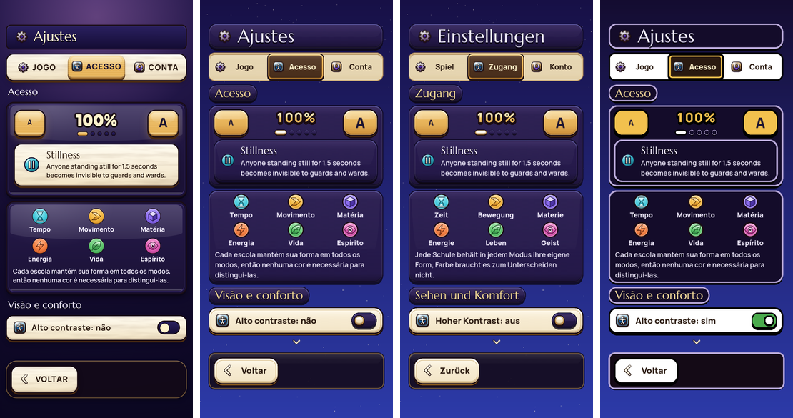

Nothing new holds P2-S3-settings-2. The notes carried to board 5b stand
(the faint `card_gold` rim, S3-R18's profile row in `screen_account.gd`,
the gear at 200%, the dock and the selected tab's brown, `_hide_kicker`).

## Round 2 (board 5b)

Posted by AD, P2-AD-board-5b, 16 November 2026, on the integration branch
at `953e742e` (P2-S3-character-2 and P2-S3-settings-2 merged, the latter
as `f675f05e`). AD re-checked objections A to G against this board's full
list (M23): every owner-checked quality (1, 2, 3, 6, 8, 9, 13, 14) on both
screens, at 100% and 200% text, in English, pt_BR and German, and in high
contrast, plus the character's Stats and Compare tabs, its four other
fixture characters, and the Account tab signed out and signed in.

**Method.** `tools/render/shoot.sh` on the character and settings shots
with `FIT=1`, `TEXT`, `LOCALE`, `CONTRAST`, `TAB` and `ID`;
`tools/ui_gate/sheet.py` for the strips and the grayscale squint;
`tools/ui_gate/checks.py all` on the committed shot records. Every render
of items 1 to 10 printed "fit ok". The draw calls were 50 to 91, within
the budget. The one fit failure is the new objection K below.

**Round 2 decision: board 5 does not stand yet.** Objections A to G all
stand as fixed, and H, I and J (the previews) still hold. Two new
objections are open: K (heavy) is the character at its highest level at
200%, which runs off the screen in every locale; L (light) is S3-R18's
profile row on the Account tab, which fails value steps. Both go to the
lead as requests with defaults (AD-R40, AD-R41). A round 3 re-checks K and
L only.

### A to G, item by item

| ID | Round 2 | What AD saw |
|---|---|---|
| A | Stands as fixed | At 200% the price stacks under the Level up label, as the key frame; no chip covers the words. German "AUFSTEIGEN" is whole and "Stufe 3 → 4" wraps inside the button. The German 200% shot prints "fit ok". |
| B | Stands as fixed | At 200% the unselected tabs are icon-only, and the tab strip and the ability header are on the first screen in English, pt_BR and German. |
| C | Stands as fixed | At 100% the four info cards are whole in every locale. On settings the second section (heading and High contrast row) is on the first screen in English, pt_BR and German (J's fix holds). |
| D | Stands as fixed | The level tag sits inside its badge at both text sizes; the price and the Level up label carry the kit's outline; the backdrop text at 200% has its outline. |
| E | Stands as fixed | At 200% German "Einstellungen" is whole on its plate, and the Stillness card grows to its text. |
| F | Stands as fixed | In the grayscale squint the title leads by size on `card_gold`, the gold A−/A+ steppers and the cream switch rows give the value steps, and the dark group headers separate them. |
| G | Stands as fixed | The stage fades into the backdrop; no hard edge is left. |

H (the state pill's words hidden at 200%), I and J hold. High contrast in
English and pt_BR holds on both screens. The Stats and Compare tabs at
100% and 200% hold, with the note on Compare below.

### The stills

Character at 100%. From left: key frame, then English, pt_BR and German.

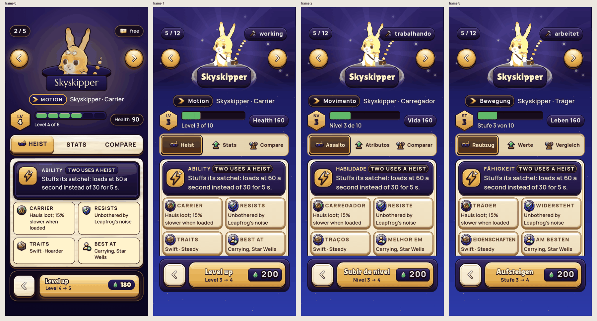

Character at 200%. From left: key frame 200%, English, key frame 200%
pt_BR, pt_BR, German.

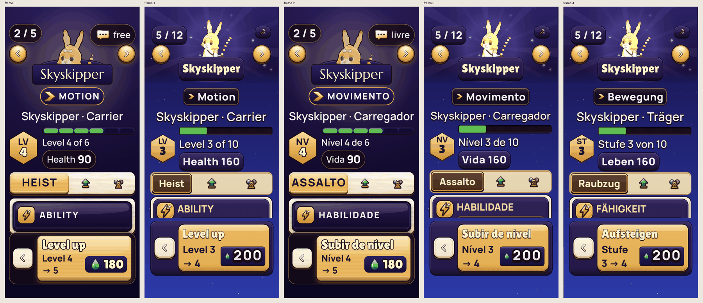

Character in high contrast. From left: key frame high contrast, English,
key frame high contrast pt_BR, pt_BR.

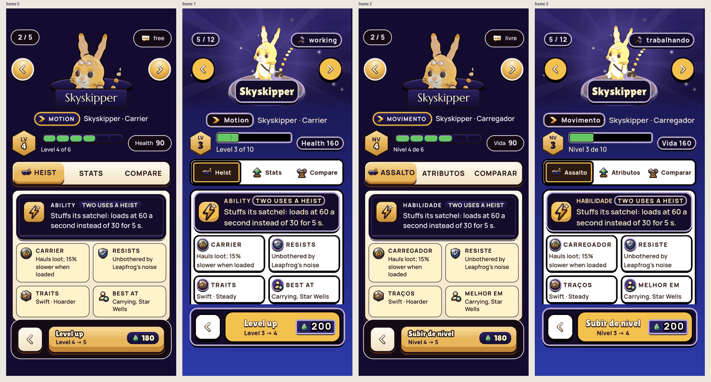

Character's other states at 200% English. From left: key frame 200%, then
fixture characters 1, 2 (scrolled to its resting view), 3 and 4.

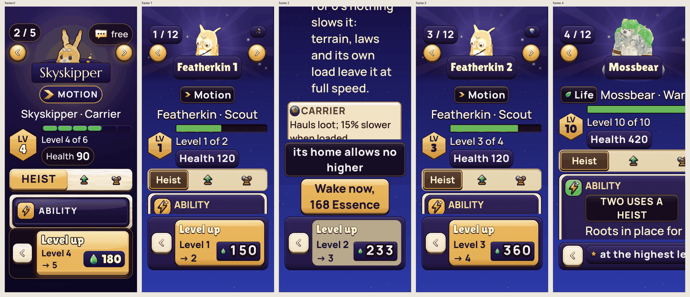

Character's tabs. From left: key frame, English Stats and Compare at
100%, pt_BR Stats and German Compare at 200%.

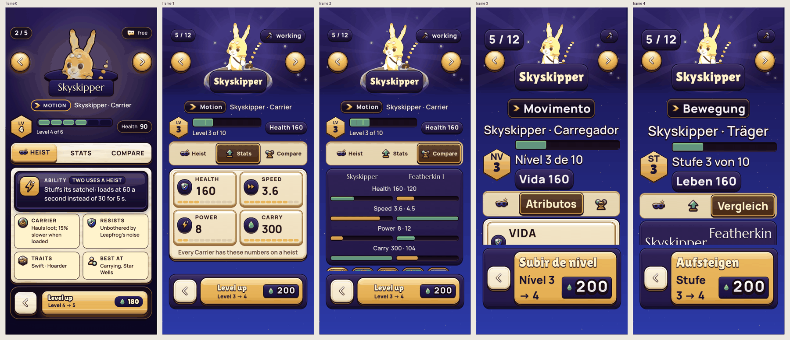

Settings at 100%. From left: key frame, English, key frame pt_BR, pt_BR,
German.

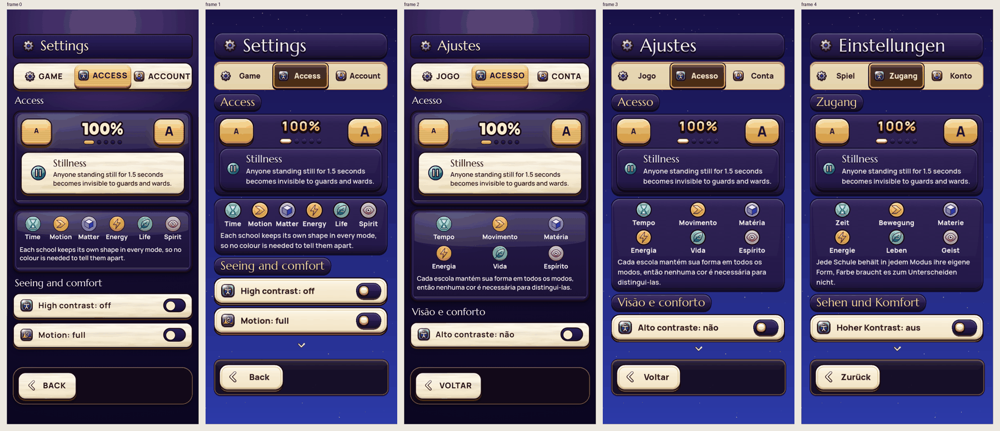

Settings at 200%. From left: key frame 200%, English, key frame 200%
pt_BR, pt_BR, German.

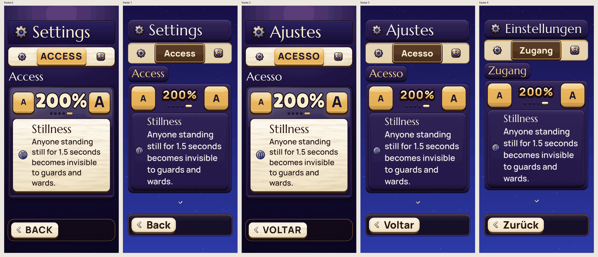

Settings in high contrast. From left: key frame high contrast, English,
key frame high contrast pt_BR, pt_BR.

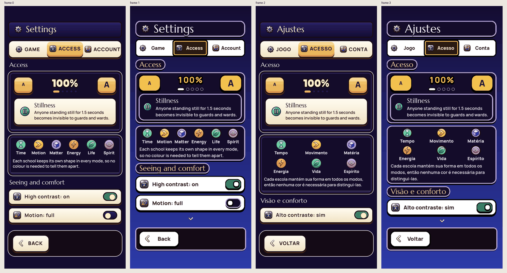

The Account tab. From left: key frame, signed out at 100% English and at
200% pt_BR, signed in at 100% English, scrolled, and at 200% pt_BR.

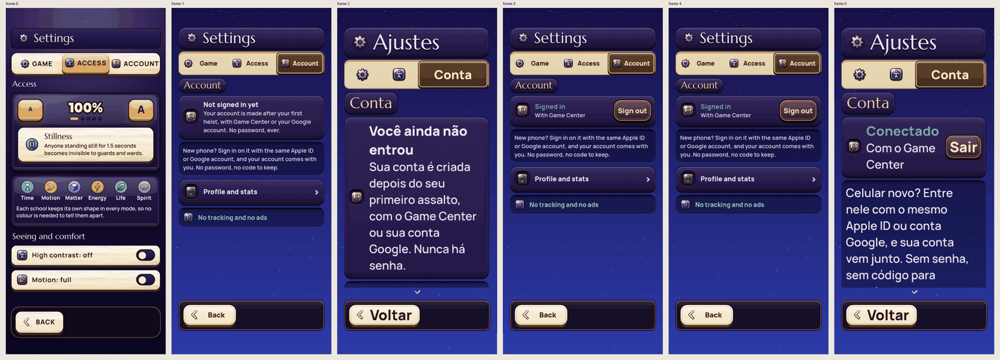

Settings in the grayscale squint. From left: English at 100%, key frame
200% pt_BR, pt_BR at 200%.

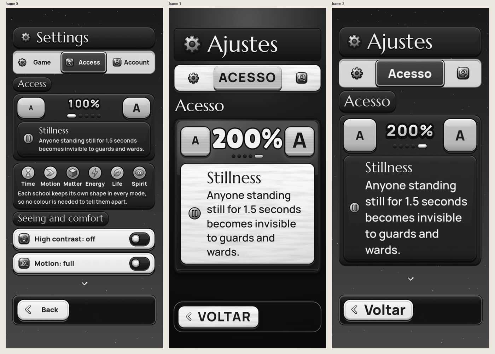

### K: the highest level at 200%

Fixture character 4 (Mossbear, level 10 of 10) fits at 100%, but at 200%
it runs off the screen in English, pt_BR and German. The sticky bar's "at
the highest level" pill (`CHARACTER_TOP_LEVEL`, built in
`character_screen.gd` `_actions`) keeps all its words at 200%: it does not
wrap, shrink or go icon-only, as the state pill does since H. German
reports "987 px of words in 900". The pill forces the whole screen wider
than the phone: the next arrow is gone, the subtitle is clipped
("Mossbear · Sentinela…", "Mossbear · Wächter…"), the tab strip is cut,
and the info grid's labels sit at x 90 + 998, past 1080. The fit check
prints 14 "fit FAIL" lines in pt_BR and German. The scripted fit check
(`docs/art/shots/menu-screens/fit_character.sh`) covers only character 5,
so the merge did not catch it. From left: key frame 200%, character 4 at
100% English, then at 200% in English, pt_BR and German.

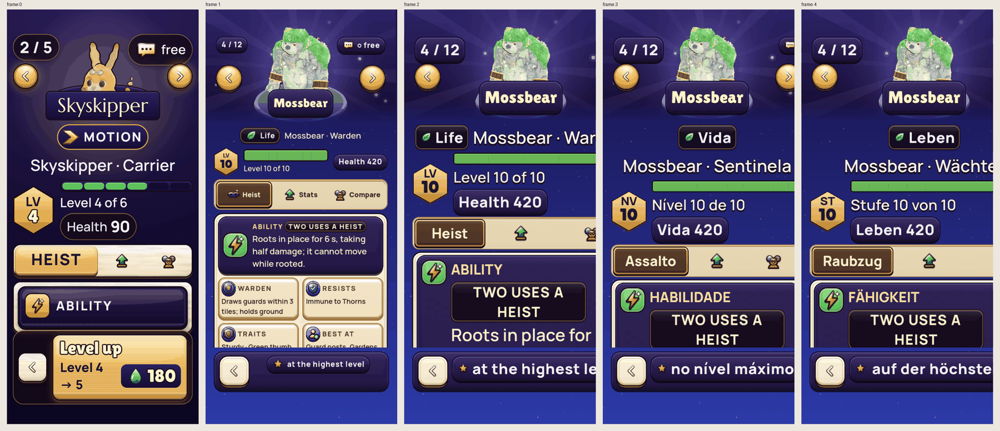

### L: the profile row's value step

S3-R18's profile row on the Account tab ("Profile and stats",
`screen_account.gd` `profile_row`) is a bare item on the night. Its
icon-and-words face sits at L* 16.1 on a ground of 13.7: `checks.py
value-steps` on `settings-account-100` gives ΔL* 2.5 and on
`settings-account-de` 3.6, FAIL (it needs 2 value steps). It is the only
failing control on the Account tab; the sign-in rows and buttons pass. It
reads, by its icon and words, but it is the one row with no plate.

### Objections

| ID | Item | Quality | Objection | Proposed fix | Owner |
|---|---|---|---|---|---|
| K | 3, 4, 5 (character at 200%) | 14, 2 | At its highest level the character screen runs off the phone at 200% in English, pt_BR and German: the "at the highest level" pill keeps all its words, forces the screen wider than 1080, cuts the next arrow, the subtitle, the tab strip and the info grid, and the fit check fails (14 lines in pt_BR and German). | In `client/scripts/character_screen.gd` `_actions`, at large text show the top-level pill as the star icon alone with an `accessibility_name` carrying the words (as H did for the state pill), or let it wrap at word boundaries inside the bar. Add character 4 (highest level) at 200% in English, pt_BR and German to `docs/art/shots/menu-screens/fit_character.sh`. | S3 |
| L | 10 (Account tab) | 8 | S3-R18's profile row fails value steps: ΔL* 2.5 (English) and 3.6 (German) against the night, the only failing control on the Account tab. | In `client/scripts/screen_account.gd` `profile_row`, give the row the plate the Access tab's rows use (a cream row, or a lit card), so it is at least 2 value steps off its ground. Re-run `checks.py value-steps` on `settings-account-100` and `settings-account-de`. | S3 |

Notes, which do not hold the board:
- The gate's advisory on `9e602fcc` (give the group headers more weight
  than the rows at 200%, quieten the gold steppers): the pt_BR key frame
  at 200% has the same weighting, a thin "Acesso" header over heavy rows
  and gold steppers. The build matches its reference, so neither is an
  objection.
- At 200% the stepper's value reads smaller than the key frame's large
  "200%". It stays legible and inside its plate.
- Compare at 200% German: "Featherkin 1" wraps its "1" to its own line,
  so the two name headings sit at different heights. The wrap is at a word
  boundary, and the name is a fixture's.
- Character 2's resting view (scrolled) shows the disabled Level up and
  the "its home allows no higher" plate; it holds.
- The signed-in shots show no Devices or Methods section, also in S3's own
  `auth_panel.gd` shot, so `_hide_kicker` could not be checked. It stays a
  note.
- Earlier notes stand: the faint `card_gold` rim, the gear at 200%, the
  dock's height and the selected tab's brown (K1), and English content in
  pt_BR and German.

### When the board stands

Board 5 stands when K and L are fixed: character 4 at 200% prints "fit ok"
in English, pt_BR and German with its next arrow, subtitle, tabs and info
grid whole, and `checks.py value-steps` passes the profile row on
`settings-account-100` and `settings-account-de`. A round 3 re-checks K
and L only; A to J stay settled unless the fix touches their code.

## Round 3 (board 5c)

Posted by AD, P2-AD-board-5c, 16 November 2026, on the integration branch
at `570c4b5b` (P2-S3-character-3 merged as `0ee8d9d8`). As the round 2
decision set out, AD re-checked only objections K and L. A to J stay
settled: character-3 changed the top-level pill (`character_screen.gd`
`_top_level`), the profile row (`screen_account.gd` `profile_row`), the
Account tab's stacking at large text (`auth_panel.gd` `_item` and
`_put_under`) and the settings shot. None of these is code that A to J's
fixes rest on.

**Method.** `tools/render/shoot.sh` on `character_screen.gd` and
`screen_settings.gd` with `FIT=1 RECORD=1`, `TEXT`, `LOCALE`, `HC`, `ID`,
`TAB` and `SIGNED=1`; `tools/ui_gate/checks.py value-steps` on AD's own
shot records; `tools/ui_gate/sheet.py strip` for the sheets. Every render
printed "fit ok": character 4 at 100% English, at 200% in English, pt_BR
and German, on all three tabs at 200% German, and in high contrast
English; character 5 at 200% pt_BR; the Account tab signed out and signed
in at 100% English and German, signed out at 200% pt_BR, and in high
contrast English, signed out and signed in. Draw calls were 35 to 91,
within the budget.

**Round 3 decision: board 5 stands on K and L.** Both are fixed. One new
light objection, M, was found on the signed-in Account tab, which round 2
did not check with `value-steps`. It goes to the lead as a request with a
default (AD-R43). Its fix is closed by a scripted check, so no round 4 is
needed.

### K: the highest level at 200%

Stands as fixed. Character 4 (Mossbear, level 10 of 10) prints "fit ok"
at 200% in English, pt_BR and German, where round 2 had 14 "fit FAIL"
lines. The "at the highest level" pill now wraps between words inside the
bar: "at the / highest level", "no nível / máximo", "auf der / höchsten /
Stufe". It keeps its star, and its `accessibility_name` carries the whole
words. The next arrow is back. The subtitle is whole ("Mossbear ·
Warden", "· Sentinela", "· Wächter"). The tab strip and the info grid sit
inside 1080. In German at 200% the Stats and Compare tabs also print "fit
ok", and character 5 at 200% pt_BR (the state pill's case, H) still holds.
`docs/art/shots/menu-screens/fit_character.sh` now covers characters 1 to
5 on all three tabs at 200% in English, pt_BR and German, so the merge
check will catch this case from now on.

From left: key frame 200%, character 4 at 100% English, then at 200% in
English, pt_BR and German.

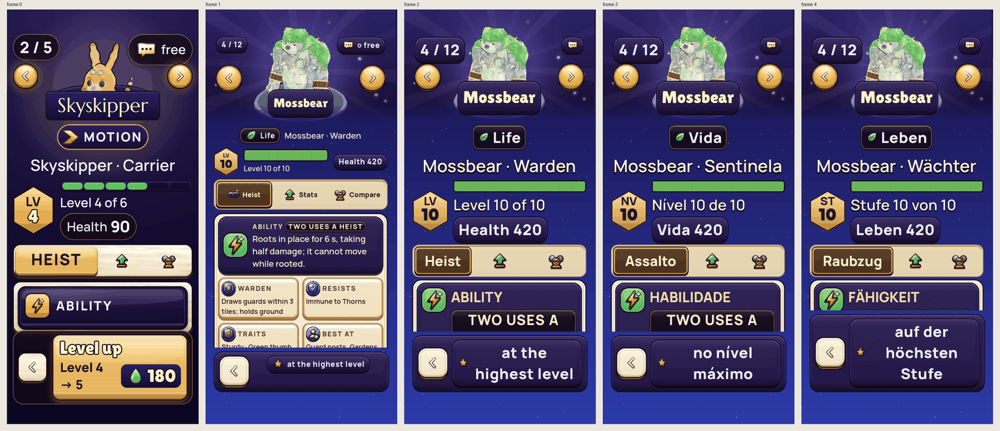

From left: key frame 200%, character 4 at 200% German on Stats and on
Compare, character 4 in high contrast English, character 5 at 200% pt_BR.

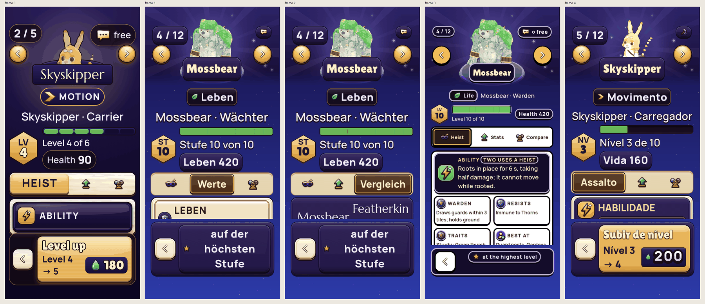

### L: the profile row's value step

Stands as fixed. The profile row ("Profile and stats") is now a parchment
item, `ScreenParts.item` on a cream plate, and the whole plate is the tap
target. `checks.py value-steps` passes it on AD's renders: ΔL* 72.7 in
English and 72.2 in German at 100%, and 80.1 in high contrast English.
Round 2 measured 2.5 and 3.6. Signed out, every control on the Account tab
passes.

From left: key frame, the Account tab signed out at 100% English, German,
high contrast English and 200% pt_BR, then signed in at 100% English.

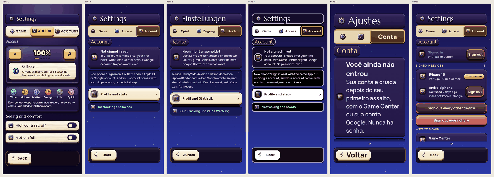

### M: the leather sign-out buttons, signed in

The signed-in shot now dispatches the devices, so the Devices section
renders for the first time. On the night, at 100%, two leather "Sign out"
buttons fail `value-steps`. They sit on the dark section card (L* about
13), not on the night itself:

| Record | Control | Face L* | Ground L* | ΔL* | Steps |
|---|---|---:|---:|---:|---:|
| signed in, 100% English | button 4: Sign out | 29.3 | 13.0 | 16.3 | 1.6 |
| signed in, 100% English | button 6: Sign out: Android phone | 29.1 | 13.0 | 16.1 | 1.6 |
| signed in, 100% German | button 4: Abmelden | 30.1 | 12.6 | 17.5 | 1.8 |
| signed in, 100% German | button 6: Abmelden: Android-Handy | 30.1 | 13.0 | 17.0 | 1.7 |

The same leather buttons pass where their ground is the darker night
("Sign out every other device", ΔL* 24.1 and 25.3). The gold "Sign out
everywhere" passes at 50.6. In high contrast every sign-out button passes
(ΔL* 30.4 to 36.7). The buttons read, by their words and their rim, but
they are the one pair of controls on the tab under 2 value steps. This
was not caused by character-3: the 100% side-by-side layout of
`auth_panel.gd` is unchanged. Round 2's signed-in still had no Devices
section, and round 2 ran `value-steps` only on the signed-out records.

### Objections

| ID | Item | Quality | Objection | Proposed fix | Owner |
|---|---|---|---|---|---|
| M | 10 (Account tab, signed in) | 8 | On the signed-in Account tab at 100%, the leather "Sign out" buttons on the section card fail value steps: ΔL* 16.1 to 17.5 (1.6 to 1.8 steps; 2 are needed) in English and German. | In `client/scripts/auth_panel.gd` `_button`, give the leather actions that sit on a section card a lighter face, or put them on the parchment plate the profile row now uses, so each is at least 2 value steps off its ground. Re-run `checks.py value-steps` on the signed-in 100% English and German records. | S3 |

Notes, which do not hold the board:
- The gate's advisory verdict on character-3 at `a6d5f2fb` fails Display
  type at 200% pt_BR on the subtitle and level line: a drop shadow but no
  outline. Those labels are unchanged since character-2 passed the same
  check at `6b7e6b42`, and character-3 did not touch them. AD reads this
  as the judge's run-to-run variation, not a change, so D stays settled.
- At 200% German the top-level pill takes three lines, so the bar is
  taller and the first screen shows only the ability card's header and
  the "TWO USES A…" chip at the bar's edge. This is the same trade B
  settled for the state pill, and the card is one scroll away.
- `_hide_kicker` can now be checked: signed in, the Devices section shows
  its "SIGNED-IN DEVICES 2" kicker. The round 2 note is closed.
- Earlier notes stand: the faint `card_gold` rim, the gear at 200%, the
  dock's height and the selected tab's brown (K1), and English content in
  pt_BR and German.

### When the board stands

Board 5 stands: A to L are fixed or settled. M is a light value-step miss,
closed by a scripted check rather than by another AD round. The follow-up
S3 task is done when `checks.py value-steps` passes every control on the
signed-in Account tab at 100% in English and German.
