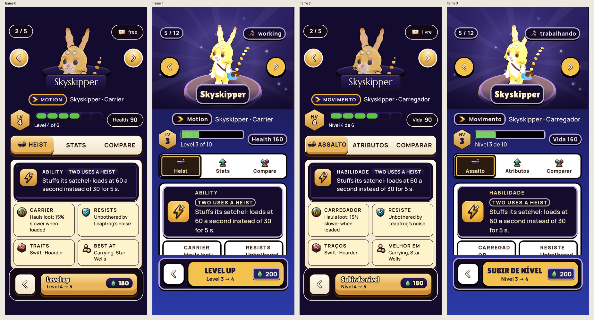
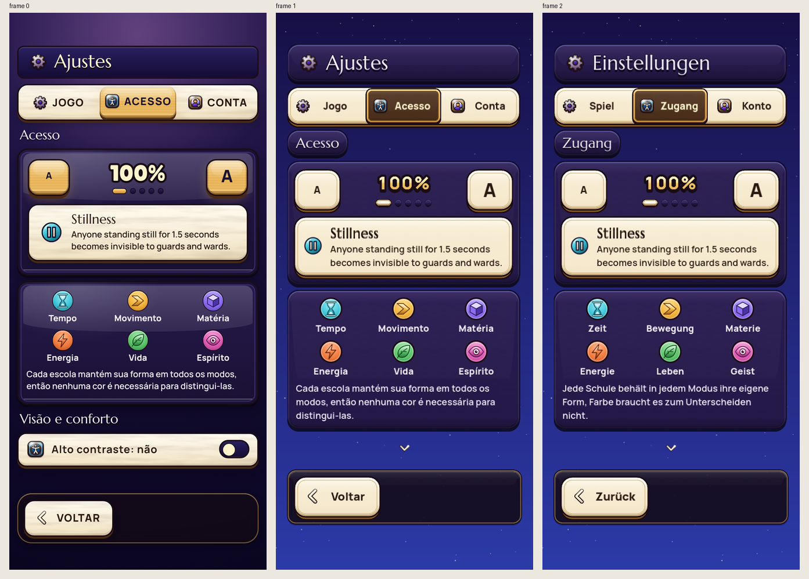
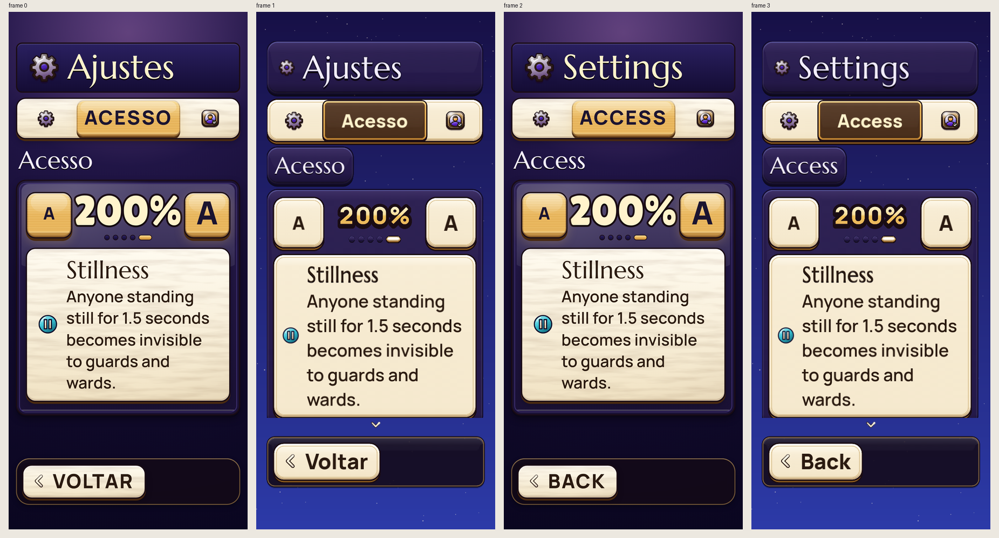

# Board 5: character and settings

Posted by AD, P2-AD-board-5, 15 November 2026, on the integration branch
at `b2adaf6a` (P2-S3-character merged as `f41d100e`, P2-S3-settings merged
as `f6f9f71a`). This is the character and settings board. It holds ten
items: the character screen and the settings screen beside their golden
references at phone size, at 100% and 200% text, in English, Portuguese
(Brazil) and German, and in high contrast. AD checks the owner-checked
qualities 1, 2, 3, 6, 8, 9, 13 and 14 on each.

**Round 1 decision: the board does not stand.** Seven objections are open
(listed in "Objections" below, in order of weight, M12). A is the Level up
button at 200%: in English the price chip covers the label, and in German
the label breaks mid-word and the level line spills out of its panel (the
shot's fit check fails). B and C are the fold: at 200% the tabs and the
ability header fall below the first screen, and at 100% the character's
info cards and the settings' second section are cut. D is display type on
the level badge and the price. E is the German settings title breaking
mid-word at 200%. F and G are light: the settings screen has no lead in
grayscale, and the character's stage ends in a hard edge. The rest holds:
the kit plates, the icons, the character on the pedestal, the colour
roles, high contrast, and the settings layout in English and Portuguese.
Character and settings are merged, so each objection goes to the lead as a
request for a follow-up task in `docs/progress/status/AD.json`, each with
a default.

## How to read it

- **Golden reference.** The character and settings key frames that AD
  approved in place of the owner (`../approvals/O2.md`), at
  `art/ui/keyframes/04-character*.png` and `05-settings*.png`, and the
  rubric's pass and fail anchors (`../rubric.md`). There is no German key
  frame; for German, the English key frame at the same text size is the
  bar.
- **Candidate.** AD rendered both screens on the integration branch with
  `tools/render/shoot.sh` on the character and settings shots and `FIT=1`,
  with `TEXT`, `LOCALE` and `CONTRAST`. Every render printed "fit ok"
  except the character in German at 200%, which printed "fit FAIL" on the
  Level up button's level line (objection A). The draw calls with
  `SERVER=1` were 81 (character, 100%), 59 to 61 (character, 200%), 59 to
  63 (settings, 100%) and 36 to 42 (settings, 200%), under the budget.
- **Size.** The project renders at 540×1170 (the window override in
  `project.godot`), half the key frames' 1080×2340. Each strip scales both
  to 960 px high, so they sit at the same size; the build's edges are a
  little softer for it. That is enough to judge at phone size.
- **Images.** AD's images are in [`board-5/`](board-5/), laid out with
  `tools/ui_gate/sheet.py strip`. A strip puts the key frame first (frame
  0) and the builds after it, at the same height, in the order the
  caption gives. The grayscale squint and the colour-vision sheets are
  `sheet.py still --gray` and `sheet.py cvd` of the 100% English build.
- **Verdicts** come from `../verdicts/<task>/<sha>.json`, written as pass
  or fail with the votes in order. All are advice only, because every
  judged quality is owner-checked (`../calibration.md`). The character was
  judged at `f1251e68` and at its ready sha `6f6a3b15`; settings at
  `eed8b817`, `f5719f28` and its ready sha `f0a36a41`. The verdicts below
  are the ready shas'; the earlier fails they fixed are named in brackets.
- **AD's check** is written as stands, note or **objection**. A note is
  recorded for the next round and blocks nothing. An objection holds the
  board.

## The items

### 1. Character at 100% text

Grayscale squint: [`1-character-100-gray.png`](board-5/1-character-100-gray.png).
Colour-vision sheet: [`1-character-100-cvd.png`](board-5/1-character-100-cvd.png).

Gate: `P2-S3-character/6f6a3b15`, the 100% shot.
- Hierarchy: pass (ppp). (`f1251e68` failed it; fixed.)
- Display type: fail (fff): "'Skyskipper · Carrier' and 'Level 3 of 10'
  sit on the starfield gradient with no ink outline… and the 'NV'/'LV' tag
  runs over the badge edge. Fix: outline the words over the backdrop, or
  set them on a plate."
- Character presence: pass (ppp).

| Quality | AD's check |
|---|---|
| 1 Materials | Stands. The stat cards, the ability card, the info cards and the action bar are kit plates with inked rims; Level up is the gold slab with a lip and a hard drop. |
| 2 Display type | **Objection D**, in part. The name "Skyskipper" carries the display face and the outline. The plain subtitle and level line on the backdrop match the key frame, which sets them the same way, so at 100% AD lets them stand and overrules the gate on that point. The level tag runs over the hexagon badge's top edge, as the gate says. The Level up label is uppercase with no outline, where the key frame sets "Level up" in the display face with an outline (folded into D). |
| 3 Icons | Stands. The schools row and the tab icons are the toon set. |
| 6 Hierarchy | Stands. Level up leads in grayscale, then the character and the name. |
| 8 Colour | Stands. Gold is on Level up and the stat arrows only. On the protanopia and deuteranopia views nothing depends on colour alone. |
| 9 Character | Stands. The character is large, on a lit pedestal, as the key frame (gate pass). |
| 13 Light | **Objection G** (light). The stage behind the character is a rectangle that ends in a hard horizontal edge about a third of the way down, then the blue backdrop starts. The key frame's sky runs on without a seam. |
| 14 One idea, fold | **Objection C.** The fourth info card is cut mid-line ("Hauls loot:") by the action bar. The tab strip (icons stacked over labels) and the ability card ("TWO USES A HEIST" on a line of its own) are taller than the key frame's, where all four info cards are on the first screen. Note: the action bar sits about 65 pt above the screen's foot, against about 40 pt in the key frame. |

### 2. Character at 100% text, Portuguese (Brazil) and German

Gate: these shots were not judged.

| Quality | AD's check |
|---|---|
| 14 One idea, fold | **Objection C**, as item 1: the last info card is cut in both locales. |
| 13 Light | **Objection G**, as item 1. |
| 2 Display type | **Objection D**, as item 1. "NÍVEL" and "AUFSTEIGEN" fit at 100%. |
| 1, 3, 6, 8, 9 | As item 1. Note: the ability prose, "TWO USES A HEIST" and "Hauls loot" are in English in both locales; the pt_BR key frame is in English there too, so this is content localisation, not the screen. |

### 3. Character at 200% text, Portuguese (Brazil) and English

The action bars at 2×, English then German:
[`3-character-200-foot.png`](board-5/3-character-200-foot.png).

Gate: `P2-S3-character/6f6a3b15`, 200% pt_BR.
- Display type: fail (fff): "…the 'NV' tag's dark glyphs merge into the
  badge, and the 200 price is a flat white figure. Fix: as at 100%, and
  give the price the display treatment."
- Hierarchy: pass (ppp).

| Quality | AD's check |
|---|---|
| 2 Display type, fit | **Objection A** (English). The "200" price chip sits over the Level up label ("LEVEL UF" shows) and over the "4" of "Level 3 → 4". pt_BR fits: "SUBIR DE / NÍVEL" on two lines with the price beside it. The key frame wraps the label above, with the level line and the price side by side below it. |
| 2 Display type | **Objection D.** The level tag is clipped at the badge's top edge ("LV" cut in English; "NV" merges into the badge in pt_BR, as the gate says). The price is a flat white figure. The subtitle and the level line are larger at 200% and still have no outline; here they want the kit's outline, as the gate asks. |
| 14 One idea, fold | **Objection B.** pt_BR: the subtitle takes two lines and "Nível 3 / de 10" two, and the tabs and the ability header fall below the first screen. English: the tabs are on the first screen, but only Heist and Stats show; Compare is cut at the right edge. The key frame keeps a compact strip (the selected tab's word plus two icon-only tabs) and the ability header above the actions. |
| 6 Hierarchy | Stands. Level up leads (gate pass). |
| 1, 3, 8, 9, 13 | As item 1 (G applies). |

### 4. Character at 200% text, German

Reference: `04-character_text200.png`. Gate: not judged. The shot's fit
check fails on the Level up button's level line.

| Quality | AD's check |
|---|---|
| 2 Display type, fit | **Objection A.** The label breaks mid-word, "AUFSTEIG / EN", and "Stufe 3 → 4" spills below the button, outside its panel (the "fit FAIL"). |
| 14 One idea, fold | **Objection B.** "Stufe / 3 von / 10" takes three lines; only Raubzug and Werte show in the tab strip; the ability header is below the first screen. |
| 2 Display type | **Objection D**, as item 3. |
| 1, 3, 6, 8, 9, 13 | As item 1. |

### 5. Character in high contrast, English and Portuguese

Gate: `P2-S3-character/6f6a3b15`, high contrast.
- Colour roles: pass (ppp).
- Hierarchy: pass (fppfpp, four of six).

| Quality | AD's check |
|---|---|
| 8 Colour | Stands. Solid white plates with dark rims and dark text; the selected tab has a gold rim; Level up stays gold. |
| 6 Hierarchy | Stands (gate pass, four of six). Level up leads. |
| 13 Light | Note. The backdrop keeps the night gradient's royal blue lower half, where the high-contrast key frame is near-black. The gradient is tokens.json's "night" under the owner's C75 (closed as A: §21.2's linear values); whether high contrast should darken it is K1's and C75's, not this screen's. |
| 1, 2, 3, 9, 14 | As item 1 (C, D and G apply). |

### 6. Settings at 100% text

Grayscale squint: [`6-settings-100-gray.png`](board-5/6-settings-100-gray.png).
Colour-vision sheet: [`6-settings-100-cvd.png`](board-5/6-settings-100-cvd.png).

Gate: `P2-S3-settings/f0a36a41`, the 100% shot.
- Hierarchy: pass, narrowly (ppffpf, three fails of six; a fail needs
  four). The weak point is the dark "Access" and "Seeing and comfort"
  header pills, which weigh less in grayscale than the bright cream rows.
- Display type: pass (ppp). (`eed8b817` failed it on the "100%" readout;
  fixed.)

| Quality | AD's check |
|---|---|
| 1 Materials | Stands. The tab strip, the rows, the steppers and Back are kit plates with inked rims. |
| 2 Display type | Stands. The title has the display face and outline; the "100%" readout is outlined. |
| 3 Icons | Stands. The gear, the tab icons and the row icons are the toon set. |
| 6 Hierarchy | **Objection F** (light). In the grayscale squint every cream plate (the tab strip, the A−/A+ steppers, Stillness, High contrast, Back) has the same value, and nothing leads; the gate passed it by one vote. The key frame gives the A−/A+ steppers and the selected tab a gold fill. |
| 8 Colour | Stands. On the protanopia and deuteranopia views the switches read by their knob and word, not by colour. |
| 9 Character | Not on this screen. |
| 13 Light | Stands. One top light on the plates. |
| 14 One idea, fold | **Objection C.** The "Motion: full" row is below the fold (a chevron shows). The key frame has both switch rows on the first screen. |

### 7. Settings at 100% text, Portuguese (Brazil) and German

Gate: these shots were not judged.

| Quality | AD's check |
|---|---|
| 14 One idea, fold | **Objection C.** In both locales the whole "Visão e conforto" / second section is below the first screen. The pt_BR key frame shows both switch rows. |
| 2, 6 | As item 6 (F applies). Note: "Stillness" and its text are in English in both locales (content localisation, as item 2). |
| 1, 3, 8, 13 | As item 6. |

### 8. Settings at 200% text, Portuguese (Brazil) and English

Gate: `P2-S3-settings/f0a36a41`, 200% pt_BR.
- Display type: pass (ppp).
- Hierarchy: pass (ppfppp). (`f5719f28` failed the header outline and
  this hierarchy; fixed.)

| Quality | AD's check |
|---|---|
| 14 One idea | Stands. The title, the tabs, the text size stepper and the first switch rows are on the first screen in both locales, close to the key frames. |
| 2 Display type | Stands. Note: the title's gear is smaller than the key frame's at 200%. |
| 6 Hierarchy | Stands (gate pass); F applies at 100%. |
| 1, 3, 8, 13 | As item 6. |

### 9. Settings at 200% text, German

Reference: `05-settings_text200.png`. Gate: not judged.

| Quality | AD's check |
|---|---|
| 2 Display type, fit | **Objection E.** The title breaks mid-word, "Einstellung / en", beside a tiny gear. The Stillness card's text is cut at "to guards and". |
| 14 One idea | Stands, with E. The tabs and the stepper are on the first screen. |
| 1, 3, 6, 8, 13 | As item 6. |

### 10. Settings in high contrast, English and Portuguese

Gate: `P2-S3-settings/f0a36a41`, high contrast.
- Colour roles: pass (ppp).
- Hierarchy: pass (ppp).

| Quality | AD's check |
|---|---|
| 8 Colour | Stands. Solid plates with dark rims; the switches read by knob and word. |
| 6 Hierarchy | Stands (gate pass). |
| 13 Light | Note, as item 5: the backdrop keeps the night gradient (K1, C75). |
| 1, 2, 3, 14 | As item 6 (C applies to the fold in pt_BR). |

## Objections

In order of weight. Character and settings are merged, so each objection
goes to the lead as a request in `docs/progress/status/AD.json` for a
follow-up task, with a proposed owner and a default.

| ID | Item | Quality | Objection | Proposed fix | Owner |
|---|---|---|---|---|---|
| A | 3, 4 | 2, 14 | At 200% the Level up button does not fit its words. English: the "200" price chip covers the label ("LEVEL UF") and the "4" of "Level 3 → 4". German: the label breaks mid-word ("AUFSTEIG / EN") and "Stufe 3 → 4" spills below the button outside its panel, so the shot's fit check fails. | In `client/scripts/character_screen.gd`, measure the label against the width left after the price chip; wrap at word boundaries only, shrink the label, or stack the price under it as the key frame does. Add the English and German 200% shots to the character's scripted fit check. | S3 |
| B | 3, 4 | 14 | At 200% the tabs and the ability header fall below the first screen (pt_BR), or the tab strip is cut to two tabs with Compare off the edge (English, German). The subtitle and level line take two or three lines. | At 200%, show the unselected tabs icon-only, as the key frame does; let the subtitle and level line shrink to one line; keep the tabs and the ability header on the first screen in every locale. | S3 (K1 if `kit_tabs.gd` needs an icon-only form) |
| C | 1, 2, 6, 7 | 14 | At 100% the first screen is cut short. Character: the fourth info card is cut mid-line in every locale, because the stacked tab strip and the ability card's own tag line are taller than the key frame's. Settings: "Motion: full" is below the fold in English, and the whole second section in pt_BR and German. | Character: put the tab icons inline with their words and the ability tag inline with its heading, as the key frame. Settings: tighten the vertical spacing and the group header pills so both switch rows fit at 100% in every locale. | S3 |
| D | 1, 2, 3, 4 | 2 | The level tag runs over the badge's top edge and is clipped or merges into it at 200%; the price is a flat white figure; at 200% the subtitle and level line on the backdrop have no outline; the Level up label has no outline. | Keep the tag inside the badge at every text size (scale the badge or set the tag above it); give the price and the Level up label the kit's display treatment (outline, drop); give the backdrop text the kit's outline at 200%. At 100% the plain subtitle and level line may stay, as the key frame. | S3 |
| E | 9 | 2 | At 200% in German the settings title breaks mid-word ("Einstellung / en") beside a tiny gear, and the Stillness card's text is cut. | In `client/scripts/settings_screen.gd`, wrap the title at word boundaries only or shrink it to fit the row; let the Stillness card grow to its text. Add the German 200% settings shot to the fit check. | S3 |
| F | 6 | 6 | In the grayscale squint no plate leads on settings: every cream plate has the same value, and the gate passed hierarchy by one vote. | Give the A−/A+ steppers the gold fill, as the key frame does, and/or strengthen the group header pills. | S3 |
| G | 1, 2, 3 | 13 | The character's stage ends in a hard horizontal edge about a third of the way down, then the blue backdrop starts; the key frame's sky runs on. | Fade the stage's bottom edge into the backdrop (a gradient mask or a soft lower edge) in `client/scripts/character_screen.gd`. | S3 |

Notes carried to the next round, which do not hold the board:
- The backdrop's royal blue lower half is tokens.json's "night" under the
  owner's C75. High contrast keeps it, where both high-contrast key frames
  are near-black; whether high contrast darkens the backdrop is for K1 and
  C75 (K1).
- The action bar sits about 65 pt above the screen's foot on both screens,
  against about 40 pt in the key frames: `client/scripts/ui.gd` sets the
  bottom safe margin from `safe_top_points` (44 pt). This also pushes the
  fold up (C). Board 4 noted the same on the result screen (K1, S3).
- The selected tab is the kit's dark brown where the key frames show gold.
  It is consistent across the kit and keeps a single gold lead per screen
  (K1).
- The ability prose, "TWO USES A HEIST", "Hauls loot", "Stillness" and its
  text are in English in pt_BR and German; the pt_BR key frames are in
  English there too (lead, content localisation).
- The settings title's gear is smaller than the key frame's at 200% (S3).

## When the board stands

The board stands when objections A–G are fixed and re-shot (the stills of
items 1 to 10), the character's German 200% shot prints "fit ok", and AD
has checked the new stills on this page. Under section 3.8 of the report,
the board merges when AD lets it stand, with no 24-hour wait.
