# Flow board 2: result, character and settings

Posted by AD, P3-AD-flow-2, 17 November 2026, on main at `44c43c4f` (the
integration branch's head when the task started; its `client/` is the same
as at the walks). It checks three flows end to end on the app's own router and
buttons:

- heist to result to home;
- home to character and back;
- home to settings and back.

Each flow was walked three ways, nine walks in all:

- 100% text in English;
- 200% text in pt_BR;
- high contrast, in English at 100%.

At each move AD checked three things: that the move goes where it should
(navigation), that the screen is still built from the kit (drift from the
kit), and that a screen's state survives the move (state carried).

**Ruling: the flows work but the board does not stand.** All nine walks
reach the end with no failed step. No move lands on the wrong screen, and
the result's Home really goes home.

AD found nine numbered findings. The two heaviest:

- **F1, a kit fault.** On every screen the router opens, the chosen tab's
  picture floats out of its tile and leaves the tile blank. This holds in
  all nine walks.
- **F2, a navigation hole.** The phone's own back gesture or button would
  quit the app from any screen.

Each finding has a number, its screen, its file and an owner, and goes to the
lead as a request in `docs/progress/status/AD.json` (AD-R47 to AD-R55, one
per finding, each with a default). Each navigation finding (F2, F3, F4, F5)
names the scripted test that would catch it. Notes N1 to N4 at the end are
small and carry no request.

## How to read it

- **The walker.** `tools/ui_gate/flow_walk.gd`. It mounts the app as
  `universe_home.gd` does (the fixture realm, the sample universe, the
  roster), opens home through `router.go(&"home")`, and then presses the
  screens' own buttons (`pressed.emit()`), as a tap would. It takes a still
  at every step (`NN-step.png`) and prints the route, the scene and what the
  step checks: the purse, the roster's scroll, the text size, the settings
  tab.
- **How to run it.** Copy it into `client/tests/shots/` (it is not
  committed there), then run
  `FLOW=<result|character|settings> OUT=<dir> TEXT=<100|200> LOCALE=<en|pt_BR> CONTRAST=<1 or empty> bash tools/render/shoot.sh client/tests/shots/flow_walk.gd <dir>/last.png`.
- **The images.** Stills are 540 by 1170 (half of the 1080 by 2340 render).
  Each flow and case has a contact sheet in `flow-2/<case>-<flow>.png`.
  Crops and comparisons are in `flow-2/f*.png` and `flow-2/n*.png`.
- **Owners.** The owner is whoever owns the file now
  (`python3 tools/coord/owners.py owner <path>`). Every file named here is
  the lead's, except `client/scripts/home.gd`, which P3-S2-home-states (S2)
  holds. The lead routes each request: to S2 while S2 holds home, else to a
  new task.
- **M40.** A mark of M40 means the finding depends on the final shape of a
  screen or a rule, and may be settled by a decision rather than a fix.

## The flows

### Heist to result to home

| Case | Sheet |
|---|---|
| 100%, en | 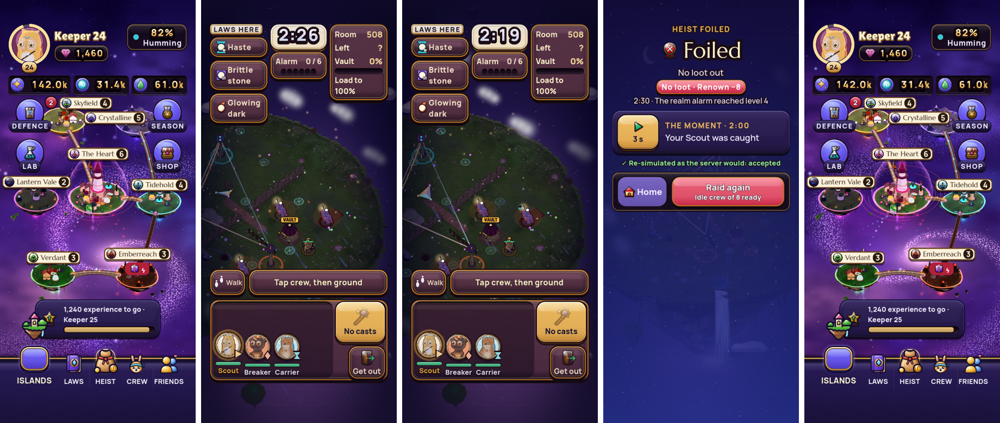 |
| 200%, pt_BR | 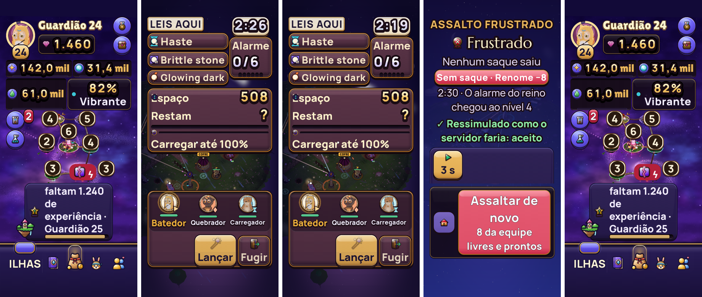 |
| High contrast | 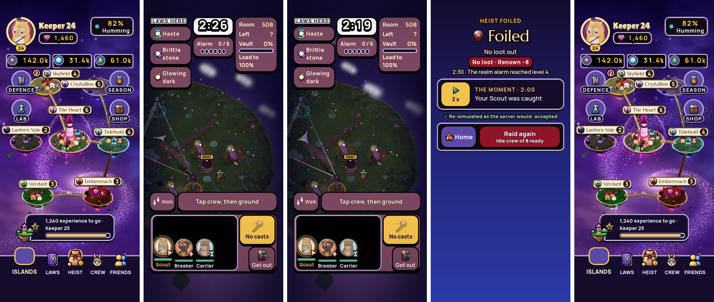 |

The steps: home, then home's Heist tab, then the heist (offline on the
fixture realm), then the heist with its clock played out, then the result,
then the result's Home, then home again.

| Check | What AD found |
|---|---|
| Navigation | Holds. The Heist tab starts the heist; `finish()` opens the result with a verdict (`ok`, `grade`, `banked`); Home returns to `home`. On home the Heist tab starts a heist, but on every other screen it opens the observatory (F3). |
| Drift from the kit | **F1** on the home before and after (the Islands picture floats over the XP strip). **F9** at 200% pt_BR: a map marker draws over the loot panel's word "Espaço". The result is kit-built. Its lower half is empty (N4). |
| State carried | Holds. On the stills the purse reads the same before and after (1,460 and 142.0k, 31.4k, 61.0k): an offline heist on the fixture realm banks nothing, as it should. |
| Content | **F8**: the heist's law names show in English in pt_BR ("Haste", "Brittle stone", "Glowing dark"). |

### Home to character and back

| Case | Sheet |
|---|---|
| 100%, en | 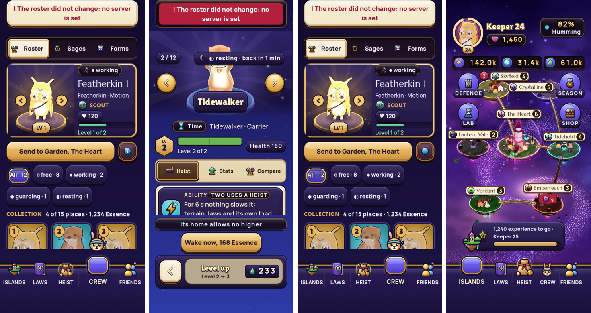 |
| 200%, pt_BR | 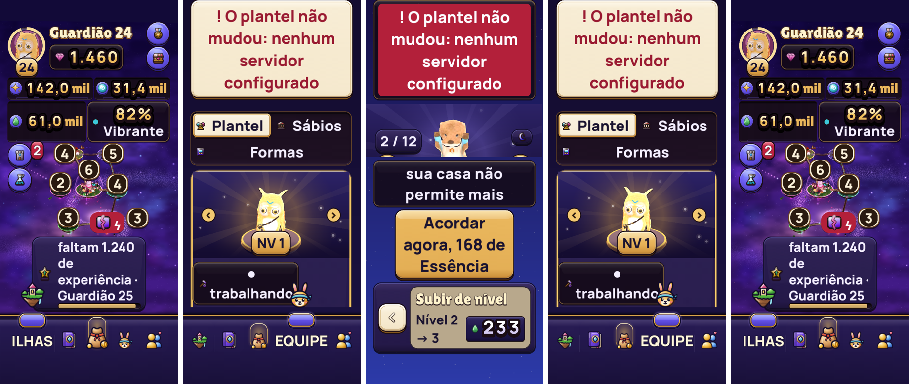 |
| High contrast | 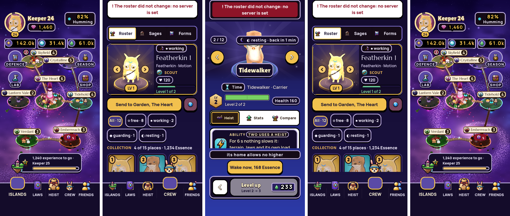 |

The steps: home, then home's Crew tab, then the roster (scrolled to 400),
then the second character, then the character's back, then the roster again,
then the roster's Islands tab, then home.

| Check | What AD found |
|---|---|
| Navigation | Holds, with a hole. Each move lands where it should. The character's back is not the screens' back control: it carries no `back` meta, the walker had to find it by its name ("Roster" / "Plantel"), and nothing but a tap reaches it. There is no system back (F2, F4). |
| Drift from the kit | **F1** on the roster (the Crew picture floats over collection card 3) and on home. **F4**: the character's back is a small parchment "<" inside the level-up card, where the other screens use the ScreenNav dock's "« Back". **F7**: the same offline notice is cream on the roster and red on the character. The ability text scrolls under the sticky "its home allows no higher" strip (N3). |
| State carried | **F5.** The roster's scroll is 0 after back in all three cases (400 before), and the roster comes back on its first stage. |

### Home to settings and back

| Case | Sheet |
|---|---|
| 100%, en | 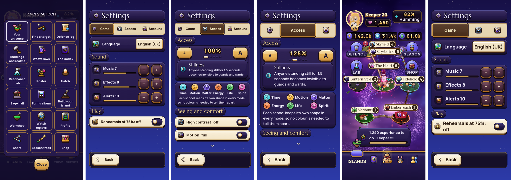 |
| 200%, pt_BR | 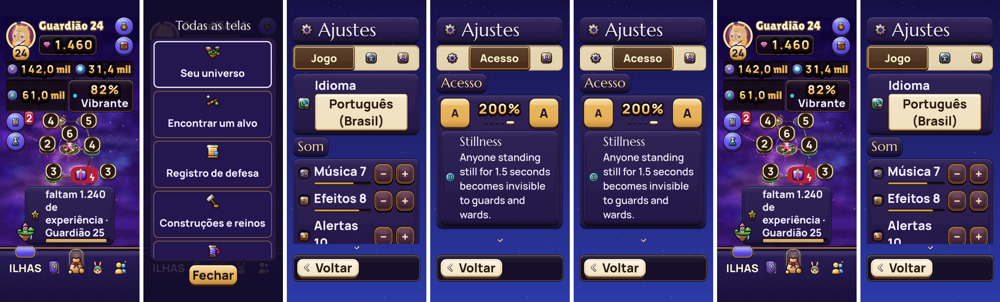 |
| High contrast | 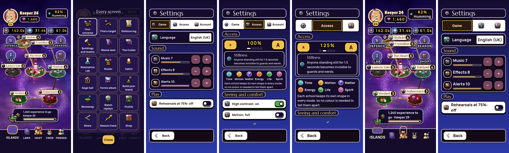 |

The steps: home, then the Keeper's plate (the menu), then Settings, then the
Access tab, then one step larger text, then Back, then home, then Settings
again.

| Check | What AD found |
|---|---|
| Navigation | Holds. The plate opens the menu, the menu's Settings opens settings, Back returns home. |
| Drift from the kit | **F1** on home after. **F3**: back on home at 125% (the high-contrast walk), home hides the other tabs' words, while ScreenNav and the stage bar keep them up to 125%. In the menu the title sits over the faded Keeper plate (N1). At 200% the Islands tab shows behind Fechar (N2). |
| State carried | Text size carries: 100 to 125 in high contrast and in English, and back on home at that size. At 200% it stays at 200, the top, as it should. **F6**: settings reopens on Game every time, not on the tab last shown (Access). |
| Content | **F8**: the Access tab's Stillness card names its law in English in pt_BR. |

## Findings

### F1. The chosen tab's picture floats out of its tile (kit, highest)

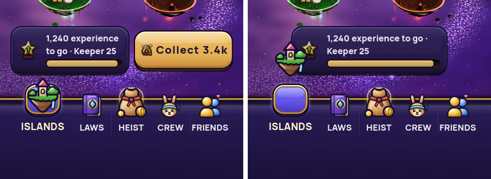

*Left: home as `universe_home.gd` mounts it directly. Right: the same home
reached through `router.go(&"home")`.*

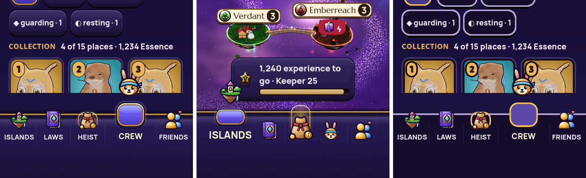

*The roster in English, home at 200% pt_BR and the roster in high
contrast.*

- **Screens.** Home and the roster, the two tab screens the walks reach
  through the router. It was seen in every case: English, 200% pt_BR and
  high contrast. ScreenNav's bar chooses its tab through the same
  `KitTabs.choose()`, so the codex, the observatory and friends are likely
  to show it too (not walked here).
- **What is wrong.** The chosen tile is a blank gold-rimmed square. Its
  picture stands about 180 render pixels higher, over home's experience
  strip or over the roster's collection card 3.
- **Why the gate missed it.** Home's own shot (`universe_home.gd`) mounts
  home directly, and there the picture sits in its tile. So board 3 and its
  rounds never saw it. Only a move through the router shows it, which is
  what a player does.
- **Probable cause.**
  - `KitTabs.choose()` (`client/ui/kit_tabs.gd:201`, the bob at :252)
    starts `Motion.bob` (`client/ui/motion.gd:357`) while the bar is in the
    tree but before the new scene is laid out.
  - The bob loops relative tweens on `position:y`. Each loop keeps writing a
    position taken from a tile that had no height yet.
- **Files.** `client/ui/kit_tabs.gd`, `client/ui/motion.gd`.
- **Owner.** The lead (AD-R47).
- **Scripted test.** A mount test in `client/tests/run.gd` would catch it:
  open each tab's route through `router.go`, let it settle, and assert that
  the chosen picture's global rect lies inside its tile's rect.

### F2. No system back: the phone's back would quit the app (navigation)

- **Screens.** Every screen.
- **What is wrong.**
  - No script handles `NOTIFICATION_WM_GO_BACK_REQUEST` or `ui_cancel`.
  - `project.godot` does not set `application/config/quit_on_go_back`, which
    defaults to true.
  - So on Android the back gesture or button quits from the character,
    settings, the result or the roster, where a player expects to go back
    one screen.
- **Files.** `client/app/router.gd` (one handler at the root), with each
  screen's back route; `client/project.godot`.
- **Owner.** The lead (AD-R48).
- **Scripted test.** In `client/tests/core_tests.gd`, beside `_router()`
  (line 144, which swaps `router.change` for a recorder): send a go-back on
  the character, settings, the result and the roster, and assert each lands
  on its back route and nothing quits. On home, assert it does not quit
  without a confirm.

### F3. Three tab bars, three route tables, two label rules (navigation, kit drift)

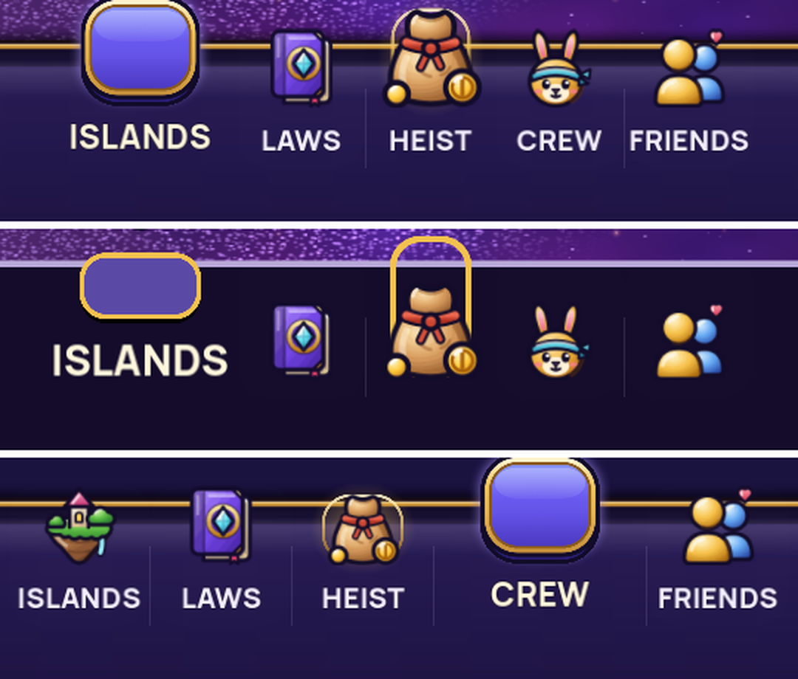

*Home at 100% (words shown), home at 125% in high contrast (only Islands
keeps its word) and the roster at 100%.*

- **Screens.** Home, the roster and every ScreenNav screen.
- **What is wrong.** Three builders make the same bar, each with its own
  routes:
  - **ScreenNav.bar** uses `Router.TABS` (`client/scripts/screen_nav.gd:127`)
    and hides the unchosen words above 125% (`LABELS_UP_TO`, line 16).
  - **StageHeroKit.tab_bar** copies the table (`client/world/stage_hero_kit.gd:316`)
    and hides words above 125% (line 328).
  - **Home** has its own `TAB_ROUTES` (`client/scripts/home.gd:26`) and
    `_on_tab` (:441). Its Heist tab starts a heist (`_play`, :976), where
    on every other screen Heist opens the observatory. Home hides words by
    fit (`_fit_tab_words`, :382), so at 125% home drops them and the roster
    keeps them.
- **The effect.** The same tap does two things, and the bar changes shape
  between screens at the same text size.
- **M40.** Whether Heist should start a heist from home is a design call.
  The duplicated tables are not.
- **Files.** `client/scripts/home.gd` (S2, P3-S2-home-states),
  `client/world/stage_hero_kit.gd`, `client/scripts/screen_nav.gd`.
- **Owner.** The lead (AD-R49). Home's part goes to S2 while S2 holds home.
- **Scripted test.** A core test that builds each bar (ScreenNav,
  StageHeroKit, home), presses every tab with the router recorder, and
  asserts each id routes to `Router.TABS[id]`, or to a single listed
  exception.

### F4. The character's back is not the kit's back (navigation, kit drift)

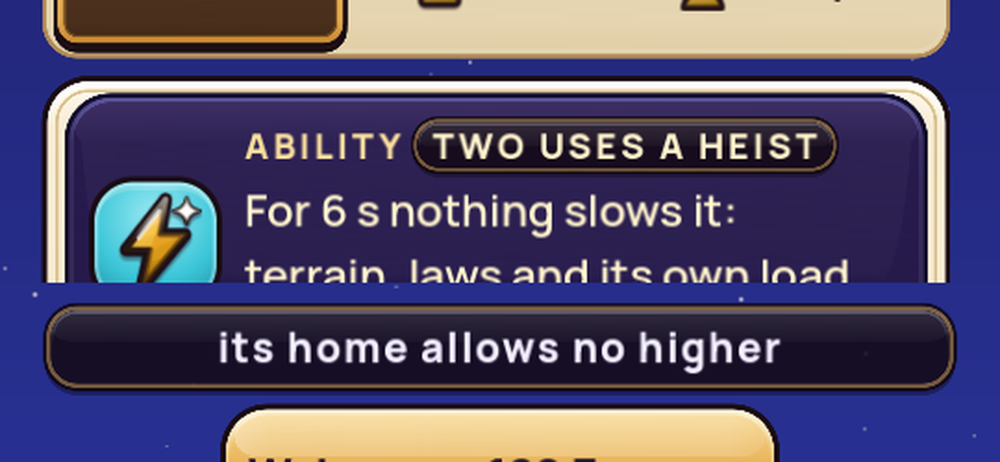

- **Screen.** The character.
- **What is wrong.**
  - Its back is `KitControls.icon_button("generalui/back", HOME_ROSTER, …)`
    (`client/scripts/character_screen.gd:111`): a 56-point parchment "<"
    inside the level-up card.
  - It is named "Roster", not "Back", and has no `back` meta.
  - Settings, the codex and the other ScreenNav screens use
    `ScreenNav.back_button`, the dock's "« Back".
  - So the character is the only screen whose back looks and reads
    differently, and any tool or handler that looks for the back (F2's
    included) misses it.
- **File.** `client/scripts/character_screen.gd`.
- **Owner.** The lead (AD-R50).
- **Scripted test.** A mount test in `client/tests/run.gd`: open every
  non-tab route through `router.go`, and assert it holds exactly one visible
  button with meta `back` that routes to its back route.

### F5. The roster forgets its scroll and stage across the character (state, navigation)

- **Screens.** The roster, then the character, then the roster.
- **What is wrong.**
  - The router rebuilds the roster (`change_scene_to_file`), so the scroll
    the player left (400) comes back as 0, in all three cases.
  - The stage picked on the roster comes back as the first stage.
  - A player who looks at characters down the list scrolls back to them
    after every one.
- **Files.** `client/scripts/roster_screen.gd` (keep scroll and stage in the
  store, or pass them as route args), `client/app/router.gd`.
- **Owner.** The lead (AD-R51).
- **Scripted test.** A mount test: open the roster, set its scroll and
  stage, `router.go(&"character", …)`, press the character's back, and
  assert the roster's scroll and stage are the same.

### F6. Settings reopens on Game, not on the tab last shown (state, M40)

- **Screen.** Settings: `tab_shown := "game"`
  (`client/scripts/settings_screen.gd:68`).
- **What is wrong.** A player who changed the text size on Access and came
  back lands on Game. The setting itself carries: home shows the new size.
- **M40.** Some games always open settings on the first tab. AD's default is
  to remember the last tab for the session.
- **File.** `client/scripts/settings_screen.gd`.
- **Owner.** The lead (AD-R52).

### F7. The same offline notice in two colours (kit drift)

- **Screens.** The roster (cream notice) and the character (red notice).
  Both say "The roster did not change: no server is set" (`ERR_OFFLINE`).
- **What is wrong.** The same state has two looks one tap apart. The kit has
  one notice: an offline state is information, not an error.
- **Files.** `client/scripts/character_screen.gd`,
  `client/scripts/roster_screen.gd`.
- **Owner.** The lead (AD-R53).

### F8. Law names and rules are English in pt_BR (content)

- **Screens.**
  - The heist's law chips ("Haste", "Brittle stone", "Glowing dark").
  - Settings' Access tab (the Stillness card).
- **What is wrong.** `client/i18n/content.csv` holds English in every locale
  column for the law keys, for example `LAW_BRITTLE_STONE`,
  `LAW_GLOWING_DARK`, `LAW_STILLNESS` and `LAW_RULE_STILLNESS`. So a pt_BR
  player reads English mid-sentence.
- **File.** `client/i18n/content.csv`.
- **Owner.** The lead (AD-R54, a translation task).

### F9. A map marker draws over the loot panel at 200% (kit drift)

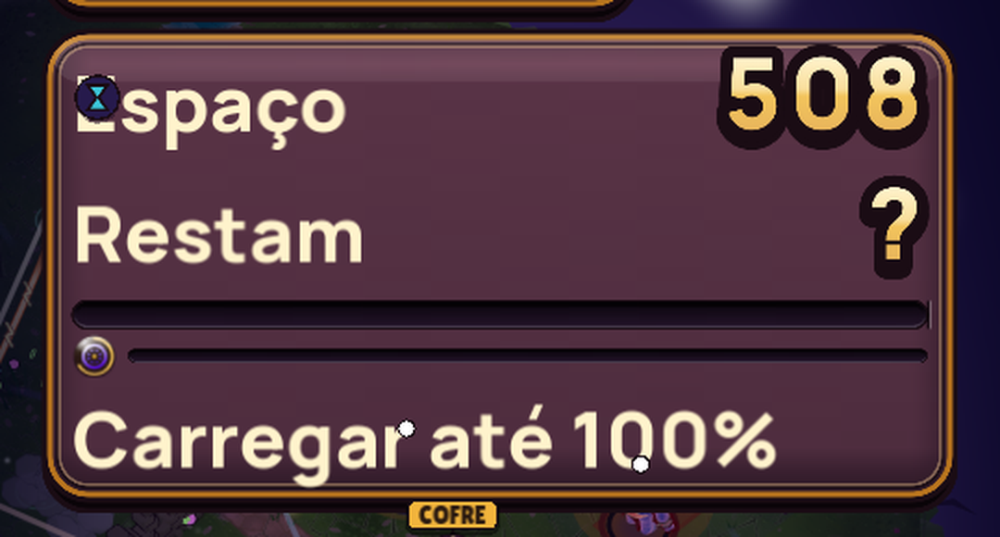

- **Screen.** The heist at 200% pt_BR.
- **What is wrong.** At 200% the loot panel grows down over the map. A map
  marker (the hourglass at the top of a sentry's beam) then draws over the
  panel's first word, so "Espaço" reads "?spaço". At 100% and in high
  contrast the panel is shorter and the marker sits on the map.
- **Cause.** The map's markers draw above the HUD.
- **Files.** `client/scripts/heist_screen.gd` (the map's layer order),
  `client/scripts/heist_hud.gd`.
- **Owner.** The lead (AD-R55).

## Notes (no request)

- **N1.** In the menu the title "Every screen" / "Todas as telas" sits over
  the faded Keeper plate (`flow-2/n1-menu-top.png`).
- **N2.** In the menu at 200% pt_BR, the tab bar's "ILHAS" shows behind
  Fechar.
- **N3.** On the character, the ability text scrolls under the sticky "its
  home allows no higher" strip with no fade (`flow-2/n3-character-strip.png`).
- **N4.** The result's lower half is empty at every size. The space would
  take the loot breakdown or the next step.
- **The shot scripts' names for high contrast differ** (`HC` in some,
  `CONTRAST` in others). The walker uses `CONTRAST`, as `universe_home.gd`
  does.
