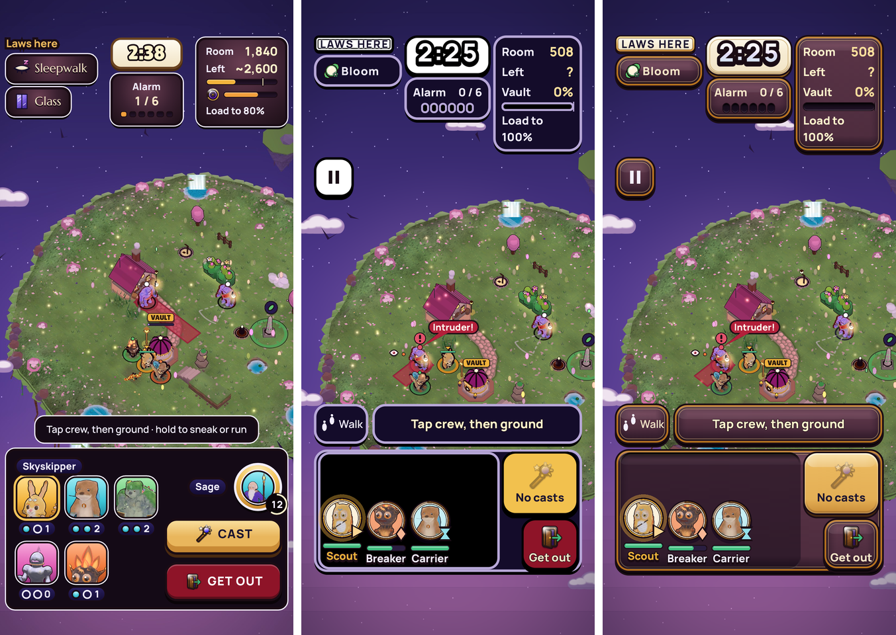
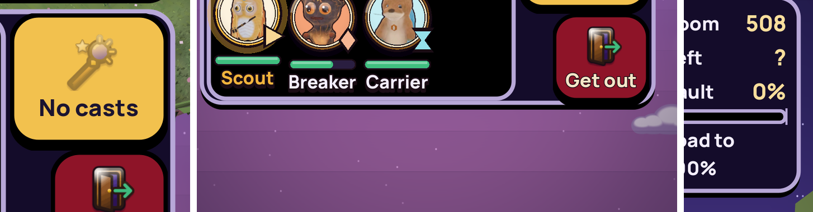
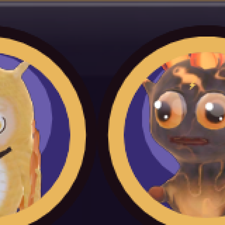
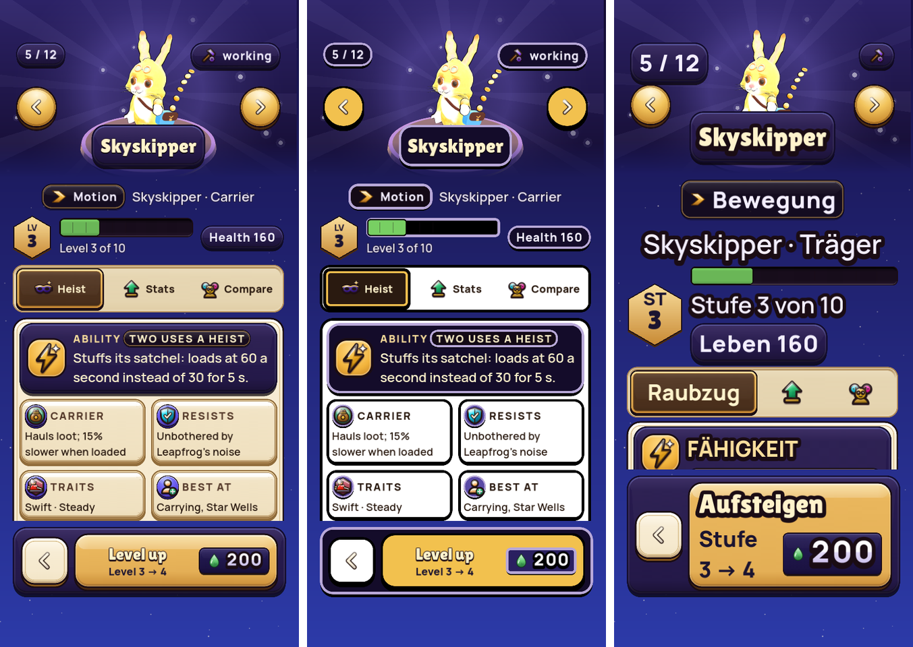
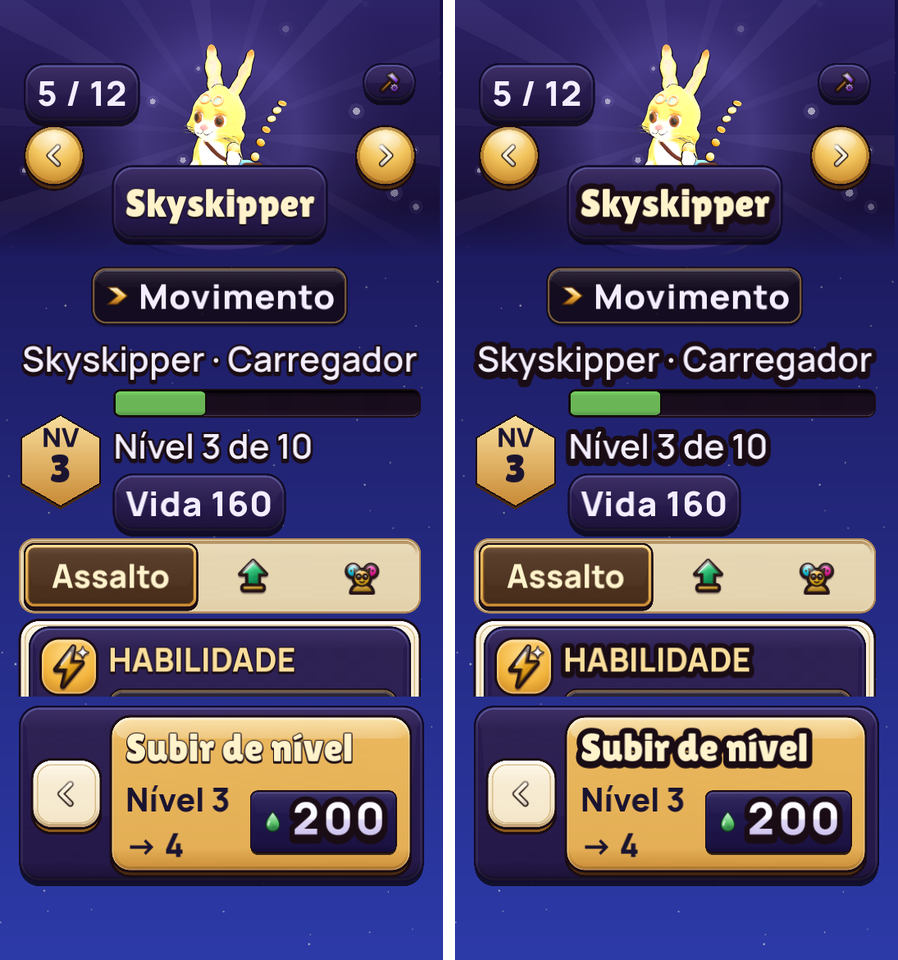
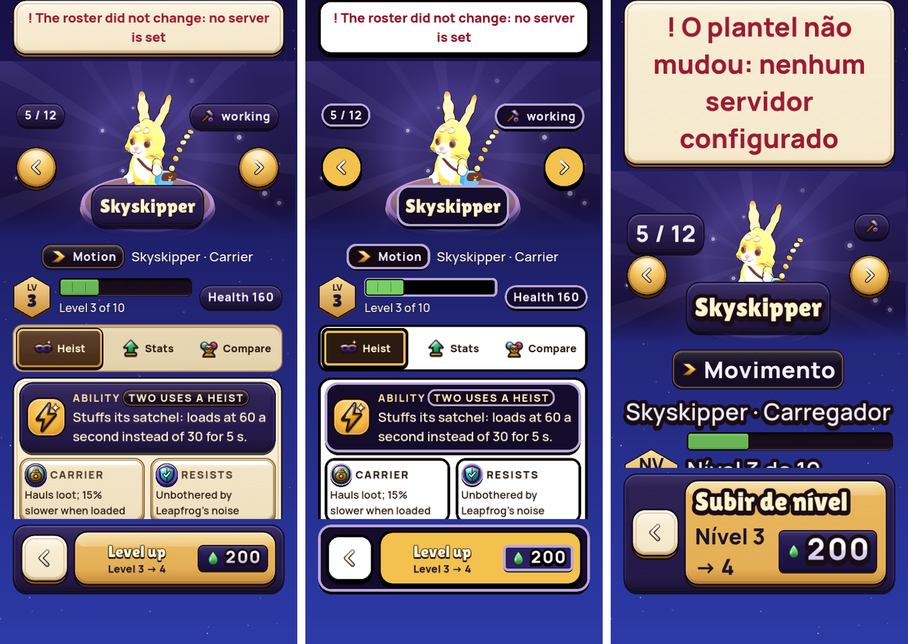

# Preview 1: the heist's high contrast and the character's offline notice

Posted by AD, P3-AD-preview-1, 17 November 2026. It holds two rulings:

- the ruling on the gate's advisory verdict for P3-S1-hc-offline-1
  (`../verdicts/P3-S1-hc-offline-1/a4ed000e.json`), on main;
- the preview of P3-S3-character-5 for S3-R34, at `4d575472` on
  `claude/ui-screens-meta`.

The result screen's two states (S1-R40) are listed in
[`../shots.md`](../shots.md), "Screens with more than one state".

**Decision.** Of the verdict's four points, three are kept and one is not:

- kept: "No casts" in gold, Get out in the alarm's red, and the stats
  figures in gold;
- not kept: the Breaker's grain.

AD withdraws the red danger plate that AD-R56 gave Get out: board 1 made
Get out leather, and red is the alarm's alone. The three kept faults go to
the lead as AD-R60 to AD-R62, for P3-S1-hc-offline-2.

Character-5 stands on all three of S3's claims, and AD has no objection
that holds it. Two objections are kept for follow-up tasks:

- **O1:** the offline notice's words are drawn in red;
- **O2:** at 200% the offline notice pushes the tabs off the first screen.

They go to the lead as AD-R63 and AD-R64, with S3 as owner. O2 depends on
the screen's final shape (M40); O1 does not.

## How the stills were made

Every still was rendered with
`env FIT=1 <settings> bash tools/render/shoot.sh client/tests/shots/<script> <still>`,
and every run printed "fit ok". The sheets are `python3
tools/ui_gate/sheet.py still`, at 960 px on the long edge. The measures
were taken on the full-size stills: 1080 × 2340 for the heist, 540 × 1170
for the character. L\* is CIE L\* from sRGB (D65), and the value rule is
ΔL\* ≥ 20 off the local ground (§21.10, pass item 3).

High contrast takes a different variable in different scripts:

- `screen_heist.gd` and `screen_result.gd` read `CONTRAST=1`;
- the character's script and the other screen scripts read `HC=1`.

A still rendered with the wrong one is the 100% still under another name.

| Still | Script | Environment | Where |
|---|---|---|---|
| heist, high contrast | `screen_heist.gd` | `CONTRAST=1` | main `ab85a72a`, checked again on `53e18516` |
| heist, 100% | `screen_heist.gd` | none | main `ab85a72a` |
| result, offline and server, 100% and hc | `screen_result.gd` | the four rows of `shots.md` | main `ab85a72a` |
| character, 100%, hc, tab 1, tab 2 | `screen_character.gd` | none; `HC=1`; `TAB=1`; `TAB=2` | S3 `a5103ce7` and main `ab85a72a` |
| character, 200%, pt_BR and de | `screen_character.gd` | `TEXT=200 LOCALE=pt_BR` or `LOCALE=de` | S3 `a5103ce7` and main `ab85a72a` |
| character offline, 100%, hc, 200% pt_BR | `screen_character.gd` | `OFFLINE=1`, with `HC=1` or `TEXT=200 LOCALE=pt_BR` | S3 `a5103ce7` |

Between `a5103ce7` and S3's head `4d575472`, only `docs/progress/S3.md`
and `S3.json` changed, so the S3 stills hold at `4d575472`.

Main moved to `53e18516` during the preview, with P3-K1-tabs-1's tab bob
and green goal bar. AD rendered the heist in high contrast and the
character at 100% again on it:

- **The character:** pixel for pixel the same.
- **The heist:** the hand and the HUD are the same. Only the world's
  ambient motion differs, between rows 433 and 2173.

## Part 1: the verdict on P3-S1-hc-offline-1

The verdict is advisory. Colour roles failed 5 of 6 samples, and
character presence passed 4 of 6. AD rules on each point below.

### R-a. "No casts" in gold: kept (AD-R60)

With no casts left, the cast control keeps its gold fill, (242, 193, 78),
L\* 80.5, at 100% and in high contrast. Only its wand fades, to 0.4. Gold
is for a live main action, and a control that cannot be cast is not one.
The gold also draws the eye to the one thing on the hand that cannot be
done.

**Default (S1, `client/scripts/heist_hand.gd`).** With no casts left,
`HeistHand.show_state` dresses `cast_button` in the leather secondary
plate:

- the wand stays at 0.4, the words take `text_on_leather`, and the control
  stays tappable;
- in high contrast it is the flat `leather_light` (#6A3E52, L\* 32.1). On
  the tray card (#140C2A, L\* 5.2) that is ΔL\* 26.9;
- the gold comes back when casts are left.

### R-b. Get out in the alarm's red: kept, and AD-R56's red withdrawn (AD-R61)

In high contrast Get out is on the red danger plate, (142, 20, 40), L\*
30.4. Three samples read it as the same red as the "Intruder!" tag. The
judge is right: board 1 made Get out leather because red is the alarm's
alone. `heist_screen.gd` says the same at 100%. AD-R56's default put Get
out on the red plate, and AD withdraws that part.

The judge's fix gives Get out "its own exit colour". AD does not take it:
the kit has four button styles (primary gold, secondary leather, tertiary
inked plate, danger red), and a fifth is not this task's to add.

**Default (S1, `client/scripts/heist_hand.gd`).** In high contrast,
`hc_plates` gives `go_button` "leather", not "red". It is drawn flat at
`leather_light` #6A3E52 with the amber rim: ΔL\* 26.9 on the tray, where
the red plate gave 25.2. S1 lists the measured ΔL\* in the handoff, and the
stills go to AD's preview.

### R-c. The stats figures in gold: kept, high contrast only (AD-R62)

In high contrast the loot figures are in the kit's `gold_top` (#F9DE9C,
L\* 89.3): Room 508, Vault 0% and "?". They read well, but gold says "act
here", and these figures are information.

**Default (S1, `client/scripts/heist_hud.gd`).** Under
`Tokens.high_contrast`, the loot figures' font colour is overridden with
`Tokens.color("cream")` (#FFF3CC, L\* 95.9). The rest stays as it is:

- `KitHud.loot_fit`'s `gold_top` in `client/ui/kit_hud.gd` (K1's);
- the heist at 100%, which matches its key frame.

### R-d. The Breaker's grain: not kept

Two samples saw grain on the Breaker's rock body. Measured on the torso,
the Laplacian's standard deviation is 21.2, against the Scout's 30.1 and
the Carrier's 25.8. The Breaker is the smoothest of the three: what reads
as grain is the rock's drawn texture at high contrast. No request.

### Note on the result screen

The result screen in its server state shows "crew of 5" beside three
portraits. That comes from the shot's mock data, not from the screen, and
it is not a fault.

## Part 2: preview of P3-S3-character-5 (S3-R34)

This is the full list, in one round (M12, M23).

### (1) The kit's calls: stands

S3's stills and main's are pixel for pixel the same (0 pixels differ) in
these four stills:

- 100% in English;
- high contrast;
- tab 1;
- tab 2.

At 200% in pt_BR and German, only the words' outline differs (claim 3),
and the layout is the same.

### (2) AD-R53's notice: met

On both screens the offline notice is on the roster's cream plate
(`StageHeroSkin.plate(status_label)`) and set through the same
`UI.set_status(status_label, "alarm", …)` call:

- `character_screen.gd`, lines 87 to 89 and 171 to 173;
- `roster_screen.gd`, lines 64 and 65, and 121.

The same notice now reads the same one tap apart.

### (3) AD-R58's outline: met

The words' outline was measured on S3's 200% pt_BR still, at 540 px wide:

| Words | Outline, a side | Note |
|---|---|---|
| Level line | 6 px | profile 7, 5, 5, 5, 5, 8, then the fill |
| Subtitle | 6 to 7 px | |
| "Subir de nível" | 6 to 7 px | on gold, L\* 77 |
| HABILIDADE | 5 px | |
| Stage headline | not measurable | merges with the dark plate |

On words 48 and 42 px tall, that is about 12.5% and 14%. The floor of
1.5 pt is 2.1 px. The measures agree with Godot's rule that a quarter of
`outline_size` is drawn on each side. They also agree with S3's
`_outline_px`, which takes 12% of the rendered size after the text scale.

### Objection O1. The offline notice's words in red (AD-R63)

On both screens the offline notice's words are in the alarm's red. Being
offline is information, not an error: see `flow-2.md` F7, AD-R53's own "not
red", and S3's own comment ("not an alarm"). The cream plate is right; the
red words are not.

**Default (S3: `client/scripts/character_screen.gd` and
`client/scripts/roster_screen.gd`), in a follow-up task.** Both screens set
the offline notice (`ERR_OFFLINE`) with
`UI.set_status(status_label, "info", …)`, in ink on the cream plate. Red
stays for the server's real refusals.

- **M40:** O1 does not depend on the screen's final shape.
- **Character-5:** it does not hold the task. AD-R53 asked for the
  roster's notice, and character-5 now matches it.

### Objection O2. At 200%, the offline notice pushes the tabs off the first screen (AD-R64)

At 200% in pt_BR, the offline notice takes four lines, about 18% of the
screen's height. It is pinned above the scroll, so it pushes the tabs and
the ability header below the first screen, against board 5's B. The level
line is cut by the foot. Main's shot script ignores `OFFLINE`, so this
is the first still of the offline state at 200%.

**Default (S3: `character_screen.gd` and `roster_screen.gd`, and
`client/tests/shots/screen_character.gd` for the fit list).** Once the
screen's shape is final:

- at large text the notice takes at most one line: the "!" and
  `ERR_OFFLINE` alone, with the full sentence as its `accessibility_name`;
- the tabs and the ability header stay on the first screen while offline,
  in en, pt_BR and de;
- the roster follows in the same task;
- `OFFLINE=1 TEXT=200`, in pt_BR and in de, joins the fit list.

- **M40:** O2 depends on the screen's final shape.
- **Character-5:** it does not hold the task.

### Notes, which do not hold the task

- **Word gaps.** At 200% the 12% outline closes the gaps between words a
  little ("Subir de nível"). They still read at 1×.
- **Board 5's own rulings.** The icon-only tabs and the state pill without
  words at 200% are board 5's B and H.
- **High contrast.** The character's high-contrast stills read well, online
  and offline.
- **S3-R35** (the quarter outline across the kit) is the lead's to decide.
  AD's measures agree with its quarter rule.
