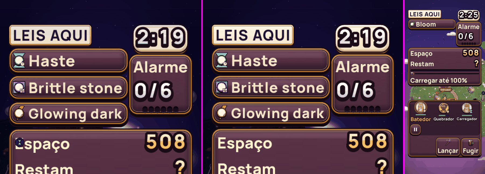
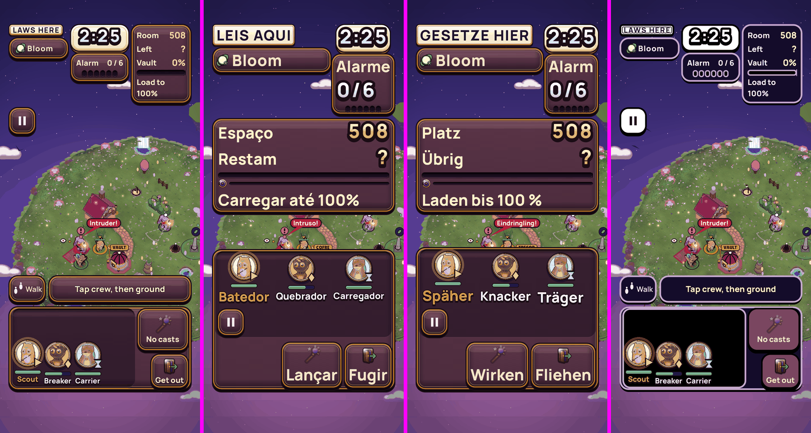
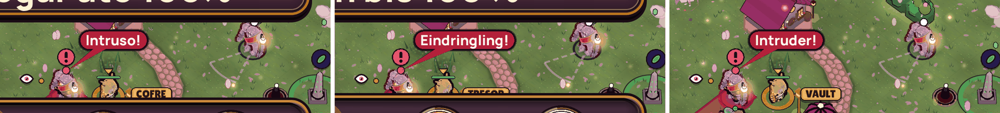
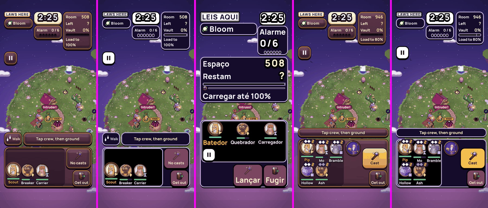
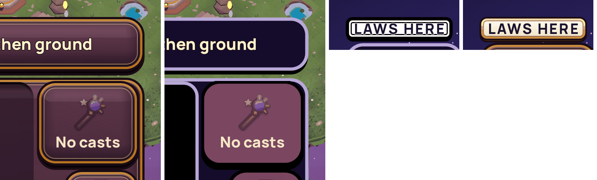
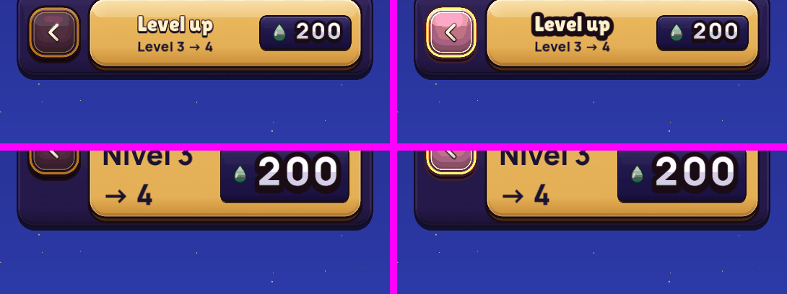
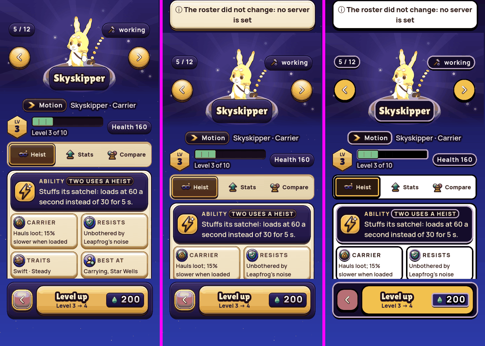
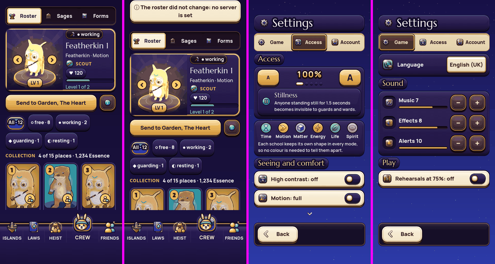
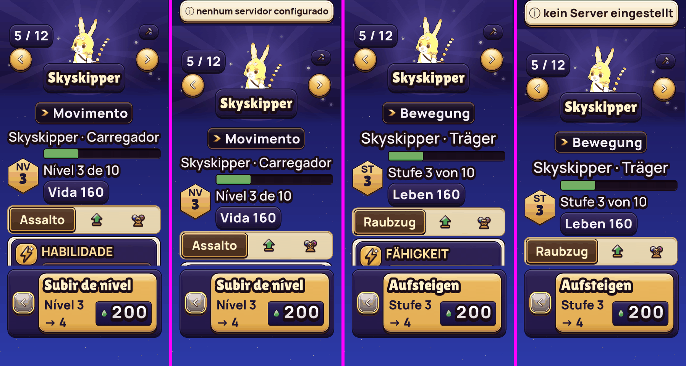
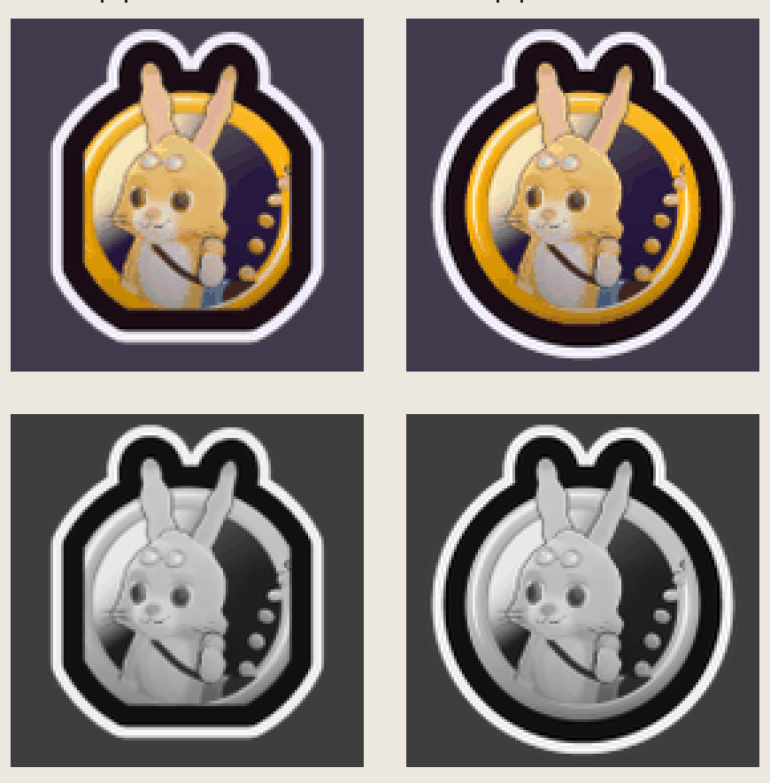

# Preview 2: the heist's markers and leather, the character's back, the pip ring, settings' tab

Posted by AD, P3-AD-audit-2, 18 November 2026. Each request below gets one
round (M12, M23):

- **S1-R42:** P3-S1-marker-1, at S1's `ee155025` on
  `claude/ui-screens-heist` (not merged);
- **S1-R41:** P3-S1-hc-offline-2, on main: the high-contrast leather face;
- **S3-R40:** P3-S3-nav-1, on main: the character's icon back, the roster's
  kept state and the offline notice;
- **AIA2-R4:** `crew__pip__normal`'s round ring in `icons_48_hc`, from
  P3-AIA2-bake-1, on main;
- **S3-R43:** settings reopening on the tab last shown, from
  P3-S3-settings-3, on main.

The lead answered all five with their defaults, because AD had no seat.
This board is the preview those answers sent to AD's next task. Every
objection kept here is a follow-up, not a hold on a merged task.

**Decision.** All five stand. Two objections are kept, and neither holds
its task:

- **AD-R65 (S1):** at 200% text the vault's label goes under the crew tray;
- **AD-R66 (S3):** at 200% text, offline, the character's ability header
  falls below the first screen.

Both depend on the screen's final shape (M40). AD-R66 fits
P3-S3-offline-1, which S3 started in cycle 141 on the same notice.

S3-R41, the back's value step that S3-R40 asked about, is met on main
since P3-K1-outline-1. The back's face measures L\* 57.0 on the tray's
13.7, where it was 23.9: ΔL\* 43.3.

## How the stills were made

Every still was rendered with
`env FIT=1 <settings> bash tools/render/shoot.sh client/tests/shots/<script> <still>`.
Every run printed "fit ok", except the roster's: `screen_roster.gd` has no
fit check, so its runs were made without `FIT=1` and printed only "wrote".
The measures were taken on the full-size stills:

- 1080 × 2340 for the heist;
- 540 × 1170 for the character, the roster and settings.

L\* is CIE L\* from sRGB (D65), and the value rule is ΔL\* ≥ 20 off the
local ground (§21.10, pass item 3). High contrast is `CONTRAST=1` for
`screen_heist.gd`, and `HC=1` for the character, roster and settings scripts
(`shots.md`).

| Still | Script | Environment | Where |
|---|---|---|---|
| heist, 100%, 200% pt_BR, 200% de, hc | `screen_heist.gd` | none; `TEXT=200` with `LOCALE=pt_BR` or `LOCALE=de`; `CONTRAST=1` | S1 `ee155025` (worktree) |
| heist, 100%, hc, hc 200% pt_BR, a cast left with and without hc | `screen_heist.gd` | none; `CONTRAST=1`, with `TEXT=200 LOCALE=pt_BR`; `MANIFEST=1`, with `CONTRAST=1` | main `fc443bbb`; hc again on `ce9113f9` |
| character online and offline: 100%, hc, 200% pt_BR and de | `screen_character.gd` | none; `OFFLINE=1`; `OFFLINE=1 HC=1`; `TEXT=200` with `LOCALE=pt_BR` or `LOCALE=de`, with and without `OFFLINE=1` | main `ce9113f9` |
| character, 100%, before P3-K1-outline-1 | `screen_character.gd` | none; `TEXT=200 LOCALE=pt_BR OFFLINE=1` | main `fc443bbb` |
| roster, online and offline | `screen_roster.gd` | none; `OFFLINE=1` | main `ce9113f9` |
| settings, access and game tabs | `screen_settings.gd` | none (opens on `access`); `TAB=game` | main `ce9113f9` |
| S1's flow stills, before and after | committed by S1 | `FLOW=result TEXT=200 LOCALE=pt_BR`, step 03 | `docs/art/shots/heist-pilot/part9-*.png` at `ee155025` |

Main moved from `fc443bbb` to `ce9113f9` during the preview, with
P3-K1-outline-1, which changes the kit's word outlines and the back button's
face. AD rendered the character, the roster and settings again on
`ce9113f9`. AD also rendered the heist in high contrast again: the hand, the
leather (#7A4660) and the HUD are the same, and only the world's ambient
motion and the words' antialiasing differ.

## Part 1: P3-S1-marker-1 (S1-R42)

### (1) The hourglass off "Espaço": stands

In S1's flow stills, step 03 at 200% pt_BR:

- **before:** the pylon's school disc covers the "E" of "Espaço";
- **after:** the word reads whole, and the loot panel stands above the map.

### (2) The HUD above the world, the guards' words above the HUD: stands

On S1's branch the HUD draws above every marker at 100%, at 200% in pt_BR
and German, and in high contrast. The guards' speech bubbles ("Intruso!",
"Eindringling!", "Intruder!") stay above the map and draw over nothing of
the HUD's. The order is what part 9 of `docs/art/tracks/heist-pilot.md`
says:

- the HUD's columns at `HeistHud.HUD_Z`, 32;
- the flying coins at 47;
- speech at 48.

The test, `heist_fx_tests.gd` `_layers`, mounts the heist with the kit's
layers on, as the app does. The shot script now does the same. Before, it
was the reason no still showed the fault.

The spell names (Haste, Brittle stone, Glowing dark) stay in English in
pt_BR, as cycle 140's policy on coined names says. That is not an objection.

### Objection AD-R65. At 200%, the vault's label goes under the crew tray

The vault's label sits at the foot of the map band at every text size. At
100% it reads whole above the tray. At 200%:

- in pt_BR, "COFRE" is cut through its middle by the tray's top edge;
- in German, "TRESOR" shows only the tops of its letters.

Before marker-1 the label drew over the tray. Marker-1 puts it under the
tray, as it puts every marker under the HUD, and that order is right. But
the vault is the heist's goal, and its name is the one marker label the
player reads to plan the route.

**Default (S1, `client/scripts/heist_screen.gd`, the camera's framing), in
a follow-up task.** At large text the opening frame keeps the vault and its
label inside the map band, between the loot panel's foot and the tray's top
edge, in en, pt_BR and de. The HUD's order stays as marker-1 sets it. The
heist's 200% stills in pt_BR and de join the evidence.

- **M40:** AD-R65 depends on the screen's final shape (the heist's
  large-text layout).
- **Marker-1:** it does not hold the task. AD-R55 asked for the HUD above
  the markers, and marker-1 meets it.

## Part 2: P3-S1-hc-offline-2's leather (S1-R41)

### (1) The kit's high-contrast face, #7A4660 in a black ink line: stands

In high contrast, "No casts" and Get out wear the kit atlas's own leather
face. It is flat #7A4660 (L\* 36.7) in a black ink line, with no amber rim,
and the words are in `text_on_leather`, (246, 230, 200). Measured on the
still:

- **on the tray card** (#140C2A, L\* 5.2): ΔL\* 31.5, where AD-R61's
  #6A3E52 gave 26.9;
- **on the crew's black well:** 36.7.

The missing amber rim is right for high contrast, not a loss. Every rim in
the mode's hand is white, lavender or black, so an amber rim would be the
one warm edge left and would pull the eye to the exit.

The other two faults of preview 1 are met:

- **AD-R60:** gold comes back only with a cast left (`MANIFEST=1`, in both
  contrasts);
- **AD-R62:** the loot figures are cream (#FFF3CC, L\* 95.9).

Get out is no longer red, so red is the alarm's alone ("Intruder!").

No objection, and no K1 request for #6A3E52: the kit's face steps further
off the tray.

**A note, which holds nothing.** In high contrast the "LAWS HERE" plate is
white with a black ink line around its words, where at 100% it is cream. It
reads well, and it is the mode's plate.

## Part 3: P3-S3-nav-1 (S3-R40)

### (1) The character keeps the kit's icon back: stands

The character's back is `ScreenNav.back_button`, the kit's icon back at the
foot's left, as AD-R50 asks. Settings' labelled parchment back is right for
settings, whose foot holds nothing else. The character's foot holds "Level
up", so a labelled back there would stand beside the primary at the same
width and compete with it.

### (2) The back's value step (S3-R41): met on main since P3-K1-outline-1

S3-R41's FAIL (L\* 23.7 on 13.6) rode with K1's kit task, and
P3-K1-outline-1 lifted the face. Measured on the character at 100%, on the
face beside the chevron, with the tray as the ground:

| Still | Face | L\* | Ground | ΔL\* |
|---|---|---|---|---|
| main `fc443bbb`, 100% | (81, 46, 64) | 23.9 | (38, 26, 76), 13.7 | 10.2 |
| main `ce9113f9`, 100% | (194, 110, 154) | 57.0 | (38, 26, 76), 13.7 | 43.3 |
| main `ce9113f9`, hc | (177, 101, 139) | 52.4 | (20, 12, 42), 5.2 | 47.2 |

The lifted face stays below "Level up"'s gold in size and value, so the
primary still leads.

### (3) The roster's kept state (AD-R51): stands

The roster hands its stage's character, its filter and its scroll to the
character's page in the route's arguments (`RosterScreen.kept`, `_open`).
The character's back hands them back (`character_screen.gd`, `_back`), and
the roster reads them in `_ready`. The stills cannot show this. The test in
`client/tests/run.gd`, `_back_routes`, checks the stage and the scroll
across a visit to a character, and compares the whole kept state, filter
included.

### (4) The offline notice as information, in one line at large text (AD-R63, AD-R64): stands

On both screens the offline notice is in ink, (42, 26, 16), with the info
glyph, on the roster's cream plate. Red stays for the server's real
refusals (`RosterScreen.failed`).

- **At 100%** it reads "The roster did not change: no server is set" in
  two lines.
- **At 200%** it takes one line, the reason alone: "nenhum servidor
  configurado" in pt_BR, "kein Server eingestellt" in German. The whole
  sentence is its `accessibility_name`.
- **In high contrast** the plate is white with ink words.

The roster's notice is the same.

### Objection AD-R66. At 200%, offline, the ability header falls below the first screen

AD-R64's default asked that "the tabs and the ability header stay on the
first screen while offline, in en, pt_BR and de". The tabs stay. The
ability header does not:

- **Online at 200%:** "HABILIDADE" in pt_BR and "FÄHIGKEIT" in German stand
  above the foot.
- **Offline at 200%:** the one-line notice (31 pt) and its band push the
  stage down about 59 pt. Only the ability card's top edge shows above the
  foot, in both languages.

P3-S3-offline-1 drops the notice's shrink, so its notice will be taller,
not shorter.

**Default (S3, `client/scripts/character_screen.gd`), in P3-S3-offline-1 as
an objection of that task's AD preview, or else in a follow-up task.** While
offline at large text, the stage gives the notice its height. One way is to
set the notice in the stage's top band, beside "5 / 12" and the job chip,
in place of the band above the scroll. Another is to shorten the stage's
gap above the name plate by the notice's height. Either way the ability
header stays above the foot in en, pt_BR and de. The roster keeps its
notice as it is, since its first screen holds the stage and its filters
either way. `OFFLINE=1 TEXT=200`, in pt_BR and in de, is already in that
task's re-shot stills.

- **M40:** AD-R66 depends on the screen's final shape (the character's
  large-text layout, which P3-S3-offline-1 changes).
- **Nav-1:** it does not hold the task, which is merged.

## Part 4: the pip's round ring (AIA2-R4): stands

In `icons_48_hc`, `crew__pip__normal`'s ink ring is round after P3-AIA2-bake-1
and was an octagon before. The round ring is concentric with the pip's round
gold portrait frame, and it matches the round crew rings on the heist's tray
and the roster's cards. The octagon was a facet artefact of the old grow, not
a drawn shape: AIA-2's container gives the round ring from the old route too.
No objection, and no change to `crew/pip.js`.

## Part 5: settings reopens on the tab last shown (S3-R43): stands

`client/scripts/settings_screen.gd` holds `static var last_tab := "game"`,
in memory only:

- the tab button's callback sets it;
- the screen opens on `tab_shown := last_tab`;
- a fresh start opens on "game";
- the test is `client/tests/settings_tab_tests.gd`.

Nothing is written to the save, which is right for a remembered view: a
restart starts from the first tab. The stills cannot show this, and the
gate judging settings-100 as it stands is right. Blind audit 2's row 22
failed "settings at 100% text" on hierarchy. That fault is the title's
weight, not the tab, and it does not touch S3-R43.

No objection.

## Notes, which hold nothing

- **The character's offline notice** names the roster ("The roster did not
  change"). That is AD-R53's choice: the same notice reads the same one
  tap apart.
- **S2-R46's quit stills** went to "AD's next task" in the lead's cycle 139
  answer. This task's list does not name them, so they are not judged here.
