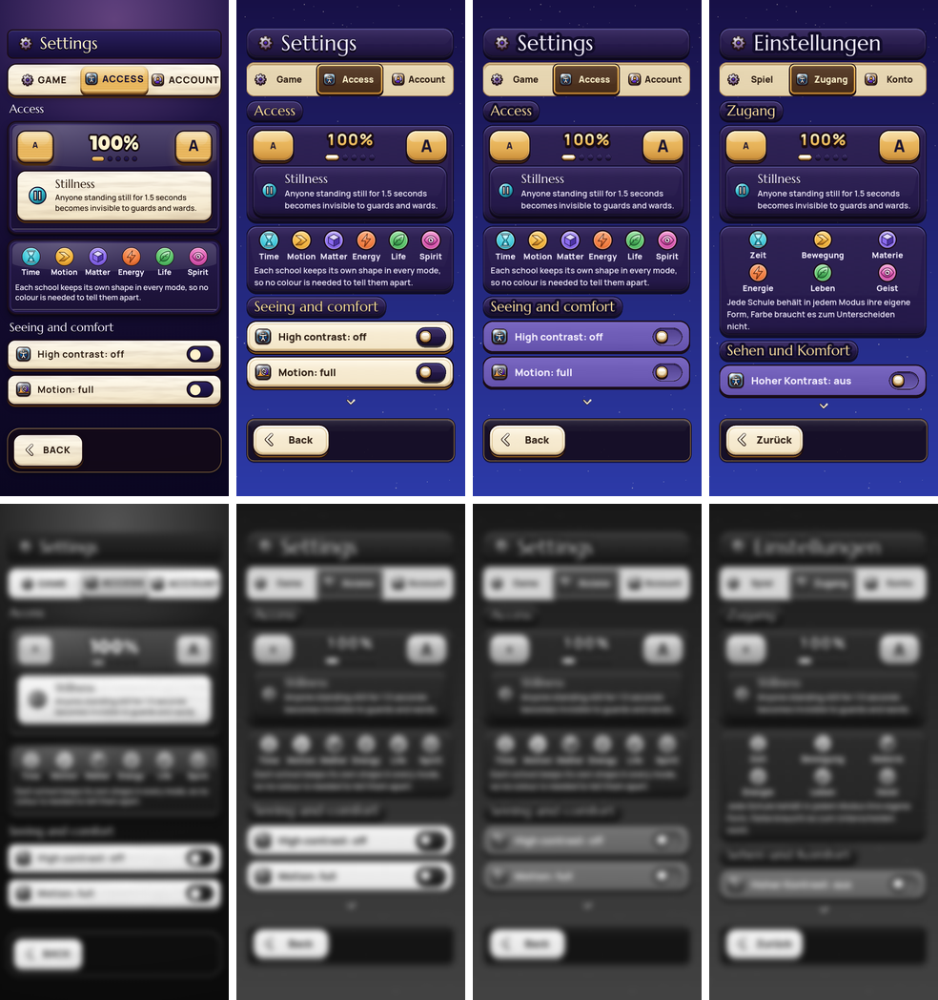
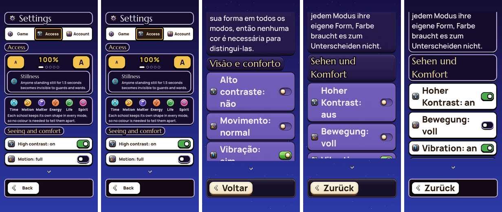
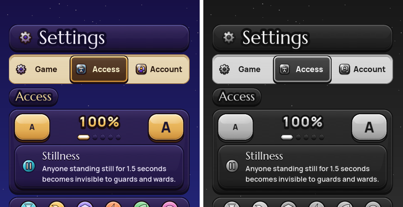

# Preview 3: settings' Access tab, the switch rows dark (S3-R45)

Posted by AD on 18 November 2026, cycle 148, for S3-R45. This is one round
(M12, M23).

**The candidate.** P3-S3-settings-4 at S3's `4a998521` on
`claude/ui-screens-meta` (marked ready, pre-check PASS). It answers
AD-R67, the wave board's one exit re-work (`wave.md`, line 13): audit 2's
miss on P3-S3-settings-3, settings at 100% text, Hierarchy
(`gate/audit/audit-2.md`, row 22).

**What changed.** The only client change since main is `_toggle` in
`client/scripts/settings_screen.gd`. When high contrast is off, the High
contrast and Motion switch rows are dressed in the kit's `ghost` look, not
`parchment`. An off switch on a ghost row draws its track as the chip
`toggle/track_off`.

**How AD checked it.**

- **Stills.** AD read S3's stills at full size, at phone size and in the
  grayscale squint (Gaussian blur on the grayscale still), next to main's
  and key frame 05. The stills: `settings-100`, `-pt_BR`, `-de` and `-hc`,
  and at 200% `-pt_BR-comfort`, `-de-comfort` and `-hc-de-comfort`, all
  under `docs/art/shots/menu-screens/`. They are unchanged from
  `debcb535` to `4a998521`.
- **Value.** AD measured L* medians from the controls' rects in
  `settings-100.shot.json`.

## Decision

S3's two departures from AD-R67's words both stand, and the rows' part of
audit 2's miss is met. The tab still does not lead, though: the cream tab
strip, which AD-R67 wrongly left as it was, is the largest light mass right
under the title. One objection is kept: **AD-R68, owned by S3, on
`client/scripts/settings_screen.gd`'s `_tabs()`**. Until it is met, AD-R67
is not answered, and the wave does not stand at O7.

## 1. The ghost rows, not `plate_dark` (departure 1): stands

AD-R67 asked for "the dark plate with cream words". S3 used the kit's
`ghost` instead, the tertiary look at L* about 45. That is the right call:

- **Value-steps.** On the night, `plate_dark` fails value-steps. The switch
  off track is the dark plate, and it vanished on it: S3 tried it at
  `5fc97aac` and dropped it (`menu-screens.md`, "Tried and dropped").
  `ghost` passes value-steps at ΔL* 39.5 on both rows at 100%, and 23.1 to
  28.3 at 200% in pt_BR and German, against 20 needed.
- **Words and switches.** The words are cream at 4.78:1 at worst
  (`budget_shots`, 0 of 19 below 4.5:1).
  - The off switch on its chip track reads as a switch at 1x.
  - The on switch (green, "Vibração: sim" at 200% pt_BR) reads too.
- **Precedent.** It is the same move as AD-R43: a kit look one step off the
  night, not a new material.

In grayscale the rows drop from L* 92 to 45, from the lightest thing on the
tab to a mid tone under the As. The Game tab's slow-rehearsals row moves
with them, from failing value-steps at 6.8 to 31.5. That is a
gain AD-R67 did not ask for, and it stands too.

## 2. Parchment kept in high contrast (departure 2): stands

In high contrast the rows stay `parchment`, as on main.

- **Ghost fails there.** Ghost darkens to L* 37.5, and two rows stood 1.7
  steps off at 200% German.
- **Parchment passes**, at ΔL* 75 to 83.
- **High contrast is where bright plates belong.** Audit 2 passed home in
  high contrast with its white rims and cream cards "light by the mode's
  design". The hc stills are the same as main's but for
  P3-K1-outline-1. The gold As stay the strongest colour, and the white
  rows sit under them.

## 3. The tab's hierarchy: one objection kept

The rubric's settings ruling (quality 6) says: "No primary (settings): the
title must be the first thing the eye lands on in grayscale. A gold tab or
gold value button louder than the title fails." Version 3 adds that leading
is size, place and weight together, not lightness alone.

Audit 2's critique named three things louder than the title: the gold As,
the cream tab strip and the cream switch rows. Settings-4 answers the rows
only.

L* medians at 100% en, measured from the record's rects:

| Shape | Main | S3 `4a998521` | Area (px) |
|---|---:|---:|---:|
| High contrast row | 92.3 | 44.7 | 35k |
| Motion row | 92.4 | 44.7 | 35k |
| Tab strip | 84.7 | 84.7 | 38k |
| Small A / large A | 74.7 / 74.0 | 74.7 / 74.0 | 6.9k each |
| Back | 92.6 | 92.6 | 13k |
| Title plate | 13 to 16 (5% of pixels over 70) | same | |

In the squint, the eye now goes first to the band of two light tabs under
the title. Next come the two gold As, then Back at the foot.

The title is the largest type at the top. But its Marcellus letters are
thin strokes of mid gray in the blur, on a plate darker than everything
around it. The "100%" readout under it, in the heavy display face with its
ink outline, is heavier type than the title.

So neither aim is met:

- **AD-R67's own aim** was the As as the tab's one lead. The strip
  outweighs them: more than five times either A's area, at L* 85 against
  74.
- **The rubric's ruling** is the title first.

**This is AD's miss, not S3's.** AD-R67 said "the tab strip and Back stay
as they are", although audit 2's own critique named the strip. S3 did what
AD-R67 asked.

### Objection A (AD-R68): quieten the tab strip, so the title leads

- **File:** `client/scripts/settings_screen.gd`, `_tabs()` (the strip is
  dressed `seg_track_light`, its tabs `seg_light` and `seg_on_light`).
- **Owner:** S3.
- **The ask.** At 100% text, outside high contrast, the strip drops to a
  mid value under the title, so that in the grayscale squint no light
  shape above the As outweighs the title. Use kit looks only.
  - **Candidate.** The track on the kit's `ghost`, as the rows now are.
    The unchosen tabs are clear with cream words and icons, and the chosen
    tab keeps its dark leather face and gold rim.
  - **Constraint.** The dark `seg_track` failed value-steps at
    `5fc97aac` (row 2 at 0.5 steps off the night). Each tab must pass
    value-steps against its own ground: the track against the night, and
    the chosen tab against the track.
- **If no kit strip passes value-steps at a mid value,** the other road is
  audit 2's fix for the title: a heavier title, in the display face with
  its outline, so it outweighs the strip by size and weight. S3 says which
  road it took.
- **Unchanged:**
  - In high contrast the strip stays light, for the reason that keeps the
    rows on parchment (section 2).
  - The As stay gold.
  - Back stays as it is.
- **Done when:**
  - the gate passes "settings at 100% text" on Hierarchy 3 of 3;
  - the 200% and high-contrast forms still pass `checks.py value-steps`
    and fit;
  - AD has seen the re-shot stills of all three tabs at 100%.

  AD's look is a check on the stills, not a new round, unless the strip's
  shape changes beyond the above.
- **Default:** S3 folds it into P3-S3-settings-4 before that task's gate
  run (back to claimed from ready at `4a998521`), and re-shoots the
  Access, Game and Account tabs at 100% en, pt_BR and German. If the lead
  has already merged settings-4, the same work is a follow-up task for S3
  on the same file, ranked as phase 3's one exit item (M57).

**M40: this objection does not depend on the screen's final shape.** The
strip is the same on all three tabs and does not move with the rows, so
the ask holds whatever else changes. Whether the strip alone is enough
does depend on the title. If S3 takes the title road instead, the strip
may stay.

### Notes, not holding

- **Back.** Back is light (L* 93) and as large as an A. It sits at the
  foot, where an exit belongs, and the rubric does not count a foot exit
  against the title. AD will look at it again only if the gate names it.
- **The rows at 100% German.** In German the Motion row starts below the
  chevron, the same as on main. That is not this task's change.
- **Key frame 05.** Key frame 05 would fail the settings ruling the same
  way (audit 2, row 22), so "as the key frame has it" does not answer this
  objection.

## Whether AD-R67 is answered

- **Not yet.** Settings-4 answers the rows, which is AD-R67's whole ask
  as written. AD-R67's done-line is the gate's Hierarchy 3 of 3 and one
  lead in the squint, and the strip keeps the tab from it.
- **When AD-R68 is met** and the gate passes the item, AD-R67 and audit
  2's miss are closed. The wave then stands at O7 with no further board,
  as `wave.md` line 29 says. AD's check of the re-shot strip is the last
  step.
- **If the gate passes Hierarchy 3 of 3 with the strip as it is,** AD
  still holds AD-R68. The gate's passes on owner-checked qualities are
  advisory, and audit 2's label is AD's.
